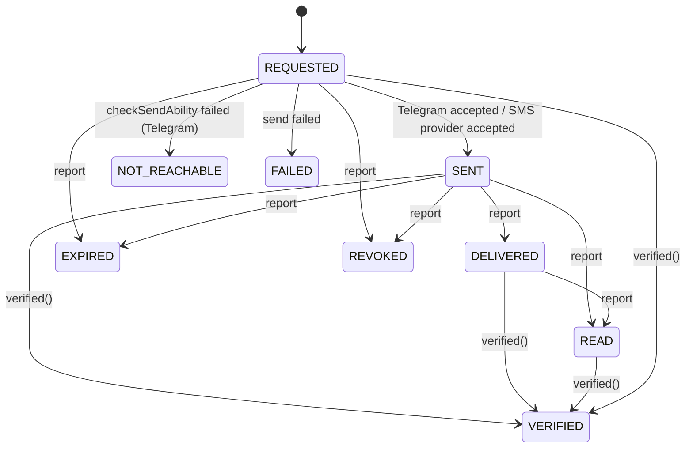

# Architecture

## Layout

| Path | Layer | Role |
|---|---|---|
| `src/server.ts` | entry | Loads config, builds the container and app, starts the settings client, the two timers, the Kafka consumer and the authz sync, listens, handles `SIGTERM`/`SIGINT` |
| `src/container.ts` | composition root | Builds Prisma, Redis, OTP store, Telegram client, SMS and push senders, settings client, OTP service, notifier, handlers, token verifier. Tests pass fakes through `ContainerOptions` |
| `src/app.ts` | HTTP | Fastify instance (`trustProxy: true`, `bodyLimit` 16 KiB), helmet, rate limit (300/min), health routes, then `registerRoutes` |
| `src/http/routes.ts` | HTTP | Internal routes, Telegram webhook, device-token routes |
| `src/middlewares/error-handler.ts` | HTTP | Maps errors to `{ error, message }` JSON (see [api.md](api.md#errors)) |
| `src/otp/otp-service.ts` | domain | OTP delivery logic: `deliver`, `onReport`, `onFallbackDue`, `pollFallbacks`, `verified`, `purgeOld`, `status` |
| `src/otp/otp-store.ts` | storage | Redis store for the sealed active code and the fallback schedule; an in-memory version for tests |
| `src/otp/telegram-gateway.ts` | adapter | Telegram Gateway API client and the delivery-report signature check |
| `src/notify/consumer.ts` | adapter | kafkajs consumer, one subscription for every handler topic |
| `src/notify/handlers.ts` | domain | Topic → recipient + template |
| `src/notify/notifier.ts` | domain | At-most-once-per-(event, channel) sending with retry counting |
| `src/notify/templates.ts` | domain | English message texts (pure functions) |
| `src/channels/sms.ts`, `src/channels/push.ts` | adapters | Twilio and console SMS; FCM HTTP v1 and console push |
| `src/lib/crypto.ts` | lib | Phone HMAC, AES-256-GCM sealer, phone masking for logs |
| `src/config/index.ts` | config | Zod schema for the environment (see [configuration.md](configuration.md)) |
| `src/generated/prisma/` | generated | Prisma client (output of `prisma generate`) |

## Background work in the process

All of it is started in `src/server.ts`. There is no separate worker process.

| Job | Interval | What it does |
|---|---|---|
| Fallback poller | every 1 s | `otp.pollFallbacks()`: claims up to 50 due ids from the Redis sorted set `otp:fallback` and runs `onFallbackDue` for each |
| Purge | every 1 h | `otp.purgeOld()`: deletes `otp_delivery` rows with `created_at` older than 30 days. Nothing purges `notification` or `device_token` |
| Kafka consumer | continuous | Only when `KAFKA_BROKERS` is set. In non-production it creates missing topics first |
| Settings client | load at start, Redis pub/sub `settings:changed`, poll every 30 s | Live values of `otp.channels` and `otp.fallbackSeconds` from platform-service (`libs/shared-settings/src/client.ts`) |
| Authz sync | load at start, Redis pub/sub `authz:changed`, poll every 30 s | Keeps the permission matrix in step with auth-service (`libs/shared-authz/src/sync.ts`). No route in this service calls `authorize()`, so it has no effect on behaviour today |

Shutdown order: authz sync, settings client, both timers, Fastify, Kafka consumer, Prisma and Redis.

## OTP delivery

auth-service generates the code and verifies it. This service only delivers it (`src/otp/otp-service.ts` header comment).

### Channel choice

- The environment decides which channels can exist: without `TELEGRAM_GATEWAY_TOKEN`, `telegram` is removed from `OTP_CHANNELS` at config load and no Telegram client is built.
- The live setting `otp.channels` (admin dashboard, from platform-service) chooses among them on every send. The container filters it so `telegram` is kept only if a token is set. If platform-service is unreachable, the env values are the defaults (`src/container.ts`).
- Telegram is used only when it is **first** in the list (`telegramFirst()`). `["sms", "telegram"]` means SMS only.
- SMS fallback is used only when `sms` is in the list (`smsOn()`).

### `deliver()` step by step

1. Validate: phone E.164 (`^\+[1-9]\d{7,14}$`), code 4–8 digits, TTL clamped to 60–1800 s. Hash the phone with HMAC-SHA256 (`PHONE_HASH_KEY`).
2. If Telegram is first, look for a **recent** Telegram attempt for the same phone hash: `channel = TELEGRAM`, status `REQUESTED` or `SENT`, created within the last TTL. If found, this request is a manual resend and goes to **SMS** (`fallback_of` = that attempt).
3. If the result is SMS but SMS is not enabled: `400 no delivery channel available`.
4. Insert an `otp_delivery` row (status `REQUESTED`).
5. Store the active code in Redis: `otp:code:{phoneHashHex}`, AES-256-GCM sealed, expires with the TTL. It replaces any previous code for that phone.
6. Telegram path: if SMS is enabled, schedule the fallback in `otp:fallback` at now + `fallbackSeconds` **before** calling Telegram, so a crash still ends in an SMS. Then `runTelegram()` in the background.
7. SMS path: if this is a resend, cancel the old attempt's fallback and revoke its Telegram message (best effort). Then send the SMS in the background.
8. Return `{ deliveryId, channel }` at once. The route answers `202`; the send result is only logged.

### `runTelegram()`

| Step | On success | On failure |
|---|---|---|
| `checkSendAbility(phone)` | continue with its `request_id` | row `NOT_REACHABLE` with the reason in `error`, cancel the scheduled fallback, SMS fallback now |
| `sendVerificationMessage({ phone_number, request_id, code, ttl, payload: deliveryId, callback_url?, sender_username? })` | row `SENT`, `telegram_request_id`, `cost_usd`; save `{deliveryId, requestId}` in the Redis code entry; note the balance | row `FAILED`, cancel the scheduled fallback, SMS fallback now |

The `payload` sent to Telegram is only the row id: no phone and no code.

### SMS fallback (`smsFallback()`)

Sends the **same code** by SMS, as a new `otp_delivery` row with `fallback_of` pointing at the Telegram attempt. It does nothing when:

- the Redis code is gone (expired or verified) or no longer lists that attempt id (a newer code replaced it), or
- SMS is disabled in the live channels (logged as a warning).

SMS text (`smsText()`): `Anbessa: your code is 123456. It expires in N minutes. Never share it with anyone.`

### Fallback timer (`onFallbackDue()`)

The poller removes due ids from the sorted set with `ZREM`; only the replica whose `ZREM` returns 1 handles an id, so several replicas do not double-send. For each claimed id: if the row is still a Telegram attempt that is not `DELIVERED`, `READ` or `VERIFIED`, run `smsFallback`, then revoke the Telegram message (best effort).

### Delivery reports (`onReport()`)

- Row lookup: by `payload` if it looks like a UUID, else by `telegram_request_id`. Unknown rows or SMS rows are ignored (the webhook still answers 200).
- Copies `is_refunded`, `request_cost`, and `request_id` if the row had none.
- Status mapping: `sent → SENT`, `delivered → DELIVERED`, `read → READ`, `expired → EXPIRED`, `revoked → REVOKED`.
- **Forward only.** Ranks: `REQUESTED 0, SENT 1, DELIVERED 2, READ 3, VERIFIED 4`. A ranked status is applied only if higher than the current one. `EXPIRED` and `REVOKED` are applied only while the row is `REQUESTED` or `SENT`. Duplicates and out-of-order reports are therefore harmless. The report's `updated_at` is not used.
- `DELIVERED`, `READ` (or `VERIFIED`) cancels the pending fallback.

### `verified()`

Called by auth-service after a successful verify. If an active code exists for the phone: call `checkVerificationStatus(request_id, code)` on Telegram (errors ignored), cancel the fallback, set every row of that code to `VERIFIED` except `FAILED` and `NOT_REACHABLE` ones, delete the Redis code. Returns `{ closed: true }`, or `{ closed: false }` when no active code was found.

### Attempt states

`verified()` uses `updateMany` with `status NOT IN (FAILED, NOT_REACHABLE)`, so `EXPIRED`/`REVOKED` rows are also set to `VERIFIED` if they belong to the active code.

### Telegram balance

Every Telegram response with `remaining_balance` updates an in-memory `lastBalance` (shown by `/internal/ops/integrations`). Below `TELEGRAM_BALANCE_ALERT_USD` the service logs `telegram gateway balance is low: top up the account` at warn level. The value is per process and lost on restart.

## Event notifications

### Flow

1. `src/notify/consumer.ts` subscribes to every topic that has a handler (group `notification-service`).
2. Each message is parsed as JSON and must have a string `eventId`; otherwise it is logged (`skipping malformed event`) and skipped.
3. The topic's handler (`src/notify/handlers.ts`) picks the recipient and the template, or returns without sending (see [events.md](events.md)).
4. The notifier (`src/notify/notifier.ts`) sends it at most once per `(eventId, channel)`.

### Dedupe and retries (`notifier.once()`)

- `dedupe_key = "{eventId}:{channel}"` (`PUSH` or `SMS`), unique in `notification`.
- Find or create the row (status `PENDING`). A unique violation (`P2002`) from a concurrent insert is handled by re-reading the row.
- If the row is not `PENDING` (`SENT`, `SKIPPED`, `FAILED`), return that status without sending.
- Send. Success: status `SENT` or `SKIPPED`, `attempts + 1`, `error` cleared.
- Failure: `attempts + 1`, `error` = first 200 chars. Below `MAX_ATTEMPTS = 5` the error is rethrown so kafkajs does not commit the offset and redelivers. On the 5th attempt the row becomes `FAILED` and the handler returns normally, so the consumer moves on.
- There is no DLQ. A failed notification stays in `notification` with status `FAILED`.
- Crash window: if the process dies after the provider accepted the message but before the row update, the row is still `PENDING` and the message is sent again on redelivery.

### Push

`notifier.push()` sends to **every** `device_token` of the user:

- No devices: `SKIPPED`.
- FCM answers 404 or `UNREGISTERED`: the token row is deleted.
- At least one device succeeded: `SENT` (failures on other devices are not retried).
- No success and at least one error: the last error is thrown (retry as above).
- All tokens unregistered: `SKIPPED`.

### SMS

`notifier.sms()` sends one SMS to the phone number from the event (only `org.member_invited` today).

### Templates and localisation

`src/notify/templates.ts`: plain functions, **English only**. Amounts are minor units formatted as `ETB` with `en-US` number formatting. `paymentDuePush` prints the weekday in `Africa/Addis_Ababa`. Push messages carry a `data.type` (and `tripId`/`checkoutUrl` where relevant) for the app to route taps. No per-user language, no stored templates.

## Device tokens

- `POST /api/notifications/devices` upserts by token: whoever registered the token last owns it. It then keeps only the 10 most recently seen tokens of that user (`MAX_DEVICES_PER_USER`) and deletes the rest.
- `POST /api/notifications/devices/remove` deletes the token only if it belongs to the caller.
- Callers: the phone app's push service (`apps/phone-app/lib/core/push/push_service.dart`, via `packages/core/lib/src/api/service_apis.dart`).

## Security model

| Concern | What the code does |
|---|---|
| Internal routes | `Authorization: Bearer <INTERNAL_SERVICE_TOKEN>`, compared with `timingSafeEqual` after a length check. Kong never routes `/internal/*` (`infra/kong/kong.yml`) |
| Telegram webhook | Only registered when `TELEGRAM_GATEWAY_TOKEN` is set. HMAC-SHA256 with key `SHA256(token)` over `"{X-Request-Timestamp}\n{rawBody}"`, hex, constant-time compare; timestamp must be within ±300 s. The raw body is read as a string in an encapsulated Fastify scope |
| App routes | Access token verified against auth-service's JWKS (`libs/shared-authz/src/verify.ts`): ES256, issuer `AUTH_ISSUER`, audience `ride-app`, `sub`/`exp`/`iat` required, 30 s clock tolerance. This service does **not** pass the Redis deny-list or permission-version checks, so a suspended user's unexpired token is still accepted here |
| Phone numbers | Postgres stores only `HMAC-SHA256(PHONE_HASH_KEY, phone)`; a check constraint enforces 32 bytes. Logs use `maskPhone()` (`+2519••••344`) |
| Codes | Never in Postgres, never in Kafka. Redis holds them AES-256-GCM sealed with `OTP_ENCRYPTION_KEY`, with the phone hash as associated data, so a value can't be moved to another key. Tampered or wrongly-keyed values read as absent |
| Logging of codes | `SMS_PROVIDER=console` logs SMS bodies, including codes; config refuses it in production. The Telegram token is never logged |
| Rate limiting | `@fastify/rate-limit` 300 requests/min per client IP (in-memory, per process) on every route except the two OTP internal routes. Kong adds 120/min and a 16 KB body limit |
| Headers | `@fastify/helmet` defaults |

## Caching

- FCM OAuth access token: cached in memory until 60 s before expiry (`src/channels/push.ts`).
- Settings and permission snapshots: in memory, refreshed as above.
- No HTTP response caching.
