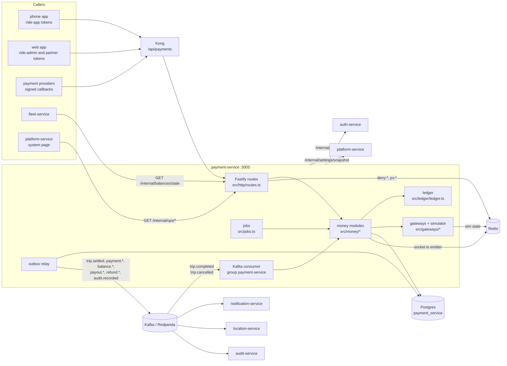

# payment-service: reference documentation

Reference for engineers working on or integrating with `services/payment-service`. Everything here describes what the code does today. Source paths are relative to the service folder (`services/payment-service/`) unless they start with a repo-level folder (`libs/`, `infra/`, `docs/`, `apps/`). For the intent behind the design, read [Payment.md](../../../docs/design/Payment.md) and workflows [08](../../../docs/design/workflows/08-payment-receipt-rating.md) and [09](../../../docs/design/workflows/09-driver-balance.md). Where the code and those documents differ, these pages follow the code.

Port **3005**, database **`payment_service`**, Kong prefix **`/api/payments`**.

## What it owns

| Area | What the service does | Main code |
|---|---|---|
| Double-entry ledger | Accounts, journal entries and postings. Every entry sums to zero (checked by a deferred trigger at COMMIT) and is never edited (triggers refuse `UPDATE`/`DELETE`). Each entry has an idempotency key | `src/ledger/ledger.ts`, `prisma/migrations/20261028100000_init/migration.sql` |
| Trip settlement | One journal entry per trip (`trip-settlement:<tripId>`) and per cancellation fee (`cancel-fee:<tripId>`), with commission and VAT, by payment method | `src/money/settlement.ts` |
| Beneficiary balances | One balance per driver (`INDIVIDUAL`) or fleet company (`ORGANIZATION`), with a state (`OK`, `WARNING`, `CASH_BLOCKED`, `BLOCKED`) recomputed after every posting | `src/money/balances.ts`, `src/money/balance-service.ts` |
| Commission rules and balance policies | Versioned per city, changed only by maker–checker proposals | `src/money/rules.ts`, `src/money/rule-changes.ts` |
| Rider charges | Mobile money and card charges for trip fares and cancellation fees, retries, rider receivables after the last retry, "pay now" | `src/money/payments.ts` |
| Top-ups | Mobile money by the owner; office cash and bank transfers recorded by finance and approved by a second person | `src/money/topups.ts` |
| Weekly settlement, dues, payouts | Payout lines for positive balances, payment dues for negative ones, batch approval, payout sending and reversal, overdue blocking | `src/money/payouts.ts`, `src/jobs.ts` |
| Refunds | Requested by one person, approved by another, sent to the provider, charged to the driver or to platform goodwill | `src/money/payments.ts` |
| Provider adapters and simulator | telebirr, CBE Birr, Chapa: callback parsing and signature checks, plus an in-process simulator that plays each provider | `src/gateways/` |
| Provider webhooks and reconciliation | Signed callbacks, stored and deduplicated in `webhook_event`; providers are asked again about operations whose callback never came | `src/money/webhooks.ts`, `src/jobs.ts` |
| Balance adjustments | Manual credits and debits (goodwill, fee reversals, corrections), maker–checker with limits re-checked on approval | `src/money/adjustments.ts` |
| Write-offs | Uncollectable debt overdue 90+ days written off as bad debt, maker–checker; dues close as `WRITTEN_OFF` | `src/money/write-offs.ts` |
| Policy overrides | Per-balance exceptions to the city's limits for a time window, maker–checker, never overlapping | `src/money/policy-overrides.ts`, `effectivePolicyAt` in `src/money/balances.ts` |
| Driver incentives | "N trips in a window earns Y": proposed, approved, evaluated over `trip_settlement` at period close and credited once within the budget | `src/money/incentives.ts` |
| Corporate invoices | Monthly, per company, from its `CORPORATE_RECEIVABLE` postings; numbered, immutable, paid by bank transfer; company admins see their own | `src/money/invoices.ts` |
| Driver earnings summary | Totals over a driver's trip settlements for today, this week, this month or a custom range | `src/money/earnings.ts` |
| Events out | Ledger-driven events through a transactional outbox | `src/outbox/` |

## What it does not own

- **Fares, quotes and cancellation fees.** trip-service and pricing-service decide the amounts; this service settles what `trip.completed` and `trip.cancelled` carry.
- **Whether a payment method is offered.** `payments.methods` is a platform-service setting owned by trip-service; this service only echoes it on `GET /api/payments/methods`.
- **Matching eligibility.** location-service applies `balance.state_changed` to its Redis state; fleet-service refuses to start a session for a `BLOCKED` balance. This service only publishes the state and answers `GET /internal/balances/state`.
- **Notifications.** notification-service turns this service's events into pushes and SMS. This service only pushes live socket events to riders and drivers through realtime-gateway's Redis adapter.
- **Real provider integrations.** Every provider runs in `simulated` mode; no real money moves, and config refuses that mode in production (see [configuration.md](configuration.md)).
- **Corporate invoices, tips, promos, write-offs, adjustments, bank statement import, receivables aging.** Not built. The permissions for adjustments and write-offs exist in `libs/shared-authz` but no route uses them.
- **Database migrations for other services, the permission matrix, live settings.** auth-service owns the matrix (synced live), platform-service owns settings.

## Overview

In one screen:

1. trip-service publishes `trip.completed` / `trip.cancelled`. The consumer dedupes by `eventId` (`inbox` table). Cash and company-account trips settle in that transaction. Mobile money and card trips create a `payment` row, commit, then ask the provider to charge.
2. The provider (today: the simulator) posts a signed callback to `POST /api/payments/webhooks/{provider}`. On success the trip settles from `PROVIDER_CLEARING`; after the last failed retry it settles from `RIDER_RECEIVABLE` (the driver is paid anyway).
3. Every posting on a balance pays open dues, recomputes the balance state, and writes `balance.state_changed` to the outbox when the state moved.
4. Owners top up by mobile money; finance records office cash and bank transfers and a second person approves.
5. Each Monday (Addis Ababa time) a settlement batch is prepared: payout lines for positive balances and payment dues for negative ones. A different person approves the batch, and payouts go to the provider. Dues not paid to the minimum by their deadline block the balance.
6. Background jobs retry charges, reconcile lost callbacks, mark overdue dues, expire proposals and check ledger integrity.
7. Money controls (maker–checker): balance adjustments, write-offs of overdue debt, per-balance policy overrides for a window, driver incentives paid at period close, and corporate invoices issued monthly from each company's receivable and marked paid by bank transfer ([architecture.md](architecture.md#money-controls-adjustments-write-offs-overrides-incentives-invoices)).

## Index

| Page | Contents |
|---|---|
| [architecture.md](architecture.md) | Folders and layers, request flow, the ledger and its sign convention, balances and policies, settlement, charges, top-ups, payouts and dues, refunds, the simulator, earnings, jobs, concurrency and idempotency, security model |
| [api.md](api.md) | Every HTTP route: who may call it, inputs and limits, responses, error codes |
| [events.md](events.md) | Kafka topics consumed and produced, the outbox relay, realtime pushes and Redis pub/sub |
| [data-model.md](data-model.md) | Every table, constraint, trigger and index; migrations in order; Redis keys |
| [integrations.md](integrations.md) | Calls to and from other services, providers and their simulation, Kong routing, sequence diagrams |
| [configuration.md](configuration.md) | Every environment variable and the live settings read from platform-service |
| [operations.md](operations.md) | Running locally, tests, Docker build, health, logs, jobs, failure modes and troubleshooting |

Related design documents: [Payment.md](../../../docs/design/Payment.md), [Database.md](../../../docs/design/Database.md) (§7.4 ledger, §8 outbox, §9 idempotency), [Role.md](../../../docs/design/Role.md) (§8 matrix, §11 maker–checker), [architecture overview](../../../docs/architecture/overview.md) (§5.4 trip completion and payment).
