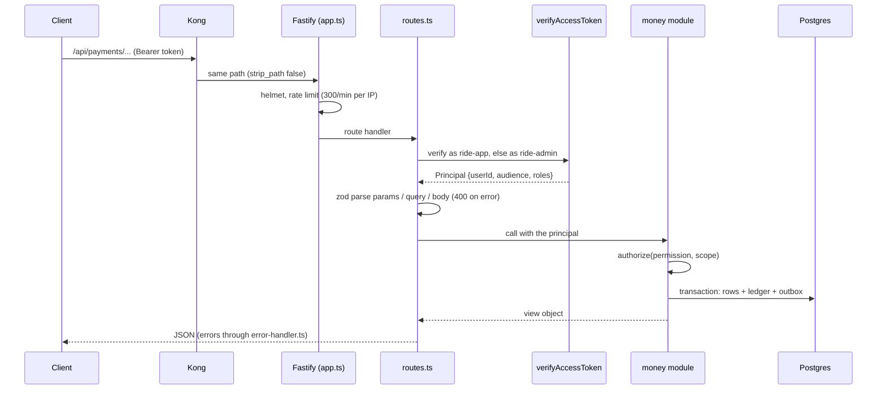
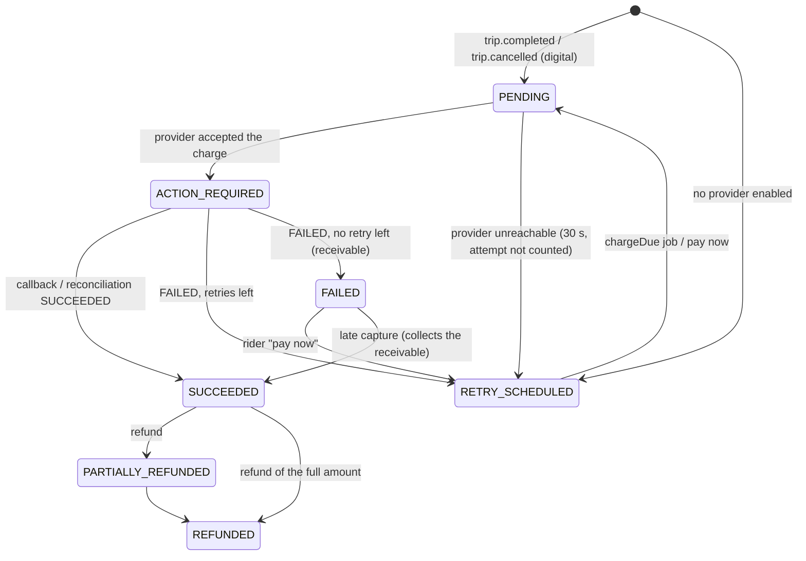
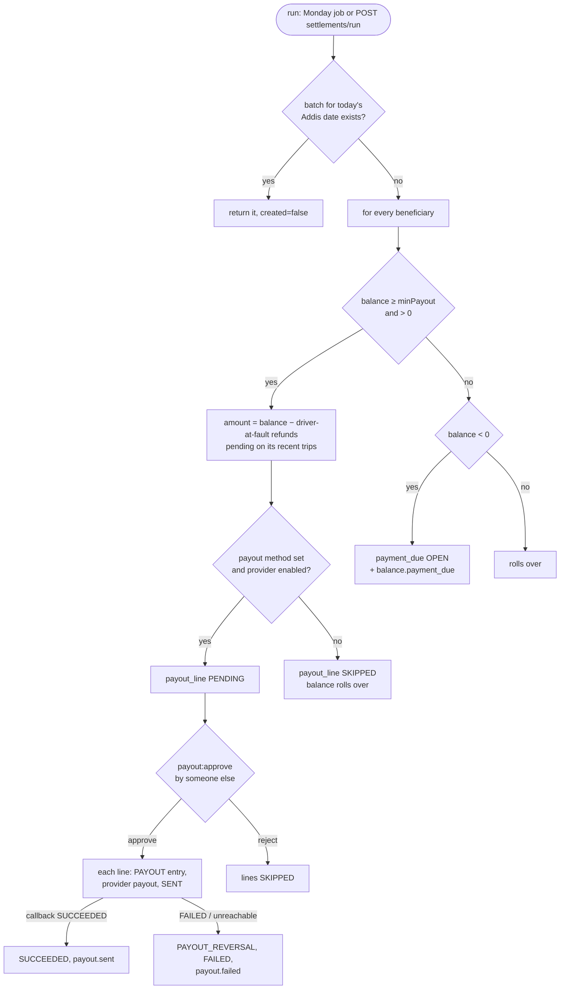

# Architecture

How payment-service is put together and how money moves through it. For the business rules behind it see [Payment.md](../../../docs/design/Payment.md); this page describes the code.

## Folders and layers

| Path | Layer | What is in it |
|---|---|---|
| `src/server.ts` | entry point | Loads config, builds the container and the app, starts the outbox relay, the Kafka consumer, the settings client, the jobs, the daily idempotency-key purge and the authz sync; handles `SIGTERM`/`SIGINT` |
| `src/container.ts` | composition root | Builds every dependency from config (Prisma, Redis, settings client, gateways + simulator, the money modules, the token verifier). Tests pass overrides through `ContainerOptions` |
| `src/app.ts` | HTTP shell | Fastify with `trustProxy: true`, `bodyLimit` 32 KB, the error handler, `@fastify/helmet`, `@fastify/rate-limit` (300/min), `/health*`, then the routes |
| `src/http/routes.ts` | HTTP routes | Every route: token verification, zod validation of params/query/body, idempotency wrapper, then a call into a money module |
| `src/middlewares/error-handler.ts` | HTTP errors | Maps `AppError`, `AuthorizationError`, `TokenError`, `ZodError` and Fastify 4xx errors to `{ error, message }` |
| `src/money/` | domain | One module per area (below). Each is a factory taking its dependencies and returning functions |
| `src/ledger/ledger.ts` | ledger | Account specs, `accountId()` (create on first use), `post()` (one balanced entry), `integrity()` |
| `src/gateways/` | providers | The `Gateway` interface (`types.ts`), one adapter per provider (`telebirr.ts`, `cbebirr.ts`, `chapa.ts`), the simulated gateway (`simulated.ts`), the simulator (`simulator.ts`) and its checkout page (`checkout-page.ts`) |
| `src/events/consumer.ts` | Kafka in | Schemas for `trip.completed` / `trip.cancelled`, handlers, the kafkajs consumer |
| `src/outbox/` | Kafka out | `writeOutbox()` (in the caller's transaction), `audit()`, the relay |
| `src/jobs.ts` | schedulers | `setInterval` jobs, one runner per job |
| `src/lib/` | helpers | `errors.ts` (AppError shorthands), `idempotency.ts` (HTTP `Idempotency-Key`), `realtime.ts` (Socket.io Redis emitter) |
| `src/db.ts` | database | `PrismaClient` with the `@prisma/adapter-pg` driver adapter |
| `src/generated/prisma/` | generated | Prisma client (`prisma generate`, git-ignored) |

Money modules:

| Module | Factory | Responsibility |
|---|---|---|
| `rules.ts` | pure functions | Commission, VAT, trip money, balance state, payment due amounts, due status, suggested top-up, Addis date. No I/O |
| `balances.ts` | helpers used inside transactions | Policy and rule lookup at a time, beneficiary creation, `afterPosting()` (dues, state, `balance.state_changed`), `balanceView()` |
| `balance-service.ts` | `createBalanceService` | Reading balances (own, fleet, by id, statement, finance list, overview, integrity), setting the payout method, the internal state lookup |
| `settlement.ts` | functions used inside transactions | `settleTripFare`, `settleCancellationFee`, `collectReceivable` |
| `payments.ts` | `createPayments` | Kafka handlers, charges and retries, provider notices for charges and refunds, reconciliation, rider routes, finance payment and refund routes |
| `topups.ts` | `createTopUps` | Mobile money top-ups, office cash and bank transfer records and approvals, reconciliation |
| `payouts.ts` | `createPayouts` | Weekly settlement run, batch approval, sending and reversing payouts, overdue sweep, reconciliation |
| `rule-changes.ts` | `createRuleChanges` | Proposals, approvals and execution of commission rules and balance policies, expiry, recomputing a city's states |
| `webhooks.ts` | `createWebhooks` | Receiving provider callbacks, routing a notice by our reference, webhook stats |
| `earnings.ts` | `createEarnings` | The driver's earnings summary |
| `access.ts` | functions | Ownership scopes and the permission checks shared by modules |

## How a request flows

- **Authentication** (`principal()` in `src/http/routes.ts`): the bearer token is verified as audience `ride-app`; if that fails with `invalid_token` it is verified again as `ride-admin`. Either audience is accepted on every route; permissions decide what the caller may do.
- **Authorization** happens inside the money modules with `authorize()` / `can()` / `citiesWith()` from `libs/shared-authz`, against the scope of the resource (owner, organisation or city). See [Security model](#security-model).
- **Write paths** run in a Prisma interactive transaction that also writes the outbox rows, so an event exists exactly when the change committed.
- **Provider calls** are made outside database transactions: the row is committed first, then the provider is called, then the result is written in a second transaction guarded by a status check.

## The double-entry ledger

`src/ledger/ledger.ts`, tables `ledger_account`, `journal_entry`, `posting`.

**Sign convention.** A posting's `amount_minor` is in santim (1 ETB = 100). Positive is a credit, negative a debit (`prisma/schema.prisma`, `Posting.amountMinor`). In practice:

| Account kind | Code | Positive means | Negative means |
|---|---|---|---|
| `BENEFICIARY_BALANCE` | `BENEFICIARY_BALANCE:{INDIVIDUAL\|ORGANIZATION}:{ownerId}` | the platform owes the driver / fleet | the driver / fleet owes the platform |
| `COMMISSION_REVENUE` | `COMMISSION_REVENUE:{cityId}` | commission earned (also the platform's share of cancellation fees) | — |
| `VAT_PAYABLE` | `VAT_PAYABLE` | VAT owed to the tax authority | — |
| `PROVIDER_CLEARING` | `PROVIDER_CLEARING:{provider}` (also `PROVIDER_CLEARING:bank` for bank transfers) | money paid out through the provider | money the provider collected for us |
| `RIDER_RECEIVABLE` | `RIDER_RECEIVABLE:{riderId}` | — | the rider owes the platform |
| `CORPORATE_RECEIVABLE` | `CORPORATE_RECEIVABLE:{orgId}` | — | the company owes the platform |
| `CASH_RECEIPTS` | `CASH_RECEIPTS:{cityId}` | — | office cash received |
| `GOODWILL_EXPENSE` | `GOODWILL_EXPENSE` | — | refunds the platform paid for |
| `PROMO_EXPENSE`, `BAD_DEBT_EXPENSE` | — | allowed by the CHECK constraint; no code posts to them | |

The sum of all accounts is always 0.

**Posting** (`post(tx, input)`):

1. If a `journal_entry` with `input.idempotencyKey` exists, return `{ created: false }` and post nothing.
2. Drop zero lines; throw `UnbalancedEntry` if the rest don't sum to 0 or aren't safe integers.
3. Resolve each account id. `accountId()` does `INSERT … ON CONFLICT (code) DO NOTHING` and reads it back, so accounts are created on first use and concurrent creators don't conflict.
4. Lock all accounts with `SELECT … ORDER BY id FOR UPDATE` (sorted ids, so two entries can't deadlock).
5. Insert the entry and its postings; increment each account's cached `balance_minor` and `version`.
6. At COMMIT the deferred constraint trigger `trg_posting_balanced` re-checks that the entry sums to 0.

Journal entry kinds and idempotency keys used by the code:

| Kind | Idempotency key | Posted by |
|---|---|---|
| `TRIP_SETTLEMENT` | `trip-settlement:{tripId}` | `settleTripFare` |
| `CANCELLATION_FEE` | `cancel-fee:{tripId}` | `settleCancellationFee` |
| `RECEIVABLE_COLLECTION` | `receivable-collection:{paymentId}` | `collectReceivable` |
| `TOP_UP` | `top-up:{topUpId}` | `topups.ts` `credit()` |
| `PAYOUT` | `payout:{payoutLineId}` | `payouts.ts` `send()` |
| `PAYOUT_REVERSAL` | `payout-reversal:{payoutLineId}` | `payouts.ts` `failLine()` |
| `REFUND` | `refund:{refundId}` | `payments.ts` `refundDone()` |

**Integrity** (`integrity(db)`): lists up to 50 accounts whose cached `balance_minor` differs from the sum of their postings, and checks the sum of all `balance_minor` is 0. Run hourly by the `ledger-integrity` job (logs `LEDGER INTEGRITY CHECK FAILED` at error level) and on demand by `GET /api/payments/ledger/integrity`.

## Beneficiaries, balances, states and policies

A **beneficiary** (`beneficiary` table) is the driver (`INDIVIDUAL`, owner id = user id) or fleet company (`ORGANIZATION`, owner id = org id) that earns a trip, as given by the trip event's `beneficiary`. Each has one `BENEFICIARY_BALANCE` account, a city, a state and a reference code `ANB-` + 6 characters from `ABCDEFGHJKLMNPQRSTUVWXYZ23456789`, used to match bank transfers and office cash (`ensureBeneficiary` in `src/money/balances.ts`; it retries up to 5 times on a code collision).

Beneficiaries are created lazily: by the first settlement, or when the owner opens their balance with `?open=true` (`GET /api/payments/balances/me` or `/balances/org/:orgId`). Reading a balance that doesn't exist yet returns a zero "empty view" without creating anything. The city is fixed at creation (the trip's `cityId`, or the `cityId` query parameter on `open=true`).

**Balance policy** (`balance_policy`, per city, versioned by `valid_from`): the latest row with `valid_from ≤ at` applies (`policyAt`); with none, the built-in `DEFAULT_POLICY` in `src/money/rules.ts`:

| Field | Default | Meaning |
|---|---|---|
| `mode` | `POSTPAID` | `PREPAID` requires `balance ≥ prepaidMinimumMinor` |
| `warningMinor` | −30 000 (−300 ETB) | below → `WARNING` |
| `cashLimitMinor` | −50 000 (−500 ETB) | below → `CASH_BLOCKED` |
| `hardLimitMinor` | −100 000 (−1 000 ETB) | below → `BLOCKED` |
| `prepaidMinimumMinor` | 10 000 (100 ETB) | `PREPAID` only |
| `dueDays` | 3 | days to pay a due |
| `minPaymentBp` | 5000 (50 %) | minimum share of a due |
| `minPayoutMinor` | 10 000 (100 ETB) | smallest payout |
| `taxBasis` | `COMMISSION` | VAT on the commission, or `FULL_FARE` |
| `vatRateBp` | 1500 (15 %) | VAT rate |

**State** (`balanceState` in `src/money/rules.ts`), evaluated in this order:

1. Any due with status `OVERDUE` → `BLOCKED`.
2. `PREPAID`: `balance < prepaidMinimumMinor` → `BLOCKED`, else `OK`.
3. `balance < hardLimitMinor` → `BLOCKED`; `< cashLimitMinor` → `CASH_BLOCKED`; `< warningMinor` → `WARNING`; else `OK`.

`cashAllowed` is true for `OK` and `WARNING`.

**After every posting on a balance** (`afterPosting(tx, accountId, { creditMinor, now })`, same transaction):

1. A positive `creditMinor` pays open dues (`OPEN`, `OVERDUE`, `MIN_PAID`), oldest `cycle_end` first, updating `paid_minor` and the status (`dueStatus`: `PAID` when fully paid, `MIN_PAID` at the minimum, else `OVERDUE`/`OPEN`).
2. If the balance is now ≥ 0, every open due becomes `PAID`.
3. The state is recomputed with the policy in force now. `overdue_since` is cleared when no due is `OVERDUE`.
4. If the state changed, `state` and `state_changed_at` are updated and `balance.state_changed` is written to the outbox.

States are also recomputed for every beneficiary of a city when a balance policy is approved (`recomputeCity`), and by the 5-minute job when a scheduled policy's `valid_from` passes.

**Commission rule** (`commission_rule`, versioned by `valid_from` / `valid_to`): `ruleAt` picks, among the rules valid at the time for the city, the most specific: a rule with `beneficiary_id` (the beneficiary owner id) ranks 2, with `vehicle_type` ranks 1; ties are unordered. With none, `DEFAULT_RULE` (`PERCENT`, 1500 bp, minimum 1 000 = 10 ETB, no maximum). `commissionOn` clamps the result to `[0, fare]`. The rule is resolved at the trip's `completedAt`.

## Settlement

`src/money/settlement.ts`. One journal entry per trip and purpose, plus a `trip_settlement` row (the commission snapshot) and a `trip.settled` outbox event.

**Trip fare** (`settleTripFare`). `tripMoney(fare, cash, rule, policy)`: commission = `commissionOn`, VAT = `vatOn`, earnings = `fare − commission − VAT` for non-cash sources, `−(commission + VAT)` for cash.

| Source (when) | Lines |
|---|---|
| `CASH` (on `trip.completed`) | beneficiary `−(commission + VAT)`, commission `+commission`, VAT `+VAT` |
| `PROVIDER` (charge captured) | clearing `−fare`, beneficiary `+earnings`, commission `+`, VAT `+` |
| `RIDER_RECEIVABLE` (last retry failed) | rider receivable `−fare`, beneficiary `+earnings`, commission `+`, VAT `+` |
| `CORPORATE` (`paymentMethod = CORPORATE` with `billingOrgId`, on `trip.completed`) | corporate receivable `−fare`, beneficiary `+earnings`, commission `+`, VAT `+` |

A `CORPORATE` event without `billingOrgId` never reaches settlement: the consumer's schema refuses it and skips it (see [events.md](events.md)). It used to be settled as cash, charging the driver commission on money they never collected (fixed 2026-10-27).

Example with the defaults, fare 400 ETB: commission 60, VAT 9. Cash: beneficiary −69. Card: clearing −400, beneficiary +331, commission +60, VAT +9.

**Cancellation fee** (`settleCancellationFee`): only when `feeMinor > 0`. Compensation = `min(driverCompensationMinor, fee)` if there is a beneficiary, else 0. No VAT. Lines: source `−fee`, beneficiary `+compensation`, commission `+(fee − compensation)`. A `CASH` source is replaced by `RIDER_RECEIVABLE` (the fee can't be collected now). A digital fee is charged like a trip fare (purpose `CANCELLATION_FEE`).

**Receivable collection** (`collectReceivable`): when a payment that was settled as a receivable is captured later, clearing `−amount`, rider receivable `+amount`.

The trip-level guards are the `trip_settlement` primary key `(trip_id, purpose)` (checked first) and the journal idempotency key.

## Rider charges

`src/money/payments.ts`. Payment statuses: `PENDING → ACTION_REQUIRED → SUCCEEDED`, or `→ RETRY_SCHEDULED → PENDING → …`, or `→ FAILED` (settled as a receivable); after refunds `PARTIALLY_REFUNDED` / `REFUNDED`.

1. **Create** (`onTripCompleted` / `onTripCancelled`, one transaction with the inbox insert): `payment` row with the settlement facts (driver, beneficiary, vehicle type, method, completedAt, compensation) in `settlement` JSON. The provider is chosen by `providerFor`: for mobile money the rider's `payer_preference` if enabled, else the first enabled provider in setting `payments.mobileMoneyProviders`, else the first enabled mobile money gateway; for cards setting `payments.cardProvider` if enabled, else the first enabled card gateway. With none, `provider = "none"`, status `RETRY_SCHEDULED`.
2. **Start** (`startCharge`, after commit): claims the attempt with a conditional update (`attempts` unchanged, status `PENDING`/`RETRY_SCHEDULED` → `PENDING`, `attempts + 1`). The reference is `ANBP{id}` (`N{attempt}` appended from attempt 2, since providers refuse a reused reference). The provider's answer moves it to `ACTION_REQUIRED` with `provider_ref` and `checkout_url`, writes `payment.action_required`, and pushes `payment:action_required` to the rider over realtime. If the provider throws, the attempt is undone and retried in 30 s.
3. **Outcome** (`applyCharge`, from a webhook or reconciliation): the notice amount must equal the payment amount (`amount_mismatch` otherwise, logged at error). `SUCCEEDED` → `captured()`: status `SUCCEEDED`, settle from `PROVIDER` (or `collectReceivable` if it was already settled as a receivable), `payment.captured`, realtime `payment:captured`. A second capture with a different provider transaction id on a paid payment is logged at error ("refund it") and not applied. `FAILED` from an older attempt is ignored (`stale_attempt`); otherwise `failed()`.
4. **Retry** (`failed`): while `attempts ≤ PAYMENT_RETRY_SECONDS.length`, status `RETRY_SCHEDULED` with `next_attempt_at = now + delay[attempts − 1]` and `payment.failed {final: false}`. After that, status `FAILED`, `settled_as_receivable = true`, the trip settles from `RIDER_RECEIVABLE`, `payment.failed {final: true}`. With the default `60,600,3600` a charge is tried 4 times.
5. **Pay now** (`POST /api/payments/payments/:id/pay`): the rider restarts a `RETRY_SCHEDULED` or `FAILED` payment at once; an `ACTION_REQUIRED` one is returned as is.

## Top-ups

`src/money/topups.ts`. Channels `MOBILE_MONEY`, `OFFICE_CASH`, `BANK_TRANSFER`.

- **Mobile money** (owner, `topup:create`): amount 1 000–10 000 000 santim (10–100 000 ETB) and an enabled mobile money provider. The `top_up` row is created `PENDING`, the charge starts at once (`ANBT{id}`) → `ACTION_REQUIRED` with a checkout URL; an unreachable provider marks it `FAILED`. The callback `SUCCEEDED` posts `TOP_UP` (clearing `−X`, balance `+X`), runs `afterPosting` with the credit (pays dues, may lift a block), writes `balance.topped_up`, and pushes `balance:topped_up` to an `INDIVIDUAL` owner. A success after the top-up was marked `FAILED` is still credited.
- **Office cash / bank transfer** (maker–checker): a finance officer records it (`topup:record_cash`) against an account id or reference code, with a receipt number unique per channel among non-rejected top-ups; status `PENDING_APPROVAL`. A different person with `topup:approve_cash` approves (posts `TOP_UP` from `CASH_RECEIPTS:{cityId}` or `PROVIDER_CLEARING:bank`) or rejects.

## Weekly settlement, dues and payouts

`src/money/payouts.ts`.

- **Run** (`run(by)`): one batch per Addis calendar day (`payout_batch.cycle_end` unique), so a rerun the same day returns the existing batch. All beneficiaries are processed in one transaction. Holds: refunds in `PENDING_APPROVAL`/`PROCESSING` with `driver_at_fault` on the beneficiary's last 500 settled trips. A batch with no ready lines is `COMPLETED` at once. Writes `audit.recorded` (`payout:prepare`).
- **Dues** (`paymentDue`): `amount = −balance`, `minimum = min(amount, max(1, ceil(amount × minPaymentBp / 10000)))`, `due_at = now + dueDays`. Unique per `(beneficiary, cycle_end)`.
- **Approve** (`decide`): `payout:approve`; the preparer can't approve (a scheduled batch has no preparer). Status `SENDING`, then each `PENDING` line is sent within the request: the amount is capped at the current balance (a line with nothing left or no method becomes `SKIPPED`), `PAYOUT` is posted (balance `−X`, clearing `+X`), the provider is called (`ANBO{id}`), the line becomes `SENT`. A provider error or a synchronous `FAILED` reverses the line at once. The batch becomes `COMPLETED` when no line is `PENDING` or `SENT`.
- **Overdue** (`overdueSweep`, 5-minute job): dues `OPEN` with `due_at < now` → `OVERDUE`, `overdue_since` set, state recomputed (→ `BLOCKED`). `MIN_PAID` dues never become overdue.

## Refunds

`src/money/payments.ts`. Statuses `PENDING_APPROVAL → PROCESSING → SUCCEEDED | FAILED`, or `REJECTED`.

1. **Request** (`refund:request` in the payment's city): only `SUCCEEDED` / `PARTIALLY_REFUNDED` payments; the amount must not exceed `amount − refunded − pending refunds`. `driverAtFault` decides who pays.
2. **Decide** (`refund:approve` in the city; the requester can't decide; rejection needs a reason). Approval sets `PROCESSING` and calls the provider's refund (`ANBR{id}`). A provider error answers 502 `provider_unavailable`; the refund stays `PROCESSING` and reconciliation queries it.
3. **Done** (`refundDone`): `REFUND` entry: clearing `+X`, and the beneficiary balance `−X` when the driver was at fault (the beneficiary of the trip's settlement), else `GOODWILL_EXPENSE −X`. The payment's `refunded_minor` and status move; `refund.succeeded` or `refund.failed`.

## Commission and policy changes (maker–checker)

`src/money/rule-changes.ts`. A `rule_change` row holds the proposed payload, expires after 7 days.

| Action | Permission | Rules |
|---|---|---|
| Propose `COMMISSION_RULE` | `commission_rule:propose` @ city | payload validated (`validateRule`) |
| Propose `BALANCE_POLICY` | `balance_policy:propose` @ city | limits must satisfy hard ≤ cash ≤ warning ≤ 0 (`validatePolicy`) |
| Approve / reject | `commission_rule:approve` / `balance_policy:approve` @ city | not the maker; reject needs a reason; expired → `EXPIRED`, 409 |
| Cancel | maker only | |

Approval (`execute`) uses `validFrom` = the payload's time, or now if missing or in the past. A commission rule ends the version in force (`valid_to = validFrom`) and inserts the new version; it fails with `rule_scheduled` if a version with a later or equal `validFrom` exists for the same city / vehicle type / beneficiary. A policy is a new row; a duplicate `(city, validFrom)` fails with `policy_scheduled`. Approving a policy recomputes every state in the city.

## Providers and the simulator

`src/gateways/`. Every provider implements `Gateway` (`types.ts`): `charge`, `payout`, `refund`, `query`, `parseWebhook`, plus `provider`, `label`, `methods`, `mode`.

| Provider | Methods | Callback format | Signature checked by the parser |
|---|---|---|---|
| `telebirr` | `MOBILE_MONEY` | JSON, `merch_order_id`, `payment_order_id`, `trade_status` (`Completed`/`Failure`/`Pending`), `biz_type` (`C2B`/`B2C`/`REFUND`) | HMAC-SHA256 base64 over sorted `key=value&…` of string fields minus `sign`/`sign_type`, in field `sign` |
| `cbebirr` | `MOBILE_MONEY` | JSON, `BillRefNumber`, `ConversationID`, `ResultCode` (`0` = success), `TransactionType` (`Payment`/`Disbursement`/`Reversal`) | HMAC-SHA256 uppercase hex over `ConversationID\|BillRefNumber\|TransID\|TransAmount\|ResultCode`, in field `Signature` |
| `chapa` | `CARD` | JSON, `tx_ref`, `event` (`charge.success`, …), `status` | HMAC-SHA256 hex of the raw body, header `chapa-signature` or `x-chapa-signature` |

Every adapter is wrapped by `simulatedGateway` (`simulated.ts`): the four request methods go to the simulator; `parseWebhook` is the adapter's real parser. `GATEWAY_MODE` accepts only `simulated`.

Our references (`makeReference` / `parseReference`): `ANB` + kind letter (`P` payment, `T` top-up, `O` payout, `R` refund) + the row UUID without dashes + `N{attempt}` for charge attempts ≥ 2. Webhooks are routed by this reference, not by the provider's id.

The simulator (`simulator.ts`) keeps operations in Redis (`sim:*` keys, 7-day TTL) or in memory without Redis, and posts the provider-format, signed callback to the operation's `notifyUrl`:

| Operation | Behaviour |
|---|---|
| charge | waits for the hosted checkout page (`/api/payments/sim/checkout/:ref`: Pay, Decline, Insufficient funds), or approves itself after `SIM_AUTO_APPROVE_SECONDS` |
| payout | decided after `SIM_PAYOUT_SECONDS`; a destination whose digits end in `0000` fails ("the receiving account is closed") |
| refund | succeeds synchronously (no callback is sent) |
| callbacks | dropped with probability `SIM_DROP_WEBHOOKS` (first delivery only); a non-2xx answer is redelivered after 1 s, 5 s and 15 s |
| query | reads the stored operation (used by reconciliation) |

## Driver earnings summary

`src/money/earnings.ts`, `GET /api/payments/earnings/me`. Requires `earnings:read` @ SELF. Sums `trip_settlement` rows with `driver_id = caller` and `settled_at` in the period (Addis days, UTC+3, no DST): `today`, `week` (Monday–Sunday), `month`, or `custom` (`from`/`to` as `YYYY-MM-DD`, 1–92 days). For each trip fare: `gross += fare`, `net += fare − commission − VAT`, cash trips add to `cashCollectedMinor`; cancellation fees count as `cancellations` and add their compensation to `net`. `balanceChangeMinor` sums `earnings_minor` (negative on cash trips). `byDay` groups by Addis day. A digital trip counts on the day it was settled (captured), not the day it was driven. Fleet drivers see the settlements where they were the driver, even though the money went to the fleet's balance.

## Background jobs

`src/jobs.ts`, started by `src/server.ts`. Each job is a `setInterval`; a run is skipped if the previous run of the same job is still going. Errors are logged (`job failed`) and the job continues. Jobs run in every replica; there is no leader election (the conditional updates below make concurrent runs safe).

| Every | Job name | Does |
|---|---|---|
| 15 s | `charges` | `payments.chargeDue()`: up to 50 payments `RETRY_SCHEDULED` with `next_attempt_at ≤ now`, or `PENDING` without `provider_ref` older than 10 s (crash between commit and provider call) |
| 1 min | `reconcile` | `payments.reconcile`, `topUps.reconcile`, `payouts.reconcile` with `RECONCILE_AFTER_SECONDS`: query the provider for up to 50 each of `ACTION_REQUIRED` payments and top-ups, `PROCESSING` refunds and `SENT` payout lines older than that, and apply any non-pending answer |
| 5 min | `dues-and-rules` | `overdueSweep()` (up to 200 dues), `ruleChanges.expire()`, and `recomputeCity` for cities whose policy `valid_from` fell in the last interval |
| 10 min | `weekly-settlement` | only if `SETTLEMENT_SCHEDULE=weekly`: on a Monday (Addis date) `payouts.run(null)`; the batch-per-day key makes later ticks that day no-ops |
| 1 h | `ledger-integrity` | `integrity()`; error log on failure |
| 24 h | (in `server.ts`) | `purgeIdempotencyKeys`: deletes HTTP idempotency keys older than 24 h |

Also running in the process: the outbox relay (every 500 ms), the settings client and the authz sync (load at start, Redis pub/sub, 30 s poll), and the simulator's timers.

## Caching

- `GET /api/payments/methods` sends `cache-control: public, max-age=30`.
- Live settings and the permission matrix are held in memory and refreshed on Redis pub/sub or a 30 s poll (`libs/shared-settings`, `libs/shared-authz`).
- `ledger_account.balance_minor` is a cached sum of postings, updated in the posting transaction and verified by the integrity check.
- `beneficiary.state` is stored, not computed on read.
- No HTTP response cache or Redis data cache otherwise.

## Concurrency and idempotency

| Concern | Mechanism | Where |
|---|---|---|
| Kafka redelivery | `inbox` insert `ON CONFLICT DO NOTHING` in the same transaction as the work | `payments.ts` `once()` |
| A trip settled twice | `trip_settlement` PK `(trip_id, purpose)` + journal key `trip-settlement:` / `cancel-fee:` | `settlement.ts` |
| One digital payment per trip and purpose | `payment` unique `(trip_id, purpose)` | schema |
| Two postings on one account | `FOR UPDATE` on account rows in id order | `ledger.ts` |
| Unbalanced entry | app check + deferred trigger | `ledger.ts`, migration |
| Two workers starting the same charge | conditional `updateMany` on `attempts` and status | `payments.ts` `startCharge` |
| Callback before the start result is written | the second transaction updates only if still `PENDING` with the same attempt | `startCharge` |
| Webhook redelivered | `webhook_event` unique `(provider, event_key)`; a processed row answers `duplicate`; status checks in each handler | `webhooks.ts` |
| Decisions racing (refunds, top-ups, batches, rule changes) | `updateMany … WHERE status = 'PENDING…'`, 409 if 0 rows | modules |
| Maker = checker | checked in code and by CHECK constraints | modules, migration |
| Settlement run twice | `payout_batch.cycle_end` unique, `payment_due` unique `(beneficiary, cycle_end)`, `payout_line` unique `(batch, beneficiary)` | `payouts.ts`, schema |
| HTTP retries | `Idempotency-Key` header on four POST routes (see [api.md](api.md#idempotency)) | `src/lib/idempotency.ts` |
| Several replicas publishing the outbox | `FOR UPDATE SKIP LOCKED` | `src/outbox/relay.ts` |

## Security model

**Authentication.** Public routes (`/api/payments/*` except the three below) need a bearer access token from auth-service, verified with `createTokenVerifier` (`libs/shared-authz/src/verify.ts`): issuer `AUTH_ISSUER`, keys from `AUTH_JWKS_URL`, audience `ride-app` or `ride-admin`. With Redis configured, a user in `deny:{userId}` gets 401 `token_revoked`, and a token whose `pv` claim is older than `pv:{userId}` gets 401 `token_outdated`. If the Redis lookup itself fails, the token is refused with `503 auth_unavailable` (`retry-after: 5`).

Unauthenticated routes: `GET /api/payments/methods`, `POST /api/payments/webhooks/:provider` (provider signature instead), and the simulator checkout `GET/POST /api/payments/sim/checkout/:ref` (only when `GATEWAY_MODE=simulated` and `NODE_ENV≠production`). Health routes are unauthenticated.

`/internal/*` routes require `Authorization: Bearer {INTERNAL_SERVICE_TOKEN}`, compared in constant time. Kong does not route `/internal/*` (`infra/kong/kong.yml`).

**Authorization.** The matrix lives in `libs/shared-authz/src/matrix.ts` and is synced live from auth-service (`createAuthzSync` in `src/server.ts`), so production grants can differ from the file. Scopes: `S` covers resources whose owner list includes the caller; `O` resources of the caller's organisation; `C` resources in the caller's city (a `GLOBAL` assignment of a city role covers every city); `G` everything. A check with no city in the resource is only met by `G` grants or `GLOBAL` assignments.

How balances are scoped (`src/money/access.ts`): an `INDIVIDUAL` balance is `{ ownerUserIds: [ownerId], cityId }`, an `ORGANIZATION` balance `{ orgId: ownerId, cityId }`. A balance the caller can't read answers **404**, not 403, so existence isn't confirmed. A rider (`ride-app` token) sees a payment if `payment:read` @ SELF covers its `riderId`; staff (`ride-admin`) see it with `balance:read`, `trip:read`, `refund:request` or `refund:approve` in its city.

With the default matrix, payment permissions are held by:

| Permission | Roles (scope) |
|---|---|
| `payment:read` | RIDER (S), FLEET_OWNER (O), CORPORATE_ADMIN (O) |
| `earnings:read` | DRIVER (S), FLEET_OWNER (O) |
| `balance:read` | DRIVER (S), FLEET_OWNER (O), SUPPORT_AGENT (C), FINANCE_OFFICER (G), FINANCE_MANAGER (G) |
| `topup:create` | DRIVER (S), FLEET_OWNER (O) |
| `topup:record_cash` | FINANCE_OFFICER (G) |
| `topup:approve_cash` | FINANCE_MANAGER (G) |
| `refund:request` | CALL_CENTER_AGENT (C), SUPPORT_AGENT (C), SAFETY_OFFICER (C), FINANCE_OFFICER (G) |
| `refund:approve` | FINANCE_MANAGER (G) |
| `payout:prepare` | FINANCE_OFFICER (G) |
| `payout:approve` | FINANCE_MANAGER (G) |
| `commission:read` | FINANCE_OFFICER (G), FINANCE_MANAGER (G) |
| `commission:collect` | FINANCE_OFFICER (G), FINANCE_MANAGER (G) |
| `commission_rule:propose`, `balance_policy:propose` | OPERATIONS_MANAGER (C) |
| `commission_rule:approve`, `balance_policy:approve` | FINANCE_MANAGER (G) |
| `report:read_finance` | FINANCE_OFFICER (G), FINANCE_MANAGER (G), AUDITOR (G) |
| `system:read` | SUPER_ADMIN (G), AUDITOR (G) |

Since `payment:read` is checked with an owner scope only, FLEET_OWNER's and CORPORATE_ADMIN's `O` grant never matches a payment in this service.

**Other protections.** `@fastify/helmet` headers; global rate limit 300 requests/min per client IP (`trustProxy: true`, so the IP comes from `X-Forwarded-For`); JSON bodies up to 32 KB, webhook bodies up to 64 KB; payout destinations are masked in every response (`•••1234`) and never put in events; internal error details never reach the client (500 `internal_error`, logged with the request id). Audit events (`audit.recorded`) are written for payout method changes, refund requests/decisions, cash records/decisions, batch preparation/decisions and rule proposals/decisions.
