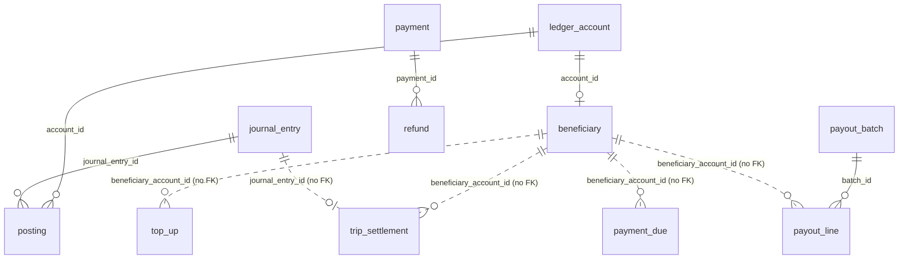

# Data model

Postgres database `payment_service`. The Prisma schema is `prisma/schema.prisma` (models in PascalCase, tables and columns snake_case via `@map`). What Prisma can't express (CHECK constraints, triggers, the exclusion constraint) is hand-written at the end of `prisma/migrations/20261028100000_init/migration.sql`. Ids default to `uuidv7()` (built into PostgreSQL 18). Timestamps are `timestamptz`; amounts are `bigint` santim. Status and kind columns are `text` with CHECK constraints, not Postgres enums.

Only five foreign keys exist (solid lines, all `ON DELETE RESTRICT`). The dotted references are plain uuid columns.

## Ledger

### `ledger_account` (`LedgerAccount`)

| Column | Type | Null | Default | Notes |
|---|---|---|---|---|
| `id` | uuid | no | `uuidv7()` | PK |
| `code` | text | no | | unique; e.g. `BENEFICIARY_BALANCE:INDIVIDUAL:<userId>`, `COMMISSION_REVENUE:addis-ababa`, `PROVIDER_CLEARING:telebirr` |
| `kind` | text | no | | CHECK `ck_ledger_account_kind`: `BENEFICIARY_BALANCE`, `COMMISSION_REVENUE`, `PROVIDER_CLEARING`, `CORPORATE_RECEIVABLE`, `RIDER_RECEIVABLE`, `PROMO_EXPENSE`, `VAT_PAYABLE`, `CASH_RECEIPTS`, `BAD_DEBT_EXPENSE`, `GOODWILL_EXPENSE` |
| `owner_type` | text | no | | CHECK `ck_ledger_account_owner`: `USER`, `ORGANIZATION`, `PLATFORM`, `PROVIDER` |
| `owner_id` | text | yes | | user / org uuid, provider name, or null for platform accounts |
| `city_id` | text | yes | | |
| `currency` | char(3) | no | `ETB` | |
| `balance_minor` | bigint | no | 0 | cached Σ postings, updated in each posting's transaction |
| `version` | int | no | 0 | incremented per posting |
| `created_at` | timestamptz | no | now | |

Indexes: `ledger_account_code_key` (unique `code`), `ledger_account_kind_idx` (`kind`). Account codes and how they're built: [architecture.md](architecture.md#the-double-entry-ledger).

### `journal_entry` (`JournalEntry`)

| Column | Type | Null | Notes |
|---|---|---|---|
| `id` | uuid | no | PK |
| `kind` | text | no | `TRIP_SETTLEMENT`, `CANCELLATION_FEE`, `TOP_UP`, `PAYOUT`, `PAYOUT_REVERSAL`, `REFUND`, `RECEIVABLE_COLLECTION` (no CHECK) |
| `reference_type` | text | no | `trip`, `payment`, `top_up`, `payout_line`, `refund` |
| `reference_id` | text | no | |
| `idempotency_key` | text | no | unique |
| `memo` | text | yes | shown on the statement |
| `created_by` | uuid | yes | approver for top-ups and refunds; null otherwise |
| `created_at` | timestamptz | no | |

Indexes: unique `idempotency_key`; `(reference_type, reference_id)`. Trigger `trg_journal_entry_append_only` (BEFORE UPDATE OR DELETE) raises `journal_entry is append-only`.

### `posting` (`Posting`)

| Column | Type | Null | Notes |
|---|---|---|---|
| `id` | uuid | no | PK |
| `journal_entry_id` | uuid | no | FK → `journal_entry.id` |
| `account_id` | uuid | no | FK → `ledger_account.id` |
| `amount_minor` | bigint | no | + credit, − debit; CHECK `ck_posting_nonzero` (≠ 0) |
| `created_at` | timestamptz | no | |

Indexes: `ix_posting_account` (`account_id, created_at DESC`, the statement), `ix_posting_entry` (`journal_entry_id`).

Triggers:
- `trg_posting_balanced`: `CONSTRAINT TRIGGER AFTER INSERT … DEFERRABLE INITIALLY DEFERRED FOR EACH ROW`, function `assert_entry_balanced()`: at COMMIT, raises `journal entry % does not balance` if the entry's postings don't sum to 0.
- `trg_posting_append_only`: BEFORE UPDATE OR DELETE raises `posting is append-only`.

The migration comment says production also withholds UPDATE/DELETE grants from the app role; no grants are in the migrations (not found in code).

## Beneficiaries, rules and policies

### `beneficiary` (`Beneficiary`)

| Column | Type | Null | Default | Notes |
|---|---|---|---|---|
| `account_id` | uuid | no | | PK, FK → `ledger_account.id` |
| `type` | text | no | | CHECK `ck_beneficiary_type`: `INDIVIDUAL`, `ORGANIZATION` |
| `owner_id` | uuid | no | | driver user id or fleet org id |
| `city_id` | text | no | | set at creation |
| `state` | text | no | `OK` | CHECK `ck_beneficiary_state`: `OK`, `WARNING`, `CASH_BLOCKED`, `BLOCKED` |
| `overdue_since` | timestamptz | yes | | set by the overdue sweep, cleared when no due is overdue |
| `state_changed_at` | timestamptz | no | now | |
| `reference_code` | text | no | | unique, `ANB-XXXXXX` |
| `payout_provider` | text | yes | | |
| `payout_destination` | text | yes | | digits (optionally `+`), masked in every response |
| `created_at` | timestamptz | no | now | |

Indexes: unique `(type, owner_id)`, unique `reference_code`, `state`.

### `commission_rule` (`CommissionRule`)

| Column | Type | Null | Notes |
|---|---|---|---|
| `id` | uuid | no | PK |
| `city_id` | text | no | |
| `vehicle_type` | text | yes | null = all vehicle types |
| `beneficiary_id` | uuid | yes | a contract rule for one driver / fleet (owner id) |
| `model` | text | no | CHECK `ck_commission_rule_model`: `PERCENT`, `FIXED_PER_TRIP`, `ZERO` |
| `rate_bp` | int | yes | CHECK `ck_commission_rule_rate`: set iff `PERCENT`, 0–10 000 |
| `fixed_minor` | bigint | yes | CHECK `ck_commission_rule_fixed`: set iff `FIXED_PER_TRIP`, ≥ 0 |
| `min_minor`, `max_minor` | bigint | yes | CHECK `ck_commission_rule_bounds`: min ≥ 0, max ≥ coalesce(min, 0) |
| `valid_from` | timestamptz | no | |
| `valid_to` | timestamptz | yes | CHECK `ck_commission_rule_validity`: > `valid_from` |
| `proposed_by`, `approved_by` | uuid | no | |
| `created_at` | timestamptz | no | |

Index `(city_id, valid_from)`. Exclusion constraint `ex_commission_rule_no_overlap` (GiST, needs `btree_gist`): no two rules with the same `city_id`, `coalesce(vehicle_type,'*')`, `coalesce(beneficiary_id::text,'*')` and overlapping `tstzrange(valid_from, valid_to)`.

### `balance_policy` (`BalancePolicy`)

| Column | Type | Null | Default | Notes |
|---|---|---|---|---|
| `city_id` | text | no | | PK part |
| `valid_from` | timestamptz | no | | PK part |
| `mode` | text | no | `POSTPAID` | CHECK: `POSTPAID`, `PREPAID` |
| `warning_minor`, `cash_limit_minor`, `hard_limit_minor` | bigint | no | | CHECK `ck_balance_policy_limits`: hard ≤ cash ≤ warning ≤ 0 |
| `prepaid_minimum_minor` | bigint | no | 0 | ≥ 0 |
| `due_days` | int | no | 3 | 1–30 |
| `min_payment_bp` | int | no | 5000 | 0–10 000 |
| `min_payout_minor` | bigint | no | 10 000 | ≥ 0 |
| `tax_basis` | text | no | `COMMISSION` | CHECK: `COMMISSION`, `FULL_FARE` |
| `vat_rate_bp` | int | no | 1500 | 0–10 000 |
| `proposed_by`, `approved_by` | uuid | no | | |
| `created_at` | timestamptz | no | now | |

PK `(city_id, valid_from)`. The latest `valid_from ≤ now` applies; no row = the built-in default in `src/money/rules.ts`.

### `rule_change` (`RuleChange`)

| Column | Type | Null | Default | Notes |
|---|---|---|---|---|
| `id` | uuid | no | | PK |
| `kind` | text | no | | CHECK: `COMMISSION_RULE`, `BALANCE_POLICY` |
| `city_id` | text | no | | |
| `payload` | jsonb | no | | the proposed rule / policy (API body shape) |
| `reason` | text | no | | |
| `maker_id` | uuid | no | | |
| `checker_id` | uuid | yes | | CHECK `ck_rule_change_checker`: ≠ `maker_id` |
| `status` | text | no | `PENDING` | CHECK: `PENDING`, `EXECUTED`, `REJECTED`, `CANCELLED`, `EXPIRED` |
| `decision_reason` | text | yes | | |
| `created_at`, `decided_at` | timestamptz | no / yes | | |
| `expires_at` | timestamptz | no | | created + 7 days |

Index `(status, created_at)`.

## Rider payments

### `payment` (`Payment`)

| Column | Type | Null | Default | Notes |
|---|---|---|---|---|
| `id` | uuid | no | | PK |
| `purpose` | text | no | | CHECK: `TRIP_FARE`, `CANCELLATION_FEE` |
| `trip_id`, `rider_id` | uuid | no | | |
| `city_id` | text | no | | |
| `method` | text | no | | CHECK: `MOBILE_MONEY`, `CARD` |
| `provider` | text | no | | `none` until a provider is enabled |
| `amount_minor` | bigint | no | | CHECK `ck_payment_amount`: > 0, 0 ≤ `refunded_minor` ≤ `amount_minor` |
| `currency` | char(3) | no | `ETB` | |
| `status` | text | no | `PENDING` | CHECK: `PENDING`, `ACTION_REQUIRED`, `RETRY_SCHEDULED`, `SUCCEEDED`, `FAILED`, `REFUNDED`, `PARTIALLY_REFUNDED` |
| `provider_ref` | text | yes | | unique; the provider's id for the current attempt |
| `provider_txn_id` | text | yes | | unique; set on capture |
| `checkout_url` | text | yes | | |
| `attempts` | int | no | 0 | |
| `next_attempt_at` | timestamptz | yes | | |
| `last_error` | text | yes | | |
| `refunded_minor` | bigint | no | 0 | |
| `settlement` | jsonb | no | | facts needed to settle later: `driverId`, `beneficiary`, `vehicleType`, `paymentMethod`, `completedAt`, `compensationMinor` |
| `settled_as_receivable` | bool | no | false | |
| `created_at`, `updated_at`, `completed_at` | timestamptz | | | `updated_at` maintained by Prisma (`@updatedAt`) |

Indexes: unique `(trip_id, purpose)`, unique `provider_ref`, unique `provider_txn_id`, `(status, updated_at)`, `(rider_id, created_at DESC)`.

### `trip_settlement` (`TripSettlement`)

The commission snapshot of a settled trip or fee.

| Column | Type | Null | Notes |
|---|---|---|---|
| `trip_id` | uuid | no | PK part |
| `purpose` | text | no | PK part: `TRIP_FARE`, `CANCELLATION_FEE` (no CHECK) |
| `payment_method` | text | no | |
| `city_id` | text | no | |
| `vehicle_type` | text | yes | null for fees |
| `driver_id` | uuid | yes | |
| `rider_id` | uuid | no | |
| `beneficiary_account_id` | uuid | yes | null for a fee with no beneficiary |
| `fare_minor`, `commission_minor`, `vat_minor` | bigint | no | for fees: fee, platform share, 0 |
| `commission_rule_id` | uuid | yes | null = built-in default rule (or a fee) |
| `earnings_minor` | bigint | no | what the beneficiary's balance moved by |
| `journal_entry_id` | uuid | no | |
| `settled_at` | timestamptz | no | |

PK `(trip_id, purpose)`. Indexes: `(beneficiary_account_id, settled_at DESC)`, `trip_settlement_driver_id_settled_at_idx` (`driver_id, settled_at DESC`, added by the second migration for the earnings summary).

### `payer_preference` (`PayerPreference`)

| Column | Type | Notes |
|---|---|---|
| `user_id` | uuid | PK |
| `mobile_money_provider` | text | |
| `updated_at` | timestamptz | |

### `refund` (`Refund`)

| Column | Type | Null | Default | Notes |
|---|---|---|---|---|
| `id` | uuid | no | | PK |
| `payment_id` | uuid | no | | FK → `payment.id` |
| `amount_minor` | bigint | no | | CHECK > 0 |
| `reason` | text | no | | |
| `driver_at_fault` | bool | no | | |
| `status` | text | no | `PENDING_APPROVAL` | CHECK: `PENDING_APPROVAL`, `PROCESSING`, `SUCCEEDED`, `FAILED`, `REJECTED` |
| `requested_by` | uuid | no | | |
| `approved_by` | uuid | yes | | CHECK `ck_refund_checker`: ≠ `requested_by` (also set on rejection) |
| `decision_reason` | text | yes | | |
| `provider_ref` | text | yes | | unique |
| `failure` | text | yes | | |
| `journal_entry_id` | uuid | yes | | |
| `created_at`, `decided_at`, `completed_at` | timestamptz | | | |

Index `(status, created_at)`.

## Top-ups, dues and payouts

### `top_up` (`TopUp`)

| Column | Type | Null | Default | Notes |
|---|---|---|---|---|
| `id` | uuid | no | | PK |
| `beneficiary_account_id` | uuid | no | | |
| `channel` | text | no | | CHECK: `MOBILE_MONEY`, `BANK_TRANSFER`, `OFFICE_CASH` |
| `provider` | text | yes | | provider for mobile money, `bank` for bank transfers, null for office cash |
| `amount_minor` | bigint | no | | CHECK > 0 |
| `status` | text | no | `PENDING` | CHECK: `PENDING`, `ACTION_REQUIRED`, `SUCCEEDED`, `FAILED`, `PENDING_APPROVAL`, `REJECTED` |
| `provider_ref`, `provider_txn_id` | text | yes | | both unique |
| `checkout_url` | text | yes | | |
| `created_by` | uuid | no | | |
| `approved_by` | uuid | yes | | CHECK `ck_top_up_checker`: null, or channel `MOBILE_MONEY`, or ≠ `created_by` |
| `receipt_no` | text | yes | | not unique in the database; the app refuses a duplicate per channel among non-rejected rows |
| `note`, `failure` | text | yes | | |
| `journal_entry_id` | uuid | yes | | |
| `created_at`, `updated_at`, `completed_at` | timestamptz | | | |

Indexes: `(beneficiary_account_id, created_at DESC)`, `(status, updated_at)`, unique `provider_ref`, unique `provider_txn_id`.

### `payment_due` (`PaymentDue`)

| Column | Type | Null | Default | Notes |
|---|---|---|---|---|
| `id` | uuid | no | | PK |
| `beneficiary_account_id` | uuid | no | | |
| `cycle_end` | date | no | | the settlement run's Addis date |
| `amount_minor`, `minimum_minor` | bigint | no | | CHECK `ck_payment_due_amounts`: both > 0, minimum ≤ amount, `paid_minor` ≥ 0 |
| `paid_minor` | bigint | no | 0 | credits since the notice |
| `due_at` | timestamptz | no | | |
| `status` | text | no | `OPEN` | CHECK: `OPEN`, `MIN_PAID`, `PAID`, `OVERDUE`, `WRITTEN_OFF` (no code sets `WRITTEN_OFF`) |
| `created_at` | timestamptz | no | | |

Indexes: unique `(beneficiary_account_id, cycle_end)`, `(status, due_at)`.

### `payout_batch` (`PayoutBatch`)

| Column | Type | Null | Default | Notes |
|---|---|---|---|---|
| `id` | uuid | no | | PK |
| `cycle_end` | date | no | | unique: one batch per Addis day |
| `status` | text | no | `PENDING_APPROVAL` | CHECK: `PENDING_APPROVAL`, `SENDING`, `COMPLETED`, `REJECTED` |
| `prepared_by` | uuid | yes | | null for the scheduled run |
| `approved_by` | uuid | yes | | CHECK `ck_payout_batch_checker`: ≠ `prepared_by` when both set |
| `reject_reason` | text | yes | | |
| `total_minor` | bigint | no | 0 | sum of ready lines |
| `line_count` | int | no | 0 | ready lines |
| `dues_created` | int | no | 0 | |
| `created_at`, `decided_at` | timestamptz | | | |

### `payout_line` (`PayoutLine`)

| Column | Type | Null | Default | Notes |
|---|---|---|---|---|
| `id` | uuid | no | | PK |
| `batch_id` | uuid | no | | FK → `payout_batch.id` |
| `beneficiary_account_id` | uuid | no | | |
| `amount_minor` | bigint | no | | CHECK > 0; lowered to the balance at send time |
| `provider`, `destination` | text | yes | | copied from the beneficiary at run time |
| `status` | text | no | `PENDING` | CHECK: `PENDING`, `SENT`, `SUCCEEDED`, `FAILED`, `SKIPPED` |
| `provider_ref`, `provider_txn_id` | text | yes | | both unique |
| `failure` | text | yes | | |
| `journal_entry_id`, `reversal_entry_id` | uuid | yes | | |
| `created_at`, `updated_at` | timestamptz | | | |

Indexes: unique `(batch_id, beneficiary_account_id)`, `(status, updated_at)`, unique `provider_ref`, unique `provider_txn_id`.

## Providers, messaging, HTTP retries

### `webhook_event` (`WebhookEvent`)

Every provider callback as received, accepted or rejected.

| Column | Type | Null | Notes |
|---|---|---|---|
| `id` | uuid | no | PK |
| `provider` | text | no | |
| `event_key` | text | no | the provider's notification id (e.g. telebirr `payment_order_id:trade_status`, CBE Birr `ConversationID:ResultCode`, Chapa `tx_ref:event`), or `rejected:<sha256 of body, 32 hex>` |
| `signature_ok` | bool | no | |
| `payload` | jsonb | no | the parsed body, or `{ raw: first 2000 chars }` if a rejected body isn't JSON |
| `outcome` | text | yes | handler result, or the rejection reason |
| `received_at` | timestamptz | no | |
| `processed_at` | timestamptz | yes | null while unprocessed (a handler error leaves it null) |

Indexes: unique `(provider, event_key)`, `received_at DESC`.

### `inbox` (`Inbox`)

| Column | Type | Notes |
|---|---|---|
| `event_id` | text | PK: the Kafka event's `eventId` |
| `topic` | text | |
| `processed_at` | timestamptz | |

### `idempotency_key` (`IdempotencyKey`)

| Column | Type | Null | Default | Notes |
|---|---|---|---|---|
| `user_id` | uuid | no | | PK part |
| `key` | text | no | | PK part |
| `request_hash` | bytea | no | | SHA-256 of `{url, body}` |
| `status` | text | no | `IN_PROGRESS` | `IN_PROGRESS` or `DONE` |
| `status_code` | int | yes | | |
| `response` | jsonb | yes | | |
| `created_at` | timestamptz | no | | purged after 24 h |

### `outbox` (`Outbox`)

| Column | Type | Null | Notes |
|---|---|---|---|
| `id` | uuid | no | PK |
| `topic` | text | no | |
| `key` | text | no | Kafka message key |
| `payload` | jsonb | no | envelope + payload |
| `created_at` | timestamptz | no | |
| `published_at` | timestamptz | yes | null until the relay sent it |

Index `ix_outbox_unpublished` on `created_at` (a plain index, not partial on `published_at IS NULL`).

## Retention

Nothing in the service deletes rows except `idempotency_key` (24 h). `outbox` (published rows), `inbox`, `webhook_event`, the ledger and all business tables grow without bound. `posting` is not partitioned.

## Migrations

`prisma/migrations/` (lock file: `postgresql`). Applied with `prisma migrate deploy` (`make db-migrate`).

| Order | Migration | What it does |
|---|---|---|
| 1 | `20261028100000_init` | Creates every table, unique index, index and the five foreign keys above. Then, by hand: `CREATE EXTENSION btree_gist`; CHECK constraints on `ledger_account`, `posting`, `beneficiary`, `commission_rule`, `balance_policy`, `rule_change`, `payment`, `refund`, `top_up`, `payment_due`, `payout_batch`, `payout_line`; functions `assert_entry_balanced()` and `refuse_ledger_change()`; triggers `trg_posting_balanced` (deferred), `trg_posting_append_only`, `trg_journal_entry_append_only`; exclusion constraint `ex_commission_rule_no_overlap` |
| 2 | `20261029100000_driver_earnings_index` | `CREATE INDEX trip_settlement_driver_id_settled_at_idx ON trip_settlement (driver_id, settled_at DESC)` for `GET /api/payments/earnings/me` |

To add a migration: `pnpm exec prisma migrate dev --create-only` in the service folder (comment in the root `Makefile`), then add any hand-written SQL to the generated file.

## Redis keys

Redis is optional outside production (`REDIS_URL`). Keys the service reads or writes:

| Key | Type | TTL | Written by | Read by | Purpose |
|---|---|---|---|---|---|
| `deny:{userId}` | any (checked with `EXISTS`) | set by auth-service | auth-service | token verifier (`src/container.ts`) | suspended users: tokens refused (`token_revoked`) |
| `pv:{userId}` | string (number) | set by auth-service | auth-service | token verifier | permission version; older tokens refused (`token_outdated`) |
| `sim:op:{providerRef}` | string (JSON `SimOperation`) | 7 days | simulator | simulator, checkout page, `query()` | a simulated provider operation |
| `sim:ref:{provider}:{kind}:{ourReference}` | string (provider ref) | 7 days | simulator | simulator `byReference` (reconciliation) | lookup by our `ANB…` reference |

Without Redis the simulator keeps operations in an in-memory `Map` (lost on restart), and the deny-list / permission-version checks are skipped. Pub/sub channels are listed in [events.md](events.md#redis-pubsub).
