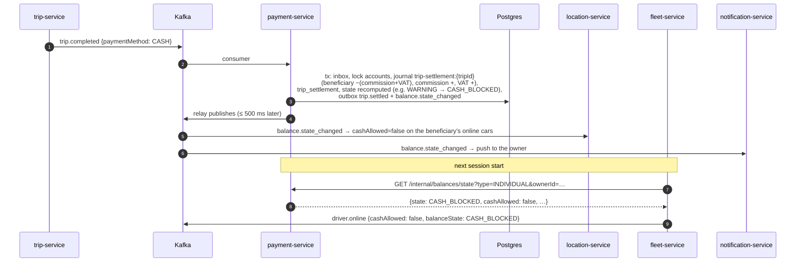

# Integrations

How payment-service talks to the rest of the system and to payment providers.

## Summary

| System | Direction | How | Purpose |
|---|---|---|---|
| trip-service | in | Kafka `trip.completed`, `trip.cancelled` | settle trips and cancellation fees |
| trip-service | out | `GET {TRIP_INTERNAL_URL}/internal/trips/:id` (service token, 3 s) | every trip event's money checked against trip-service's record before posting; 404 → anomaly (not posted); other errors / timeout → the handler throws and Kafka retries (`src/lib/trips.ts`) |
| fleet-service | in | HTTP `GET /internal/balances/state` | balance state when a driver starts a session |
| platform-service | in | HTTP `GET /internal/ops/outbox`, `/internal/ops/integrations` | system page |
| platform-service | out | HTTP `GET /internal/settings/snapshot` + Redis `settings:changed` | live settings (`payments.*`) |
| auth-service | out | HTTP JWKS (`AUTH_JWKS_URL`), `GET /internal/authz/snapshot` + Redis `authz:changed`; Redis `deny:*`, `pv:*` | token verification, permission matrix |
| notification-service | out | Kafka | pushes for payments, receipts, balances, payouts, refunds |
| location-service | out | Kafka `balance.state_changed` | matching eligibility |
| audit-service | out | Kafka `audit.recorded` | audit log |
| realtime-gateway | out | Redis (Socket.io emitter) | live pushes to riders and drivers |
| phone app, web app | in | HTTP through Kong `/api/payments` | balances, payments, finance pages |
| telebirr, CBE Birr, Chapa | out / in | simulated; callbacks in through Kong `/api/payments/webhooks/{provider}` | charges, payouts, refunds |

## Services it calls

| Target | Call | Auth | Timeout | Failure behaviour | Code |
|---|---|---|---|---|---|
| auth-service | `GET {AUTH_JWKS_URL}` | none | jose defaults | token verification fails → 401 | `libs/shared-authz/src/verify.ts` |
| auth-service | `GET {AUTH_INTERNAL_URL}/internal/authz/snapshot` at start, on `authz:changed`, every 30 s | `Bearer INTERNAL_SERVICE_TOKEN` | 3 s | logged; the built-in matrix (`libs/shared-authz/src/matrix.ts`) or the last loaded one stays in force | `libs/shared-authz/src/sync.ts`, `src/server.ts` |
| platform-service | `GET {PLATFORM_INTERNAL_URL}/internal/settings/snapshot` at start, on `settings:changed`, every 30 s | `Bearer INTERNAL_SERVICE_TOKEN` | 3 s | logged ("settings refresh failed; keeping the current values"); registry defaults apply until a load succeeds | `libs/shared-settings/src/client.ts`, `src/container.ts` |
| itself (simulator) | `POST {PUBLIC_URL}/api/payments/webhooks/{provider}` | provider signature | 5 s | non-2xx or error → redelivered after 1 s, 5 s, 15 s, then given up; reconciliation recovers the result | `src/gateways/simulator.ts` (`httpDeliver`) |

No other outbound HTTP calls exist. Real provider HTTP calls are not written yet.

## Who calls it

| Caller | Route(s) | Notes |
|---|---|---|
| fleet-service | `GET /internal/balances/state?type=&ownerId=` | `services/fleet-service/src/lib/clients.ts`, 2 s timeout, header `x-service-name: fleet-service`. A `BLOCKED` state refuses the session; an error or non-2xx returns null and fleet-service lets the driver go online (logged). The result's `state` and `cashAllowed` go into `driver.online` |
| platform-service | `GET /internal/ops/outbox` (2 s), `GET /internal/ops/integrations` (2 s), `GET /health/ready` | `services/platform-service/src/system/health.ts` |
| web app (`apps/web`) | staff Money pages (`src/pages/money/*`), partner company page (`src/pages/partner/Partner.tsx`) | via Kong, or Vite's dev proxy `/api/payments` → `PAYMENT_URL` (default `http://localhost:3005`) |
| phone app | balances, top-ups, trips, preferences, earnings | via Kong |
| payment providers | `POST /api/payments/webhooks/{provider}` | via Kong |

## Kafka summary

Details in [events.md](events.md).

| In | Out |
|---|---|
| `trip.completed`, `trip.cancelled` (group `payment-service`) | `trip.settled`, `payment.action_required`, `payment.captured`, `payment.failed`, `balance.state_changed`, `balance.topped_up`, `balance.payment_due`, `payout.sent`, `payout.failed`, `refund.succeeded`, `refund.failed`, `audit.recorded` |

## Kong routing

`infra/kong/kong.yml` (and `infra/kong/kong.dev.yml`, which points at `http://host.docker.internal:3005`):

| Route | Paths | Methods | `strip_path` |
|---|---|---|---|
| `payment-routes` | `/api/payments` | all | false |
| `payment-webhooks` | `/api/payments/webhooks` | POST | false |

Service plugins (apply to both routes): `rate-limiting` 120/minute, `policy: local`; `request-size-limiting` 64 KB. Kong doesn't verify JWTs (the service does) and never routes `/internal/*`.

The webhook route is limited to 120/min at Kong, below the service's own 600/min for that route. `PUBLIC_URL` must be the public URL behind Kong so that providers and payers' browsers can reach `/api/payments/webhooks/{provider}` and the hosted checkout.

## Payment providers

Three providers, all simulated (`GATEWAY_MODE=simulated` is the only value the config accepts). Each adapter file's header lists the real API it stands for.

| Provider | Label | Methods | Real API (from the file header) | Callback auth here | Going live |
|---|---|---|---|---|---|
| `telebirr` (`src/gateways/telebirr.ts`) | telebirr | `MOBILE_MONEY` | `POST {base}/payment/v1/merchant/preOrder`, `queryOrder`; callback signed SHA256WithRSA | HMAC-SHA256 (base64) with `TELEBIRR_WEBHOOK_SECRET` over the sorted `key=value&…` string | replace the request methods with HTTP calls and the HMAC check with the RSA public key check |
| `cbebirr` (`src/gateways/cbebirr.ts`) | CBE Birr | `MOBILE_MONEY` | C2B payment request with USSD push, B2C disbursement, reversal; async result URL | HMAC-SHA256 (uppercase hex) with `CBEBIRR_WEBHOOK_SECRET` over `ConversationID\|BillRefNumber\|TransID\|TransAmount\|ResultCode` | use the bank's documented scheme and credentials |
| `chapa` (`src/gateways/chapa.ts`) | Chapa (cards) | `CARD` | `POST /v1/transaction/initialize` (hosted checkout), `GET /v1/transaction/verify/{tx_ref}`, `POST /v1/refund/{tx_ref}`, `POST /v1/transfers`; header `Chapa-Signature` / `x-chapa-signature` HMAC-SHA256 of the body | same scheme with `CHAPA_WEBHOOK_SECRET` | replace the request methods |

Which provider is used:

| Operation | Provider |
|---|---|
| Rider mobile money charge | rider's preference (`PUT /api/payments/me/preferences`) if enabled → first enabled in setting `payments.mobileMoneyProviders` → first enabled mobile money gateway |
| Rider card charge | setting `payments.cardProvider` if enabled → first enabled card gateway |
| Top-up | the one the owner chose (must be a mobile money gateway) |
| Payout | the beneficiary's `payout_provider` (any enabled gateway, including `chapa`) |
| Refund | the provider of the original payment |
| Bank transfer top-up | no gateway: credited from `PROVIDER_CLEARING:bank` on approval |

Simulator behaviour and settings: [architecture.md](architecture.md#providers-and-the-simulator) and [configuration.md](configuration.md#simulator). The simulator signs callbacks with the same secrets the parsers verify, so the webhook, dedupe, routing and ledger code is what would run against real providers.

## Sequence diagrams

### Digital trip: completion, charge, capture, settlement

```mermaid
sequenceDiagram
  autonumber
  participant T as trip-service
  participant K as Kafka
  participant P as payment-service
  participant DB as Postgres
  participant S as provider (simulator)
  participant RG as realtime-gateway (Redis)
  participant N as notification-service
  participant R as Rider app
  T->>K: trip.completed {paymentMethod: MOBILE_MONEY, fareMinor, beneficiary}
  K->>P: consumer (group payment-service)
  P->>DB: tx: inbox insert, payment PENDING (commit)
  P->>DB: claim attempt 1 (attempts 0→1)
  P->>S: charge(ANBP…, amount, notifyUrl)
  S-->>P: providerRef, checkoutUrl
  P->>DB: tx: ACTION_REQUIRED + outbox payment.action_required
  P-->>RG: payment:action_required {payment, instructions}
  RG-->>R: socket event
  K-->>N: payment.action_required → approve push
  R->>S: approves (phone / checkout page)
  S->>P: POST /api/payments/webhooks/telebirr (signed)
  P->>DB: webhook_event upsert (dedupe)
  P->>DB: tx: SUCCEEDED, journal trip-settlement:{tripId}<br/>(clearing −fare, beneficiary +earnings, commission, VAT),<br/>trip_settlement, afterPosting, outbox trip.settled,<br/>payment.captured [, balance.state_changed]
  P-->>S: 200 {received: true, outcome: captured}
  P-->>RG: payment:captured
  K-->>N: trip.settled → receipt push
  Note over P,S: if the callback is lost, the reconcile job queries the provider<br/>after RECONCILE_AFTER_SECONDS and applies the answer
  Note over P: a decline → RETRY_SCHEDULED (payment.failed final=false);<br/>after the last retry → FAILED, settled from RIDER_RECEIVABLE
```

### Cash trip: settlement and balance state reaching matching



### Mobile money top-up

```mermaid
sequenceDiagram
  autonumber
  participant D as Driver app
  participant P as payment-service
  participant DB as Postgres
  participant S as provider (simulator)
  participant K as Kafka
  participant N as notification-service
  D->>P: POST /api/payments/balances/{accountId}/top-ups<br/>{amountMinor, provider} + Idempotency-Key
  P->>DB: idempotency_key IN_PROGRESS
  P->>DB: top_up PENDING
  P->>S: charge(ANBT…, notifyUrl)
  S-->>P: providerRef, checkoutUrl
  P->>DB: top_up ACTION_REQUIRED; idempotency_key DONE (201 stored)
  P-->>D: 201 {top-up, checkoutUrl, instructions}
  D->>S: approves
  S->>P: POST /api/payments/webhooks/{provider} (signed)
  P->>DB: tx: journal top-up:{id} (clearing −X, balance +X),<br/>dues paid oldest first, state recomputed,<br/>top_up SUCCEEDED, outbox balance.topped_up [, balance.state_changed]
  P-->>D: socket balance:topped_up (owner-drivers)
  P->>K: relay publishes balance.topped_up
  K->>N: push "payment received"
```
