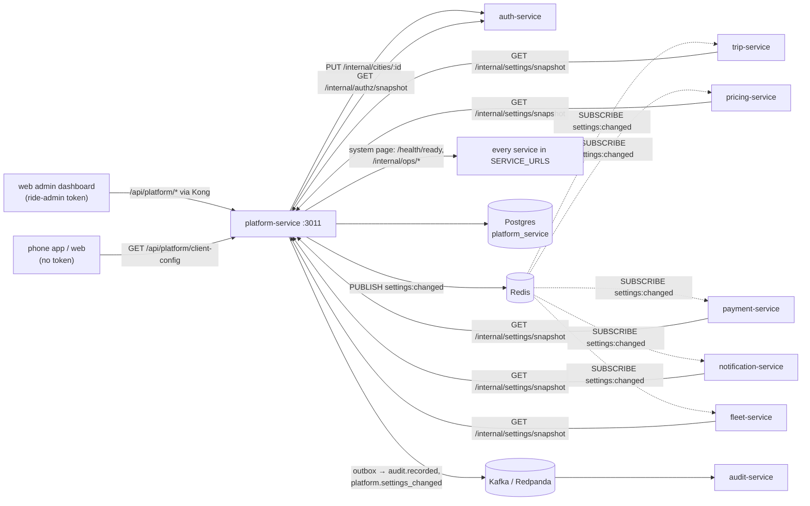

# platform-service documentation

platform-service holds the platform's **live configuration** and the admin **system page**. It listens on port 3011 and owns the Postgres database `platform_service`.

Everything here is taken from the code in `services/platform-service/` and the libraries it uses. Where something could not be found in the code, the page says so.

## What it owns

| Area | What | Source |
|---|---|---|
| Live settings | Stored values (global and per-city overrides) for the keys defined in `libs/shared-settings/src/registry.ts`, their change history, and change requests for sensitive keys (maker–checker) | `src/settings/service.ts` |
| Settings version | One counter (`settings_version`) that moves on every settings, city or vehicle-type change | `src/settings/service.ts` `bumpVersion` |
| Settings snapshot | `GET /internal/settings/snapshot`, which every service loads through `createSettingsClient` | `src/http/routes.ts`, `libs/shared-settings/src/client.ts` |
| Cities | Id, name, time zone, on/off, bounding box | `src/catalog/service.ts` |
| Vehicle types | Code, name, seats, on/off, cities where offered, sort order | `src/catalog/service.ts` |
| Announcements | Banners per audience, cities and time window | `src/catalog/service.ts` |
| Client configuration | Public `GET /api/platform/client-config` for the phone app and the web | `src/catalog/service.ts` `clientConfig` |
| System page | Health of every service, outbox backlogs, Kafka consumer lag, Redis, outside integrations | `src/system/health.ts` |

## What it does not own

| Not here | Where it lives |
|---|---|
| Setting **definitions** (type, bounds, default, scope, sensitive flag) | `libs/shared-settings/src/registry.ts`. Adding a setting is a code change in the library, not a database row |
| Acting on settings (matching, fees, fares, OTP, document reminders) | The owning service (`owner` field in the registry): trip-service, pricing-service, payment-service, notification-service, fleet-service |
| Staff organisations per city and the permission matrix | auth-service. platform-service only pushes each city to `PUT /internal/cities/:id` and reads the matrix with `createAuthzSync` |
| The audit log | audit-service consumes the `audit.recorded` events platform-service writes |
| Point-in-city lookups for pricing and mapping | `libs/shared-location/src/cities.ts` (a static list, see [architecture.md](architecture.md#cities-in-two-places)) |
| Fare rules with validity periods, zones, promotions | Not built (design: [workflow 15](../../../docs/design/workflows/15-pricing-promotions.md)) |

## Neighbours

## Index

| Page | Contents |
|---|---|
| [architecture.md](architecture.md) | Internal layout, settings catalogue, versioning and snapshots, maker–checker, client configuration, system page, security |
| [api.md](api.md) | Every HTTP route with caller, permission, request and response shapes, errors |
| [events.md](events.md) | Outbox topics and payloads, the Redis `settings:changed` channel |
| [data-model.md](data-model.md) | Tables, constraints, indexes, the migration, Redis keys |
| [integrations.md](integrations.md) | Who calls it, whom it calls, Kong, sequence diagrams |
| [configuration.md](configuration.md) | Every environment variable |
| [operations.md](operations.md) | Run, test, build, health, logs, failure modes |

## Related design docs

- [Architecture overview](../../../docs/architecture/overview.md) (§3 services, §4 communication)
- [Role.md §11, approvals (maker–checker)](../../../docs/design/Role.md)
- [Database.md §8, outbox](../../../docs/design/Database.md)
- [Auth.md §9.5, token checks](../../../docs/design/Auth.md)
