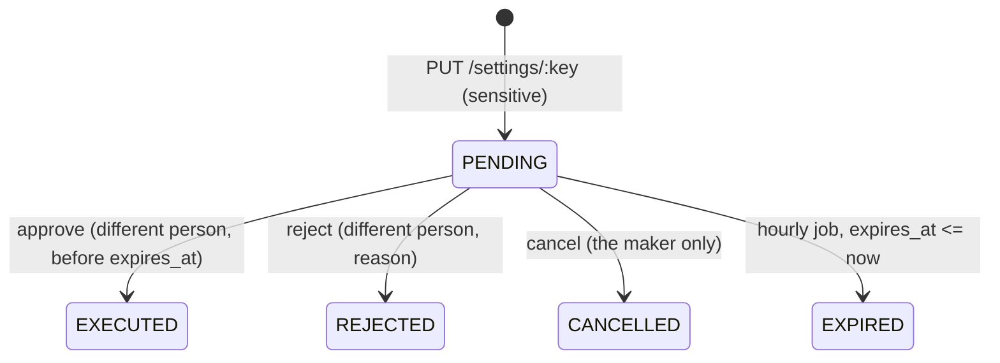

# platform-service architecture

## Layout

```
src/
├── server.ts            start-up: seed + city sync, outbox relay, hourly expiry, authz sync, listen, shutdown
├── app.ts               Fastify: error handler, helmet, rate limit (300/min), /health*, routes
├── container.ts         composition root: Prisma, Redis, settings, catalog, system health, token verifier
├── config/index.ts      env → typed config (zod), production checks
├── db.ts                Prisma client over @prisma/adapter-pg
├── http/routes.ts       every HTTP route (public, staff, internal)
├── settings/service.ts  live settings: overview, history, propose, approve/reject/cancel, expiry, snapshot
├── catalog/service.ts   cities, vehicle types, announcements, client-config, first-start seed
├── system/health.ts     the system page checks (cached 10 s)
├── outbox/outbox.ts     event shapes + writeOutbox (in the caller's transaction)
├── outbox/relay.ts      outbox → Kafka (500 ms loop, FOR UPDATE SKIP LOCKED)
├── lib/identity.ts      auth-service client: PUT /internal/cities/:id
├── lib/errors.ts        AppError helpers (400/401/403/404/409)
├── middlewares/error-handler.ts
└── generated/prisma/    generated client (prisma generate, do not edit)
```

The service follows the same structure as the other services: a composition root (`createContainer`) builds every dependency and the tests build the real app with fakes injected through `ContainerOptions` (`db`, `identity`, `publisher`, `verifyAccessToken`, `now`).

## Request flow

1. Fastify receives the request (`trustProxy: true`, body limit 32 KB).
2. `@fastify/rate-limit` allows 300 requests per minute per client IP (plugin default key) for every route, including `/internal/*`.
3. The route parses params, query and body with zod. A `ZodError` becomes `400 validation_error` with `issues[]`.
4. Staff routes call `staff(req)`: the bearer token is verified with `verifyAccessToken(token, "ride-admin")` (audience `ride-admin`). Then the service method calls `authorize(principal, "<permission>")`.
5. The service method does its work in one Prisma transaction, writing the outbox rows in the same transaction.
6. After commit, settings, city and vehicle-type changes call `publish(version)`, which sends the new version on the Redis channel `settings:changed`.
7. Errors are mapped by `src/middlewares/error-handler.ts` (see [api.md](api.md#errors)).

## The settings catalogue

The definitions are code, in `libs/shared-settings/src/registry.ts` (`SETTINGS`). Each `SettingDef` has `key`, `group`, `label`, `description`, `type` (`int`, `number`, `bool`, `string`, `enum`, `intList`, `enumList`, `money`), `default`, optional `min`/`max`/`options`/`unit`, `scope` (`global` or `city`), `sensitive`, and `owner` (the service that acts on it).

platform-service stores only values that differ from the default. It never stores a definition.

| Group | Keys | Scope | Sensitive | Owner |
|---|---|---|---|---|
| Matching | `match.timeoutSeconds`, `match.offerSeconds`, `match.radiiMeters` | global | no | trip-service |
| Trip rules | `trip.pinRequired`, `quote.ttlSeconds` | global | no | trip-service |
| Trip rules | `trip.arrivalRadiusMeters`, `trip.freeWaitingSeconds`, `trip.noShowAfterSeconds`, `trip.completeFarFromDropoffMeters` | city | no | trip-service |
| Cancellations and fees | `cancel.freeSeconds` | city | no | trip-service |
| Cancellations and fees | `cancel.feeMinor`, `cancel.driverShare` | city | **yes** | trip-service |
| Fares | `fares.{economy,comfort,minivan}.{baseMinor,perKmMinor,perMinMinor,minFareMinor,waitingPerMinMinor}` (money, 0–1 000 000 santim) | city | **yes** | pricing-service |
| Payments | `payments.methods` | city | **yes** | trip-service |
| Payments | `payments.mobileMoneyProviders`, `payments.cardProvider` | global | no | payment-service |
| Sign-in and OTP | `otp.channels` | global | no | notification-service |
| Sign-in and OTP | `otp.fallbackSeconds` | global | **yes** | notification-service |
| Documents | `documents.expiryWarningDays`, `documents.reminderDays` | global | no | fleet-service |
| Apps and maintenance | `maintenance.newTrips` | global | **yes** | trip-service |
| Apps and maintenance | `maintenance.message` | global | no | platform-service |
| Apps and maintenance | `apps.minVersion.{rider,driver}.{android,ios}` (semver `x.y.z`) | global | **yes** | platform-service |
| Feature flags | `features.phoneBooking`, `features.corporateBooking` | global | no | trip-service |
| Feature flags | `features.scheduledRides`, `features.sos`, `features.support`, `features.promos`, `features.accountDeletion` (all default `false`) | global | no | platform-service (read by the phone app via client-config) |

Validation (`validateSetting`) per type:

| Type | Accepted |
|---|---|
| `int`, `money` | integer within `min`–`max` |
| `number` | finite number within `min`–`max` |
| `bool` | boolean |
| `string` | string up to `max` (default 500) characters, trimmed; `apps.minVersion.*` must match `^\d{1,4}\.\d{1,4}\.\d{1,4}$` |
| `enum` | one of `options` |
| `intList` | 1–10 integers, each within `min`–`max` |
| `enumList` | non-empty, no repeats, each one of `options` |

### Resolution

`resolveSetting(snapshot, key, cityId, defaults)` in `libs/shared-settings/src/client.ts`:

1. the city override, if `cityId` is given, the key's scope is `city` and the city has a value;
2. the global value;
3. the calling service's own `defaults` (for example its env values);
4. the registry default.

An unknown key throws (`unknown setting <key>`).

## Changing a setting

`PUT /api/platform/settings/:key` → `settings.propose()`:

1. `authorize(p, "settings:propose")`.
2. Unknown key → `404 not_found`. A `cityId` on a global key → `400`. Reason shorter than 5 characters → `400`.
3. `value: null` means "remove the stored value" (back to the default). Any other value goes through `validateSetting` → `400 invalid_value` on failure.
4. A `cityId` that is not in the `city` table → `400 unknown city`.
5. **Not sensitive:** one transaction runs `applyTx` (below), then `publish(version)`. Response `200 { status: "APPLIED", version }`.
6. **Sensitive:** one transaction checks there is no other `PENDING` change for the same key and city (`409 change_pending`), creates a `setting_change` row with `expires_at = now + 7 days`, and writes an `audit.recorded` event with outcome `PENDING_APPROVAL`. Response `202 { status: "PENDING_APPROVAL", change }`. Nothing reaches services yet.

`applyTx` (shared by direct changes and approvals), inside one transaction:

1. read the existing `setting_value` row for `(key, city_id)`;
2. delete it (value `null`), update it, or create it;
3. `bumpVersion` → `settings_version.version + 1`;
4. insert `setting_history` (`old_value`, `new_value`, `changed_by`, `approved_by`, `reason`, `version`);
5. write two outbox rows: `platform.settings_changed` and `audit.recorded` (action `settings:change`, outcome `EXECUTED`, reason `"<old> → <new> · <reason>"`, where a missing value shows as `default`).

### Maker–checker for sensitive settings



| Step | Rule | Code |
|---|---|---|
| approve | `settings:approve`; row locked `FOR UPDATE`; status must be `PENDING` (`409 not_pending`); maker ≠ checker (`403 maker_is_checker`); not past `expires_at` (`409 expired`); value re-validated against the current registry; then `applyTx` with `changedBy = maker`, `approvedBy = checker` and status `EXECUTED` | `settings.approve` |
| reject | `settings:approve`; locked; `PENDING`; maker ≠ checker; reason 5–500 characters; writes `audit.recorded` action `settings:reject` | `settings.reject` |
| cancel | No permission check beyond a valid staff token; only the maker (`403`); locked; `PENDING`; no audit event is written | `settings.cancel` |
| expire | `setInterval` every hour in `server.ts`: `UPDATE ... SET status = 'EXPIRED' WHERE status = 'PENDING' AND expires_at <= now`. No audit event | `settings.expire` |

The database enforces maker ≠ checker as well (`ck_setting_change_maker_checker`). The default permission matrix (`libs/shared-authz/src/matrix.ts`) gives `settings:propose`, `settings:approve`, `city:manage`, `announcement:manage` to `SUPER_ADMIN`, and `settings:read`, `system:read` to `SUPER_ADMIN` and `AUDITOR`. The live matrix comes from auth-service and can differ.

## Versioning and snapshots

- `settings_version` is a single row (`id = 1`, enforced by a CHECK). It moves on every applied setting change, every city save, every vehicle-type save, and once on the first-start seed. Announcements do **not** move it.
- `loadSnapshot()` reads `setting_value`, `settings_version`, `city` (by name) and `vehicle_type` (by `sort_order`, `code`) in parallel and returns:

```ts
interface SettingsSnapshot {
  version: number;
  global: Record<string, unknown>;                       // key → value (city_id NULL)
  cities: Record<string, Record<string, unknown>>;       // cityId → key → value
  cityList: { id; name; timezone; enabled; bbox: { minLat; minLng; maxLat; maxLng } }[];
  vehicleTypes: { code; name; seatsMin; seatsMax; enabled; cities: string[] }[];
}
```

- The snapshot is built from the database on every request. There is no in-process cache in platform-service.
- The four reads run with `Promise.all` outside a transaction, so a snapshot is not guaranteed to be a single consistent read.

### How other services read settings

`createSettingsClient` in `libs/shared-settings/src/client.ts`:

| Moment | What happens |
|---|---|
| start | `refresh("start")`: `GET /internal/settings/snapshot` with the service token, 3 s timeout. On failure the service keeps the empty snapshot, so every key resolves to its own defaults or the registry default |
| Redis message on `settings:changed` | `refresh("published")`. The message body (the version) is ignored; the client always fetches the full snapshot |
| every 30 s (`pollMs`) | `refresh("poll")` |
| refresh result | Replaces the snapshot only when `version` differs. A failed refresh keeps the current snapshot and logs a warning |
| `get(key, cityId)` | Synchronous, never fails (except for an unknown key) |

Users found in code: trip-service, pricing-service, payment-service, notification-service, fleet-service (each `src/container.ts`).

## Cities, vehicle types, announcements

### Seed on first start

`catalog.seed()` runs at start. If the `city` table is empty, it creates, in one transaction, the cities in `CITIES` from `libs/shared-location` (`addis-ababa` "Addis Ababa", `hawassa` "Hawassa", with their boxes), the vehicle types `economy` (3–4 seats, order 1), `comfort` (3–4, order 2), `minivan` (5–8, order 3), and bumps the version. It then calls auth-service `PUT /internal/cities/:id` for **every** city in the table. On failure, `server.ts` logs a warning and retries the whole seed every 30 s. The HTTP server starts listening only after the first seed attempt returns (successful or not).

### Saving a city

`saveCity` (`city:manage`):

1. id must match `^[a-z0-9-]{2,40}$` (the route allows 1–40; the service requires 2–40);
2. bbox: south-west below and left of north-east, and each side at most 3°;
3. create: `409` if it exists; update: `404` if it does not;
4. **auth-service first:** `PUT /internal/cities/:id` with `{ name, timezone }`. If that fails (`503 dependency_unavailable`), nothing is saved here;
5. upsert the city, bump the version, write `audit.recorded` (`city:manage`, reason `"<name> created|enabled|disabled|updated"`);
6. publish `settings:changed`.

If the local transaction fails after auth-service accepted the city, auth-service keeps it. No compensation was found in code.

### Saving a vehicle type

`saveVehicleType` (`city:manage`): code `^[a-z0-9_]{2,30}$`, seats 1–20 with min ≤ max, every city in `cities` must exist. Upsert; a new type gets `sort_order = count + 1`. Bumps the version, writes `audit.recorded` (`vehicle_type:manage`), publishes.

A new vehicle type has no fares unless its `fares.<code>.*` keys exist in the registry (only economy, comfort and minivan exist). See [pricing-service architecture](../../pricing-service/docs/architecture.md#vehicle-types-without-fares).

### Announcements

`saveAnnouncement` / `archiveAnnouncement` (`announcement:manage`): title 3–80, body 3–500, severity `info|warning`, at least one audience of `rider|driver|partner|staff`, up to 50 cities (empty = all), `endsAt` after `startsAt`. Writes `audit.recorded` (`announcement:create|update|archive`). Does **not** bump the settings version and does not publish. Archiving sets `archived = true`; rows are never deleted.

### Cities in two places

The `city` table is the admin's list and is part of the snapshot (`cityList`). `libs/shared-location/src/cities.ts` has a separate, hard-coded `CITIES` map that pricing-service (`cityAt`) and mapping-service (search boxes) use. A city added through `POST /api/platform/cities` appears in client-config and in the snapshot, but not in `CITIES`. platform-service uses `CITIES` only for the first-start seed.

## Client configuration

`GET /api/platform/client-config?audience=&cityId=` (no token) → `catalog.clientConfig()`:

| Field | Source |
|---|---|
| `version` | `settings_version` |
| `cities[]` | enabled cities: `{ id, name, timezone, bbox }` |
| `vehicleTypes[]` | enabled types: `{ code, name, seatsMin, seatsMax, cities }` |
| `features` | `phoneBooking`, `corporateBooking`, `tripPin` (= `trip.pinRequired`), `scheduledRides`, `sos`, `support`, `promos`, `accountDeletion`, global values only |
| `maintenance` | `{ newTripsPaused: maintenance.newTrips, message: maintenance.message }` |
| `minAppVersions` | `{ rider: { android, ios }, driver: { android, ios } }` |
| `announcements[]` | not archived, `starts_at <= now`, `ends_at` null or in the future, matching `audience` if given, newest first, at most 20, then filtered by `cityId` (announcements with no cities always pass) |

City overrides are not applied (resolution is called without a city). The response carries `cache-control: public, max-age=15`; there is no server-side cache, so every request loads the full snapshot plus the announcements from Postgres.

The phone app (`apps/phone-app/lib/features/config/client_config_provider.dart`) fetches it at start and every 60 s, keeps the last good copy in preferences, and replaces its state only when `version` changes. The web (`apps/web/src/lib/platform.tsx`) loads it with React Query under the key `client-config` and invalidates it after admin edits.

## System page

`GET /api/platform/system?refresh=` (`system:read`) → `system.check()`. Results are cached in memory for 10 s unless `refresh=true`. Checks run in parallel:

| Section | How | Timeout |
|---|---|---|
| `services[]` | `GET <url>/health/ready` for each `SERVICE_URLS` entry. Non-2xx → `down`; error → `down` ("no answer in 2 s" / "unreachable"); a 2xx body that contains the string `"degraded"` → `degraded` | 2 s |
| `outbox[]` | own `outbox` (count and oldest unpublished) plus `GET /internal/ops/outbox` (service token) on auth-, trip-, fleet- and payment-service | 2 s |
| `kafka` | kafkajs admin: for each `CONSUMER_GROUPS` id, committed offsets vs. topic high-water marks. A committed offset < 0 counts the whole partition as lag | kafkajs defaults |
| `redis` | `PING` | 2 s |
| `integrations.messaging` | notification-service `GET /internal/ops/integrations` | 2 s |
| `integrations.routing` | the `engines` object from mapping-service's `/health/ready` body | — |
| `integrations.locationStream` | the `kafka` object from realtime-gateway's `/health/ready` body | — |
| `integrations.documentStorage` | fleet-service `GET /internal/ops/storage` | 4 s |
| `integrations.payments` | payment-service `GET /internal/ops/integrations` | 2 s |

The cache is per process; with several replicas each keeps its own.

## Outbox

Events are written by `writeOutbox(tx, ...)` in the same transaction as the change. Each payload gets `eventId` (UUIDv7), `version: 1` and `at` (ISO time) added. The relay (`src/outbox/relay.ts`) runs every 500 ms when `KAFKA_BROKERS` is set: it selects up to 100 unpublished rows `ORDER BY created_at FOR UPDATE SKIP LOCKED`, sends them one by one (idempotent producer, `maxInFlightRequests: 1`, `acks: -1`), marks them published, and loops while batches are full. A failure rolls back the transaction (rows stay unpublished), logs a warning and reconnects on the next tick. Delivery is at-least-once: a crash after send and before commit re-sends. Without `KAFKA_BROKERS` the rows stay in the table.

See [events.md](events.md).

## Idempotency and concurrency

- No idempotency keys on any route. Repeating a `PUT /settings/:key` applies it again (new history row, new version). Repeating `POST /cities` returns `409`.
- One pending change per key and city is checked inside the transaction with `findFirst`; there is no unique index for it, so two concurrent proposals could both pass.
- Approve, reject and cancel lock the change row with `SELECT ... FOR UPDATE`.
- `setting_value` has a unique index on `(key, city_id) NULLS NOT DISTINCT`, so two concurrent first writes cannot create two rows.
- The version counter is incremented with `UPDATE ... version = version + 1`, which serialises concurrent changes on that row.

## Security model

| Caller | Check |
|---|---|
| `/api/platform/client-config` | None (public) |
| other `/api/platform/*` | Bearer access token, audience `ride-admin`, verified against auth-service's JWKS (`AUTH_JWKS_URL`, issuer `AUTH_ISSUER`). With Redis: refused if `deny:<userId>` exists or the token's permission version is older than `pv:<userId>` (Auth.md §9.5). Then `authorize()` on the permission, global scope |
| `/internal/settings/snapshot` | `Authorization: Bearer <INTERNAL_SERVICE_TOKEN>`, compared with `timingSafeEqual` |

- The permission matrix follows auth-service live through `createAuthzSync` (`GET /internal/authz/snapshot`, Redis channel `authz:changed`, 30 s poll).
- `@fastify/helmet` sets the security headers.
- Kong does not verify tokens (comment in `infra/kong/kong.yml`); Kong does not route `/internal/*`.
- Sensitive settings need two different people (code check plus DB constraint).
- Error responses never include internal details; 5xx are logged with the request id.
