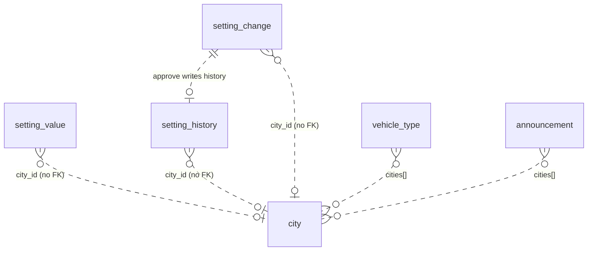

# platform-service data model

Database: `platform_service` (Postgres). Schema: `prisma/schema.prisma`. Migrations: `prisma/migrations/`. Prisma 7 reads the URL from `prisma.config.ts` (`DATABASE_URL`). Primary keys default to `uuidv7()` (a Postgres 18 function; the dev compose uses `postgis/postgis:18-3.6-alpine`).

## Migrations

| Order | Folder | What |
|---|---|---|
| 1 | `20261027160000_init` | Every table below, their indexes, and the constraints Prisma can't express (CHECKs, the `NULLS NOT DISTINCT` unique index, the partial outbox index). Inserts the single `settings_version` row `(1, 0)` |

## Tables

### `setting_value`

A stored value. `city_id` NULL = the global value; otherwise a city override. Missing row = the default applies.

| Column | Type | Null | Default | Notes |
|---|---|---|---|---|
| `id` | uuid | no | `uuidv7()` | PK |
| `key` | text | no | | registry key |
| `city_id` | text | yes | | no FK to `city` |
| `value` | jsonb | no | | |
| `updated_by` | uuid | no | | staff user id |
| `updated_at` | timestamptz | no | now | |

Index: `ux_setting_value_key_city` UNIQUE `(key, city_id) NULLS NOT DISTINCT`, so there is one global row per key.

### `setting_history`

Every applied change.

| Column | Type | Null | Notes |
|---|---|---|---|
| `id` | uuid | no | PK, `uuidv7()` |
| `key` | text | no | |
| `city_id` | text | yes | |
| `old_value` | jsonb | yes | JSON null = was the default |
| `new_value` | jsonb | yes | JSON null = back to the default |
| `changed_by` | uuid | no | the maker |
| `approved_by` | uuid | yes | the checker (sensitive keys) |
| `reason` | text | no | |
| `version` | integer | no | `settings_version` after this change |
| `at` | timestamptz | no | default now |

Index: `setting_history_key_at_idx (key, at DESC)`.

### `setting_change`

Change requests for sensitive keys.

| Column | Type | Null | Default | Notes |
|---|---|---|---|---|
| `id` | uuid | no | `uuidv7()` | PK |
| `key` | text | no | | |
| `city_id` | text | yes | | |
| `value` | jsonb | yes | | JSON null = back to the default |
| `reason` | text | no | | |
| `maker_id` | uuid | no | | |
| `checker_id` | uuid | yes | | |
| `status` | text | no | `'PENDING'` | |
| `decision_reason` | text | yes | | |
| `created_at` | timestamptz | no | now | |
| `decided_at` | timestamptz | yes | | |
| `expires_at` | timestamptz | no | | created + 7 days |

Constraints: `ck_setting_change_status` (`PENDING, EXECUTED, REJECTED, EXPIRED, CANCELLED`), `ck_setting_change_maker_checker` (`checker_id IS NULL OR checker_id <> maker_id`). Index: `setting_change_status_created_at_idx (status, created_at)`.

### `settings_version`

| Column | Type | Default | Notes |
|---|---|---|---|
| `id` | integer | 1 | PK; `ck_settings_version_single CHECK (id = 1)` |
| `version` | integer | 0 | +1 on every setting, city or vehicle-type change |

### `city`

| Column | Type | Null | Default | Notes |
|---|---|---|---|---|
| `id` | text | no | | PK, e.g. `addis-ababa`; `ck_city_id` `^[a-z0-9-]{1,40}$` |
| `name` | text | no | | |
| `timezone` | text | no | `Africa/Addis_Ababa` | |
| `enabled` | boolean | no | true | |
| `min_lat`, `min_lng`, `max_lat`, `max_lng` | double precision | no | | `ck_city_bbox`: min < max on both axes |
| `created_at`, `updated_at` | timestamptz | no | now | |

### `vehicle_type`

| Column | Type | Null | Default | Notes |
|---|---|---|---|---|
| `code` | text | no | | PK, e.g. `economy`; `ck_vehicle_type_code` `^[a-z0-9_]{1,30}$` |
| `name` | text | no | | |
| `seats_min`, `seats_max` | integer | no | | `ck_vehicle_type_seats`: 1 ≤ min ≤ max ≤ 20 |
| `enabled` | boolean | no | true | |
| `cities` | text[] | yes (column) | | empty = every city |
| `sort_order` | integer | no | 0 | |
| `updated_at` | timestamptz | no | now | |

### `announcement`

| Column | Type | Null | Default | Notes |
|---|---|---|---|---|
| `id` | uuid | no | `uuidv7()` | PK |
| `title`, `body` | text | no | | |
| `severity` | text | no | `'info'` | `ck_announcement_severity`: `info`, `warning` |
| `audiences` | text[] | | | `rider`, `driver`, `partner`, `staff` |
| `cities` | text[] | | | empty = every city |
| `starts_at` | timestamptz | no | | |
| `ends_at` | timestamptz | yes | | `ck_announcement_window`: null or after `starts_at` |
| `archived` | boolean | no | false | |
| `created_by` | uuid | no | | |
| `created_at`, `updated_at` | timestamptz | no | now | |

Index: `announcement_archived_starts_at_idx (archived, starts_at)`.

### `outbox`

| Column | Type | Null | Notes |
|---|---|---|---|
| `id` | uuid | no | PK, `uuidv7()` |
| `topic` | text | no | `audit.recorded`, `platform.settings_changed` |
| `key` | text | no | Kafka message key |
| `payload` | jsonb | no | includes `eventId`, `version`, `at` |
| `created_at` | timestamptz | no | default now |
| `published_at` | timestamptz | yes | set by the relay |

Index: `ix_outbox_unpublished (created_at) WHERE published_at IS NULL`. No cleanup of published rows was found in code.

## Relationships

There are no foreign keys. `city_id` in the settings tables and the `cities` arrays are checked in application code (`checkCity`, `saveVehicleType`), except announcement `cities`, which are not checked.

## Redis keys

platform-service stores no data of its own in Redis. It uses:

| Key / channel | Type | Access | Written by | Purpose |
|---|---|---|---|---|
| `settings:changed` | pub/sub channel | PUBLISH | platform-service | tell services to reload the snapshot |
| `deny:<userId>` | string (existence) | EXISTS | auth-service | refuse tokens of suspended users |
| `pv:<userId>` | string (number) | GET | auth-service | refuse tokens older than a role change |
| `authz:changed` | pub/sub channel | SUBSCRIBE | auth-service | reload the permission matrix |

TTLs of `deny:*` and `pv:*` are set by auth-service (not in this service's code).
