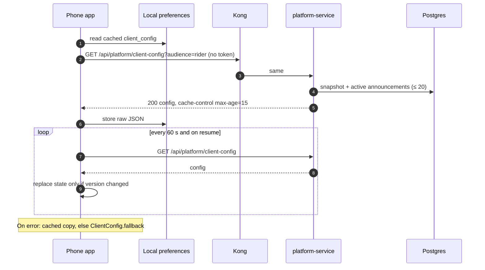

# platform-service integrations

## Who calls platform-service

| Caller | Path | Auth | Caller-side timeout / failure behaviour | Source |
|---|---|---|---|---|
| trip-, pricing-, payment-, notification-, fleet-service | `GET /internal/settings/snapshot` | service token | 3 s; on failure keep the last snapshot (or defaults at start) | `libs/shared-settings/src/client.ts`, each service's `src/container.ts` |
| web admin dashboard | `/api/platform/settings*`, `/cities`, `/vehicle-types`, `/announcements*`, `/system` | `ride-admin` token | React Query; System page refetches every 15 s | `apps/web/src/pages/admin/*.tsx` |
| web (all surfaces) | `GET /api/platform/client-config` | none | React Query key `client-config` | `apps/web/src/lib/platform.tsx` |
| phone app | `GET /api/platform/client-config?audience=<mode>` | none (`auth: false`) | at start, every 60 s, on resume; falls back to the cached copy, then `ClientConfig.fallback` | `apps/phone-app/lib/features/config/client_config_provider.dart` |

## Whom platform-service calls

| Target | Path | Auth | Timeout | On failure | Source |
|---|---|---|---|---|---|
| auth-service | `PUT /internal/cities/:id` body `{ name, timezone }`, header `x-service-name: platform-service` | service token | 3 s | `503 dependency_unavailable`; city save aborted; seed retried every 30 s | `src/lib/identity.ts` |
| auth-service | `GET /internal/authz/snapshot` | service token | 3 s | keeps the current matrix, polls every 30 s | `libs/shared-authz/src/sync.ts` |
| auth-service | `GET /api/auth/jwks` (`AUTH_JWKS_URL`) | none | jose remote JWKS defaults | token verification fails → 401 | `libs/shared-authz` |
| every `SERVICE_URLS` entry | `GET /health/ready` | none | 2 s | shown as `down` | `src/system/health.ts` |
| auth-, trip-, fleet-, payment-service | `GET /internal/ops/outbox` | service token | 2 s | row with `error` | `src/system/health.ts` |
| notification-service, payment-service | `GET /internal/ops/integrations` | service token | 2 s | `{ error }` | `src/system/health.ts` |
| fleet-service | `GET /internal/ops/storage` | service token | 4 s | `{ error }` | `src/system/health.ts` |
| Kafka (admin) | consumer offsets, topic offsets | none | kafkajs | `{ configured: true, error: "Kafka unreachable: …" }` | `src/system/health.ts` |
| Kafka (producer) | outbox topics | none | kafkajs | rows stay unpublished, retried every 500 ms | `src/outbox/relay.ts` |
| Redis | `PUBLISH settings:changed`, `PING`, `EXISTS deny:*`, `GET pv:*` | `REDIS_URL` | `maxRetriesPerRequest: 2` | publish failure logged; services poll | `src/container.ts` |
| Postgres | Prisma | `DATABASE_URL` | | 500 / readiness 503 | `src/db.ts` |

There are no calls to OSRM, mapping-service or pricing-service other than the health check.

## Kong

`infra/kong/kong.yml`:

```yaml
- name: platform-service
  url: http://platform-service:3011
  routes:
    - name: platform-routes
      paths: ["/api/platform"]
      strip_path: false
  plugins:
    - name: rate-limiting
      config: { minute: 120, policy: local }
```

- All methods are routed. Kong does not check tokens; the service does.
- `/internal/*` and `/health*` are not routed.
- `make dev-gateway` generates `infra/kong/kong.dev.yml` with upstream `http://host.docker.internal:3011` (`scripts/kong-dev-config.sh`).

## Flows

### A setting change reaching trip-service

```mermaid
sequenceDiagram
  autonumber
  actor A as Super admin (web)
  participant K as Kong
  participant P as platform-service
  participant DB as Postgres platform_service
  participant R as Redis
  participant T as trip-service (settings client)
  A->>K: PUT /api/platform/settings/match.offerSeconds {value: 20, reason}
  K->>P: same
  P->>P: verify ride-admin token, authorize settings:propose, validateSetting
  P->>DB: BEGIN; upsert setting_value; version+1; insert setting_history; outbox (platform.settings_changed, audit.recorded); COMMIT
  P->>R: PUBLISH settings:changed "<version>"
  P-->>A: 200 {status: APPLIED, version}
  R-->>T: message on settings:changed
  T->>P: GET /internal/settings/snapshot (service token)
  P->>DB: read values, version, cities, vehicle types
  P-->>T: SettingsSnapshot
  T->>T: replace snapshot (version changed); get("match.offerSeconds") = 20
  Note over T: If the Redis message is lost, the 30 s poll does the same.
```

For a sensitive key, step 4 only creates a `setting_change` row and returns `202`; the flow above happens when a second super admin calls `POST /api/platform/settings/changes/:id/approve`.

### App start fetching client-config



### Creating a city

```mermaid
sequenceDiagram
  autonumber
  actor A as Super admin
  participant P as platform-service
  participant Auth as auth-service
  participant DB as Postgres
  participant R as Redis
  A->>P: POST /api/platform/cities {id, name, timezone, enabled, bbox}
  P->>P: authorize city:manage, check id and bbox, check not existing
  P->>Auth: PUT /internal/cities/:id {name, timezone} (3 s)
  alt auth-service fails
    P-->>A: 503 dependency_unavailable (nothing saved)
  else ok
    P->>DB: upsert city; version+1; outbox audit.recorded
    P->>R: PUBLISH settings:changed
    P-->>A: 201 City
  end
```

The rider-estimate flow (pricing → mapping → location) is in [pricing-service integrations](../../pricing-service/docs/integrations.md).
