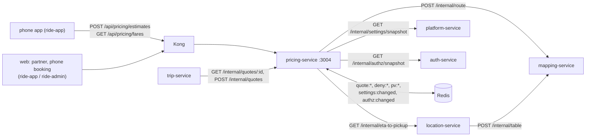

# pricing-service documentation

pricing-service makes **fare quotes**. It listens on port 3004. It has **no database**: quotes live in Redis until they expire.

Everything here comes from the code in `services/pricing-service/` and the libraries it uses. Where something could not be found in the code, the page says so.

## What it owns

| Area | What | Source |
|---|---|---|
| Estimates | `POST /api/pricing/estimates`: one quote per vehicle type for a pickup → drop-off, plus the shared route line | `src/http/routes.ts`, `src/quotes.ts` |
| The fare formula | base + distance + time, rounded to whole birr, at least the minimum | `src/fares.ts` `price()` |
| Quotes | Stored in Redis (`quote:<id>`) for `quote.ttlSeconds`; read by trip-service at request time | `src/quotes.ts` |
| Public fare card | `GET /api/pricing/fares?cityId=` | `src/http/routes.ts` |

## What it does not own

| Not here | Where |
|---|---|
| Fare values | Live settings `fares.<type>.*` in platform-service (sensitive: maker–checker). Definitions and defaults in `libs/shared-settings/src/registry.ts` |
| Quote lifetime | Live setting `quote.ttlSeconds` (owner trip-service in the registry) |
| Vehicle types offered per city | platform-service catalogue (in the settings snapshot) |
| Routes, distances, polylines | mapping-service (`POST /internal/route`) |
| ETA to pickup, drivers nearby | location-service (`GET /internal/eta-to-pickup`) |
| Which city a point is in | `cityAt()` in `libs/shared-location/src/cities.ts` (static list) |
| Trips, booking with a quote, checking who may use a quote | trip-service |
| Versioned fare rules, zones, promotions, surge | **Not built** (README "Not built yet"; design in [workflow 15](../../../docs/design/workflows/15-pricing-promotions.md)) |

## Neighbours

## Index

| Page | Contents |
|---|---|
| [architecture.md](architecture.md) | Layout, fare formula, quotes, estimates with route geometry, ETA, security |
| [api.md](api.md) | Every route with shapes, limits and errors |
| [events.md](events.md) | No Kafka; the Redis channels it listens to |
| [data-model.md](data-model.md) | No database; Redis keys |
| [integrations.md](integrations.md) | Calls in and out, Kong, sequence diagrams |
| [configuration.md](configuration.md) | Environment variables |
| [operations.md](operations.md) | Run, test, build, health, failure modes |

## Related design docs

- [Workflow 05, ride booking and matching (part B, quotes)](../../../docs/design/workflows/05-ride-booking-matching.md)
- [Workflow 15, pricing, zones and promotions](../../../docs/design/workflows/15-pricing-promotions.md) (mostly not built)
- [Architecture overview](../../../docs/architecture/overview.md)
