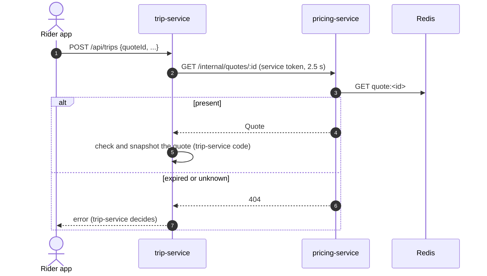

# pricing-service integrations

## Who calls pricing-service

| Caller | Path | Auth | Caller timeout / behaviour | Source |
|---|---|---|---|---|
| phone app | `POST /api/pricing/estimates`, `GET /api/pricing/fares` (no token) | `ride-app` token for estimates | — | `packages/core/lib/src/api/service_apis.dart`, `packages/core/lib/src/models/quote.dart` |
| web, partner page | `POST /api/pricing/estimates` (`vehicleTypes: ["economy"]`) | partner (`ride-app`) token | — | `apps/web/src/pages/partner/Partner.tsx` |
| web, call-center phone booking | `POST /api/pricing/estimates` | staff (`ride-admin`) token | — | `apps/web/src/pages/staff/PhoneBooking.tsx` |
| trip-service | `GET /internal/quotes/:id?tripId=&userId=` (books the discount for that trip), `POST /internal/quotes/:id/unbook` (the trip wasn't created) | service token | 2.5 s; 404 → no quote; other errors thrown (unbook failures are only logged) | `services/trip-service/src/quotes.ts` `pricingQuotes` (used when `PRICING=service`, the default) |
| trip-service | `POST /internal/quotes` (re-price a scheduled ride at dispatch) | service token | 5 s; 404/405 or any error → the scheduler keeps the booked quote; the fare is the lower of the two | `services/trip-service/src/quotes.ts` `reprice`, called from `src/trips/scheduled.ts` `dispatchOne` |

## Whom pricing-service calls

| Target | Path | Auth | Timeout | On failure | Source |
|---|---|---|---|---|---|
| mapping-service | `POST /internal/route` `{ points: [pickup, dropoff], geometry: true }` | service token | 2.5 s | estimate fails `503 dependency_unavailable` | `src/lib/mapping.ts` |
| location-service | `GET /internal/eta-to-pickup?lat&lng&cityId&vehicleType` (once per type) | service token | 1.5 s | ETA `null`, `driversNearby: 0`; estimate continues | `src/lib/location.ts` |
| platform-service | `GET /internal/settings/snapshot` | service token | 3 s | keep current snapshot (registry defaults at start) | `libs/shared-settings` |
| auth-service | `GET /internal/authz/snapshot` | service token | 3 s | keep current matrix | `libs/shared-authz/src/sync.ts` |
| auth-service | JWKS `AUTH_JWKS_URL` | none | jose defaults | token rejected → 401 | `libs/shared-authz` |
| Redis | `SET/GET quote:*`, `EXISTS deny:*`, `GET pv:*`, SUBSCRIBE | `REDIS_URL` | `maxRetriesPerRequest: 2` | readiness 503; estimates 500; token checks refuse the request with `503 auth_unavailable` (`retry-after: 5`) | `src/container.ts` |

pricing-service never calls OSRM directly; mapping-service is the only service that does (`infra/mapping-stack/README.md`).

## Kong

`infra/kong/kong.yml`:

```yaml
- name: pricing-service
  url: http://pricing-service:3004
  routes:
    - name: pricing-routes
      paths: ["/api/pricing"]
      strip_path: false
  plugins:
    - name: rate-limiting
      config: { minute: 120, policy: local }
```

All methods are routed; tokens are checked in the service. `/internal/quotes` is not routed.

## Rider estimate: pricing → mapping → location

```mermaid
sequenceDiagram
  autonumber
  actor R as Rider app
  participant K as Kong
  participant P as pricing-service
  participant M as mapping-service
  participant O as OSRM
  participant L as location-service
  participant Rd as Redis
  R->>K: POST /api/pricing/estimates {pickup, dropoff}
  K->>P: same (rate limit 120/min)
  P->>P: verify token (ride-app, else ride-admin); cityAt(pickup); offered types; fare cards
  par route
    P->>M: POST /internal/route {points, geometry: true} (2.5 s)
    M->>Rd: GET map:route:<hash>
    alt cache miss
      M->>O: /route/v1/driving/... overview=full, geometries=polyline6 (≤ ENGINE_TIMEOUT_MS)
      alt OSRM ok
        O-->>M: distance, duration, geometry
        M->>Rd: SET map:route:<hash> EX 3600
      else OSRM down / slow / breaker open
        M->>M: straight line × 1.35 at 22 km/h, approximate: true (not cached)
      end
    end
    M-->>P: {distanceMeters, durationSeconds, geometry, approximate}
  and ETA per vehicle type
    P->>L: GET /internal/eta-to-pickup?...&vehicleType=economy (1.5 s)
    L->>L: up to 5 available drivers within 6 km (Redis geo)
    L->>M: POST /internal/table {sources: drivers, destinations: [pickup]}
    M-->>L: durations
    L-->>P: {etaSeconds, driversNearby, approximate}
  end
  P->>P: price() per vehicle type
  P->>Rd: SET quote:<id> <json> EX quote.ttlSeconds (per quote)
  P-->>R: {quotes[], route{polyline6, ...}}
```

## Booking with the quote



## A fare change

Fares are live settings. A super admin proposes `PUT /api/platform/settings/fares.economy.perKmMinor` (sensitive → `202`), a second super admin approves, platform-service publishes `settings:changed`, and pricing-service reloads the snapshot. The next estimate uses the new card; quotes already in Redis keep their fare. See [platform-service integrations](../../platform-service/docs/integrations.md#a-setting-change-reaching-trip-service).

## Workflow 15 (added)

| Direction | Peer | What | Source |
|---|---|---|---|
| in | web staff pages `/staff/ops/zones`, `/staff/ops/pricing`, `/staff/marketing/promos` | zones, fare changes, promos (`ride-admin`) | `apps/web/src/lib/marketing.ts` |
| in | phone app (not wired yet) | `promoCode` on `POST /api/pricing/estimates`, `POST /api/pricing/promos/check` | — |
| in | trip-service | `GET /internal/quotes/:id` now books the promo discount; quotes carry `discountMinor`, `payableMinor`, `promo`, `fareRuleId`, `zoneIds` | `src/quotes.ts` `forBooking` |
| in | Kafka `trip.completed`, `trip.cancelled` | promo redemption / release | `src/events/consumer.ts` |
| out | Kafka | `pricing.rule_scheduled`, `pricing.rule_activated`, `pricing.zone_changed`, `promo.activated`, `promo.redeemed`, `promo.exhausted`, `audit.recorded` | `src/outbox/` |
| out | Postgres | `pricing_service` | `src/db.ts` |
| out | Redis | `PUBLISH pricing:catalog_changed`, subscribed by every replica | `src/container.ts`, `src/server.ts` |

How a promo reaches the rider's bill (built):

- **trip-service** picks the trip id first, reads the quote with it (`?tripId=&userId=`), copies the booked quote's `discountMinor` and `promo.code` onto the trip (`trip.promo_discount_minor`, clamped to 0 … fare) and sends `promoDiscountMinor` (the discount actually applied, ≤ the final fare) on `trip.completed`; redemption and release find the reservation by trip id. A quote has at most one non-cancelled trip (unique index `ux_trip_quote_live`); a quote rebooked after its trip was cancelled comes without the discount.
- **payment-service** settles with the rider paying `fare − discount` (nothing charged when it covers the whole fare), the driver's earning computed on the full fare, and the discount debited to `PROMO_EXPENSE:{cityId}` in the same journal entry (Payment.md §6.4), from `trip.completed`'s `promoDiscountMinor`. It does not consume `promo.redeemed`.
- Not covered: scheduled rides (dispatch re-prices without a promo, and a BOOKED reservation expires after 24 h); partner-funded promos are expensed like platform ones.
