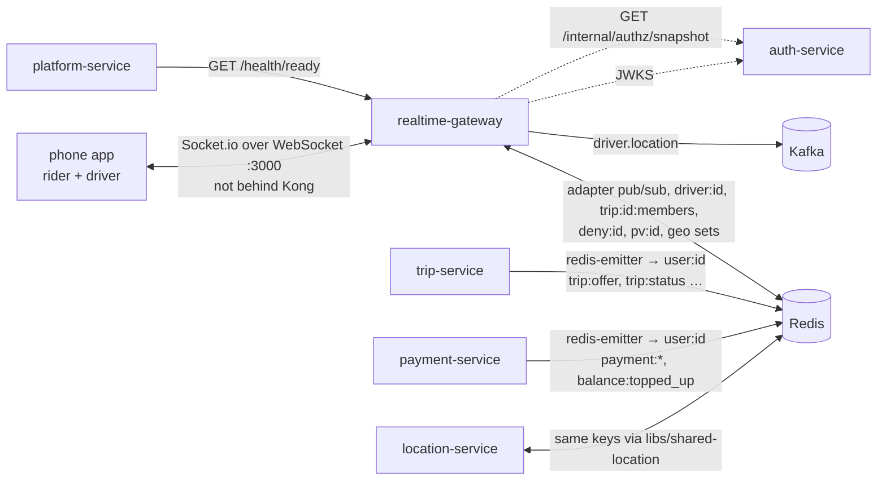

# realtime-gateway: reference documentation

realtime-gateway is the **Socket.io server** the phone app keeps one connection to. It authenticates the connection once at the handshake, takes driver GPS pings (`location:update`) and writes them into Redis with `libs/shared-location`, fans each on-trip ping out to the trip's room, publishes accepted pings to Kafka (`driver.location`), and delivers what other services emit to users through Socket.io's Redis adapter.

The service's [README](../README.md) has the quick start. These pages describe what the code does, with source paths. Design intent: [architecture §5.3 (live tracking)](../../../docs/architecture/overview.md#53-live-location-tracking), [workflow 04](../../../docs/design/workflows/04-driver-shift.md), [workflow 06](../../../docs/design/workflows/06-trip-execution.md), [Auth.md §10](../../../docs/design/Auth.md#10-verifying-tokens-in-other-services). Where they differ from the code, these pages follow the code.

## What it owns

| Area | Code |
|---|---|
| WebSocket connections (Socket.io 4, Redis adapter) | `src/server.ts` |
| Handshake authentication: access JWT, suspension deny list, permission version | `src/middlewares/auth.middleware.ts` |
| Per-user rooms `user:{userId}` and per-trip rooms `trip:{tripId}` | `src/server.ts`, `src/sockets/location.handler.ts` |
| Driver pings: permission, rate, plausibility, Redis write | `src/sockets/location.handler.ts` → `recordPing()` in `libs/shared-location/src/drivers.ts` |
| Live position fan-out to the trip room (`driver:location`) | `src/sockets/location.handler.ts` |
| `driver.location` Kafka stream (guarded, never blocks a ping) | `src/kafka.ts` |
| Closing sockets of suspended users (60 s recheck) | `src/server.ts` |

## What it does not own

| Not here | Where |
|---|---|
| Driver state (online/offline, on trip, balance) | location-service, from Kafka events. The gateway only reads `driver:{id}` and writes position fields |
| Trip membership (`trip:{id}:members`) | location-service on `trip.matched` |
| Offers, trip status, payment notifications | trip-service and payment-service, which emit through `@socket.io/redis-emitter`; the gateway has no code for these events |
| HTTP APIs | none besides health. No REST routes, no database |
| Staff (web) real-time | not supported: only `ride-app` tokens can connect. The web ops map polls location-service |
| Push notifications | notification-service |

## Neighbours

## Index

| Page | Contents |
|---|---|
| [architecture.md](architecture.md) | Server setup, handshake, rooms, the ping path, fan-out, emitters, reconnect semantics, decisions |
| [api.md](api.md) | Every socket event in and out (payloads, acks, errors) and the HTTP health routes |
| [events.md](events.md) | Kafka `driver.location`, Redis adapter channels, `authz:changed` |
| [data-model.md](data-model.md) | Redis keys read and written; no SQL database |
| [integrations.md](integrations.md) | Who connects, who emits, Kong (no route), sequence diagrams |
| [configuration.md](configuration.md) | Every environment variable |
| [operations.md](operations.md) | Running, testing, building, scaling, health, logging, failure modes |
