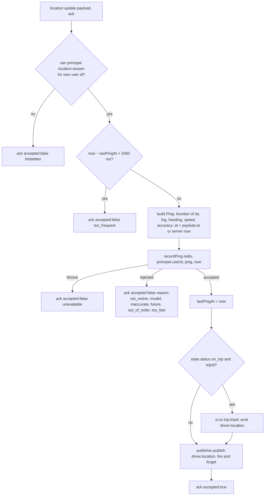

# realtime-gateway: architecture

## 1. Layout

```
services/realtime-gateway/src/
├── server.ts                    HTTP health server, Socket.io + Redis adapter, rooms, deny recheck, authz sync, shutdown
├── config/index.ts              env → typed config (Zod), parsed at import time
├── middlewares/auth.middleware.ts   handshake authentication (io.use)
├── sockets/location.handler.ts  location:update, trip:subscribe, trip:unsubscribe
└── kafka.ts                     guarded driver.location publisher (and a no-op one)
```

The ping logic (validation, Redis layout) is in `libs/shared-location` and shared with location-service. See location-service's [architecture.md §4](../../location-service/docs/architecture.md#4-ping-validation-done-in-realtime-gateway-defined-here) and [data-model.md](../../location-service/docs/data-model.md).

## 2. Startup (`src/server.ts`)

1. `config` is parsed when `config/index.ts` is imported (blank values count as unset). A Zod error crashes the process.
2. Two ioredis clients: `pubClient` (`new Redis(REDIS_URL)`, ioredis defaults) and `subClient = pubClient.duplicate()`.
3. Kafka publisher: `kafkaLocationPublisher` if `KAFKA_BROKERS` is set, else `noopPublisher` (warning logged).
4. A plain `node:http` server answers `/health`, `/health/live`, `/health/ready`, 404 otherwise. Socket.io attaches to the same server (default path `/socket.io/`).
5. `new Server(httpServer, { cors: { origin: true }, maxHttpBufferSize: 16 * 1024 })`. Transports are the Socket.io defaults (polling and websocket); the phone app uses websocket only.
6. `io.adapter(createAdapter(pubClient, subClient))` (`@socket.io/redis-adapter`, default key prefix `socket.io`).
7. `io.use(createSocketAuth(pubClient))`.
8. If `INTERNAL_SERVICE_TOKEN` is set: `createAuthzSync(...).start()` (permission matrix from auth-service, `authz:changed` channel, 30 s poll). Otherwise the built-in matrix (`libs/shared-authz/src/matrix.ts`) applies, warning logged.
9. `httpServer.listen(PORT)`.

Shutdown on `SIGTERM`/`SIGINT`: `io.close()` (closes all sockets), stop the Kafka producer, disconnect both Redis clients, exit 0. The authz sync is not stopped explicitly.

## 3. Handshake authentication (`src/middlewares/auth.middleware.ts`)

Runs once per connection. Not repeated per event ("re-verifying a JWT on every location ping would add latency", comment in the file).

| Step | Rule | On failure |
|---|---|---|
| Token present | `socket.handshake.auth.token` is a non-empty string | refused |
| Signature and claims | `createTokenVerifier` (`libs/shared-authz/src/verify.ts`): ES256, `iss = AUTH_ISSUER`, **`aud = ride-app`**, keys from `AUTH_JWKS_URL` (jose remote JWKS), `sub`/`exp`/`iat` required, 30 s clock tolerance | refused |
| Not suspended | `EXISTS deny:{userId}` = 0 | refused |
| Permission version | `GET pv:{userId}`; refused if the token's `pv` claim is lower | refused |

Every refusal reaches the client as the same `connect_error` with message **`unauthorized`**: the middleware catches all errors (including Redis errors from the deny/pv lookups) and calls `next(new Error("unauthorized"))`. The specific reason (`invalid_token`, `token_revoked`, `token_outdated`, missing token, Redis down) is not sent and not logged.

On success: `socket.data.userId = principal.userId` and `socket.data.principal = principal` (roles parsed from the token for audience `ride-app`).

Staff tokens (`ride-admin`) can't connect.

### After the handshake

| Changes after connect | Effect on an open socket |
|---|---|
| User suspended (`deny:{userId}` set) | a per-socket `setInterval` every **60 s** checks `EXISTS deny:{userId}`; if set, `socket.disconnect(true)`. A Redis error counts as "not denied" |
| Token expires | nothing; the socket stays open. The app refreshes the token before each reconnect |
| Roles / permission version change | nothing until reconnect (`pv` is checked only at the handshake) |
| Permission matrix edited in the admin dashboard | applies at once to `can()` checks (the matrix is global in-process state updated by authz sync), with the roles from the original token |

## 4. Rooms

| Room | Joined when | Left when | Who emits into it |
|---|---|---|---|
| `user:{userId}` | on every connection (`server.ts`), so all of a user's devices are in it | disconnect | trip-service and payment-service through the Redis emitter |
| `trip:{tripId}` | `trip:subscribe` succeeds | `trip:unsubscribe` or disconnect | the gateway itself (`driver:location`) |

Room membership is held by the Redis adapter, so an emit to a room from any pod (or from the emitter in another service) reaches sockets on every pod.

## 5. `trip:subscribe` authorisation

1. `tripId` must be a string matching a UUID regex. Otherwise ack `{ ok: false, reason: "invalid" }`.
2. `SISMEMBER trip:{tripId}:members userId` (`isTripMember`). The set holds the rider and the driver, written by location-service on `trip.matched`, kept 12 h, cut to 5 min after the trip ends. Not a member → `{ ok: false, reason: "not_found" }`. Redis error → `{ ok: false, reason: "unavailable" }`.
3. `socket.join("trip:{tripId}")`, ack `{ ok: true }`.

No permission (`location:read_live`) is checked: membership alone decides. A fleet owner is not a member and can't join (they can read the position over HTTP from location-service). There is no limit on how many trip rooms one socket joins.

Because `trip.matched` reaches location-service through Kafka while trip-service pushes `trip:status` directly, a rider's first `trip:subscribe` right after the match can be refused with `not_found`. The app retries every 5 s and polls the HTTP fallback meanwhile (`apps/phone-app/lib/features/rider/trip/active_trip_controller.dart`).

## 6. The ping path (`location:update`)



Details from the code:

- **Who may stream.** `can(principal, "location:stream", { ownerUserIds: [principal.userId] })`. In the built-in matrix only `DRIVER` has `location:stream` (scope `SELF`). Checked on every ping, against the live matrix.
- **The driver id is the token's `sub`.** Any `driverId` or `tripId` in the payload is ignored (integration test: "fans out to the assigned trip only, ignoring any trip id in the message").
- **Minimum interval.** `MIN_PING_INTERVAL_MS = 1000`, tracked **per socket** in a closure variable and updated only by **accepted** pings. Rejected pings don't move it, and a second socket for the same driver has its own counter (the plausibility checks in `recordPing` still apply across sockets because they use the Redis state).
- **Plausibility** (in `recordPing`/`checkPing`): online, valid coordinates, accuracy ≤ 100 m, not > 5 s in the future, newer than the last accepted ping, ≤ 200 km/h from it.
- **Redis write.** One read (`HGETALL driver:{id}`) then one pipeline (geo set by status, `seen`, driver hash, TTL, and `trip:{id}:last` while on a trip).
- **Fan-out** goes only to the trip in the driver's Redis state. The payload includes `speed` "so the rider's map moves the car smoothly between pings" (comment) and `heading` as sent.
- **Kafka** is not awaited; failures never reach the ack.
- **No ack callback** is fine: `reply()` ignores a missing or non-function ack.

## 7. How other services reach sockets

trip-service and payment-service each have `src/lib/realtime.ts` with the same `socketEmitter(redis)`: `new Emitter(redis).to("user:{userId}").emit(event, payload)` from `@socket.io/redis-emitter`. The emitter publishes on the Redis channel the gateway's adapter subscribes to (both use the default `socket.io` key), so:

- they need the **same Redis** as the gateway (`docs/production/README.md` says so for trip-service);
- there's no HTTP hop and no acknowledgement: if the user has no connected socket, the event is dropped;
- the gateway contains no code for these events; payloads are defined by the emitting service.

The event list is in [api.md](api.md#server--client).

## 8. Reconnect semantics

| Item | Behaviour |
|---|---|
| Server-side session | none. Socket.io connection state recovery is not enabled; a reconnect is a new socket with a new handshake |
| `user:{userId}` | re-joined automatically on every connection |
| `trip:{tripId}` | **not** restored by the server; the client must send `trip:subscribe` again. The app's `RealtimeHub` re-subscribes every remembered trip on `connect` (`apps/phone-app/lib/core/realtime/realtime_hub.dart`) |
| Events while disconnected | lost (no buffering, no replay). The rider app polls `GET /api/locations/trips/:id/driver` every 5 s while not joined |
| Ping rate limit | resets with the new socket (`lastPingAt = 0`) |
| Token | checked again at every reconnect. The app refreshes the token before each reconnect attempt, force-refreshes after an `unauthorized`, and signs out after 3 refusals in a row |
| App backoff | reconnection delay 1 s growing to 16 s max (`setReconnectionDelay(1000)`, `setReconnectionDelayMax(16000)`) |
| Gateway pod restart | sockets on that pod drop; the driver's next ping on another pod continues where Redis left off (state is all in Redis) |

## 9. Key decisions (from code comments)

| Decision | Where | Why given |
|---|---|---|
| Redis adapter for rooms and broadcasts | `server.ts` | any pod can reach any socket; horizontal scaling |
| Auth only at the handshake | `auth.middleware.ts` | per-ping JWT checks would add latency on the hot path |
| Address users (`user:{id}`), not connections | `server.ts`, emitters | every device of the user receives it |
| Token in `auth.token`, not cookies; `cors.origin: true` | `server.ts` | no ambient credentials, so any origin may connect |
| Trip for fan-out comes from Redis state, never the message | `location.handler.ts` | a driver can't push positions into someone else's trip |
| Kafka is a side path | `kafka.ts` | a Kafka failure must never crash the socket server or reach the driver (workflow 04 step 11) |
| Suspensions recheck every 60 s | `server.ts` | a suspension must end connections opened before it (Auth.md §9.5) |
