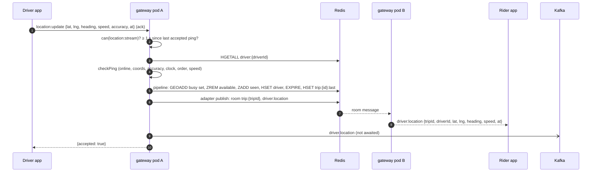
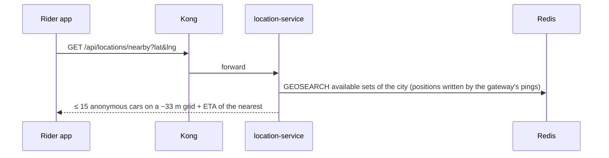

# realtime-gateway: integrations

## Who connects / calls the gateway

| Client | How | Code |
|---|---|---|
| Phone app (rider and driver modes, one connection per signed-in session) | Socket.io client, websocket transport, `auth.token` = access JWT, `forceNew` | `apps/phone-app/lib/core/realtime/realtime_hub.dart` (`WS_URL` from `apps/phone-app/env/*.json`, default `ws://localhost:3000`) |
| trip-service | not a connection: publishes through `@socket.io/redis-emitter` into `user:{id}` rooms | `services/trip-service/src/lib/realtime.ts` |
| payment-service | same | `services/payment-service/src/lib/realtime.ts` |
| platform-service (admin system page) | `GET /health/ready` (reads the `kafka` counters) | `services/platform-service/src/system/health.ts`, target from `SERVICE_URLS` (default `realtime-gateway=http://localhost:3000`) |
| Web app | does **not** connect (staff tokens are `ride-admin`, refused at the handshake). The ops map polls location-service | `apps/web/src/lib/hooks.ts` |

## Whom the gateway calls

| Callee | What | Timeout | On failure |
|---|---|---|---|
| Redis | adapter, location keys, deny list, permission version | ioredis defaults (no options passed) | handshake refused (`unavailable`, not counted toward the app's sign-out); pings ack `unavailable`; `trip:subscribe` ack `unavailable`; `/health/ready` 503 |
| auth-service JWKS (`AUTH_JWKS_URL`) | key set for ES256 verification (jose remote JWKS, cached, refetched for an unknown `kid`) | jose defaults | handshakes refused |
| auth-service `GET /internal/authz/snapshot` | live permission matrix (only with `INTERNAL_SERVICE_TOKEN`) | 3 s | keeps the current/built-in matrix, logged; polled every 30 s and on `authz:changed` |
| Kafka | `driver.location` | kafkajs defaults | counted as dropped; never affects the ping |

The gateway makes no HTTP call to location-service or trip-service. Coordination with location-service is entirely through Redis keys written with `libs/shared-location`.

## Same-Redis requirement

trip-service and payment-service must use the **same Redis** as the gateway for their emits to reach sockets, and location-service must share it so pings land in the state matching reads (`docs/production/README.md` notes this for trip-service).

## Kong

There is **no** Kong route for the gateway: `infra/kong/kong.yml` and the generated `kong.dev.yml` have no `realtime-gateway` service and no WebSocket route. `docs/development/README.md` states the same ("realtime-gateway (Socket.io, `:3000`) isn't behind Kong; apps connect to it directly"); even the phone app's `env/dev-kong.json` keeps `WS_URL=ws://localhost:3000`. In production the load balancer in front of the gateway must support WebSocket (`docs/production/README.md` §7). Kong's rate limits and size limits don't apply; the only limits are the 16 KiB message size and the 1 ping/s per socket rule.

## Sequence: driver ping → location state → rider sees the car



## Sequence: trip matched → rider joins the trip room

```mermaid
sequenceDiagram
  autonumber
  participant T as trip-service
  participant R as Redis
  participant G as realtime-gateway
  participant A as Rider app
  participant K as Kafka
  participant L as location-service
  T->>R: emitter → user:{riderId}: trip:status {status: matched, trip}
  R-->>G: adapter message
  G-->>A: trip:status
  T->>K: trip.matched (outbox relay)
  K->>L: trip.matched
  L->>R: SADD trip:{tripId}:members riderId driverId; driver → on_trip
  A->>G: trip:subscribe "tripId" (ack)
  G->>R: SISMEMBER trip:{tripId}:members riderId
  alt member
    G-->>A: {ok: true} (joined trip:{tripId})
  else not yet applied
    G-->>A: {ok: false, reason: "not_found"}
    A->>A: retry every 5 s, poll GET /api/locations/trips/{id}/driver meanwhile
  end
  Note over A,G: after a reconnect the app sends trip:subscribe again for every remembered trip
```

## Sequence: nearby cars on the rider home screen

The gateway is **not** involved: the rider app polls location-service over HTTP every 10 s. See location-service's [integrations.md](../../location-service/docs/integrations.md#sequence-nearby-cars-on-the-rider-home-screen).


