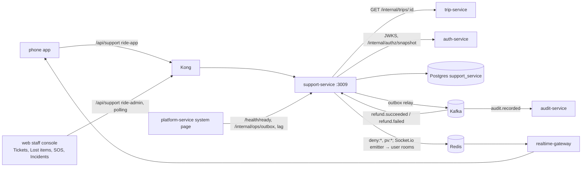

# support-service: reference documentation

Reference for engineers working on `services/support-service`. It describes what the code does today. Source paths are relative to the service folder unless they start with `libs/`, `infra/`, `docs/`, `apps/` or `services/`. For the intent, read [workflow 13](../../../docs/design/workflows/13-support-refunds.md), [workflow 14](../../../docs/design/workflows/14-safety-sos.md) and [Role.md](../../../docs/design/Role.md).

## What it owns

| Area | What the service does | Main code |
|---|---|---|
| Tickets | Create (app or staff on behalf), SLA, city queues with filters, thread with internal notes, claim/assign, status, resolve, reopen, linked refunds, timers | `src/support/tickets.ts` |
| Lost items | Rider report → driver/fleet answer → return or close, a three-party thread without phone numbers, repeat "not found" counter, 48 h timer | `src/support/lost-items.ts` |
| SOS | Trigger with dedupe, location updates, city queue, acknowledge, notes, resolve | `src/support/sos.ts` |
| Incidents | Open from SOS / ticket / by hand, notes, recorded actions, resolve | `src/support/incidents.ts` |
| Rules | Priorities, SLAs, state machines, time windows (pure) | `src/support/policy.ts` |
| Events | Outbox → Kafka (`ticket.*`, `lost_item.returned`, `sos.*`, `incident.*`, `audit.recorded`); `refund.succeeded/failed` in | `src/outbox/`, `src/events/consumer.ts` |

## What it does not own

- **Refunds and adjustments.** They are requested and approved in payment-service (maker–checker). A ticket only keeps the refund id the agent got back.
- **Suspensions and bans.** These are done in auth-service (`/api/identity`, `user:suspend`). The web calls it, then records the decision on the incident.
- **Trip evidence** (timeline, GPS trace, fare). This is read from trip-service and payment-service by the web.
- **Notifications.** notification-service has no template for tickets, lost items or SOS (emergency contacts included). The phone app gets best-effort socket pushes from this service instead ([integrations.md](integrations.md)).
- **Not built yet (phase 1):**
  - system auto-tickets (low ratings, cash mismatch, route deviation)
  - masked calls between rider and driver
  - the return-trip fee
  - paging the on-call lead when an SOS isn't acknowledged in 60 s (the queue flags `ackOverdue`)
  - SMS fallback to the safety short number
  - system SOS triggers
  - pair blocks (`PAIR_BLOCK` can be recorded but nothing enforces it)
  - data-disclosure requests

## Neighbours

## Index

| File | Contents |
|---|---|
| [architecture.md](architecture.md) | Modules, request flow, state machines, SLAs, concurrency, idempotency, timers, security |
| [api.md](api.md) | Every route, its permission and errors |
| [events.md](events.md) | Topics produced and consumed, payloads, audit actions, socket pushes |
| [data-model.md](data-model.md) | Tables, enums, indexes, constraints, triggers |
| [integrations.md](integrations.md) | trip-service, auth-service, payment-service, realtime-gateway, Kong, web, platform-service |
| [configuration.md](configuration.md) | Every environment variable |
| [operations.md](operations.md) | Running, testing, building, health, failure modes |
