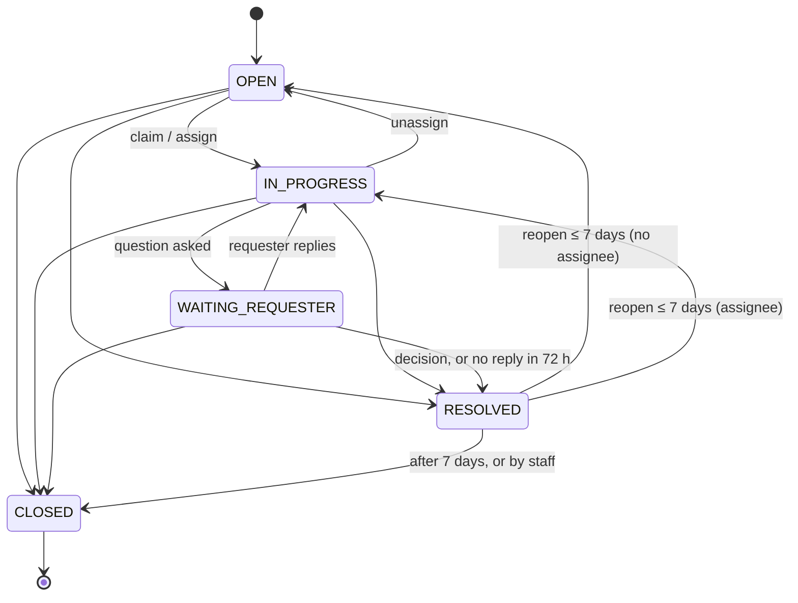
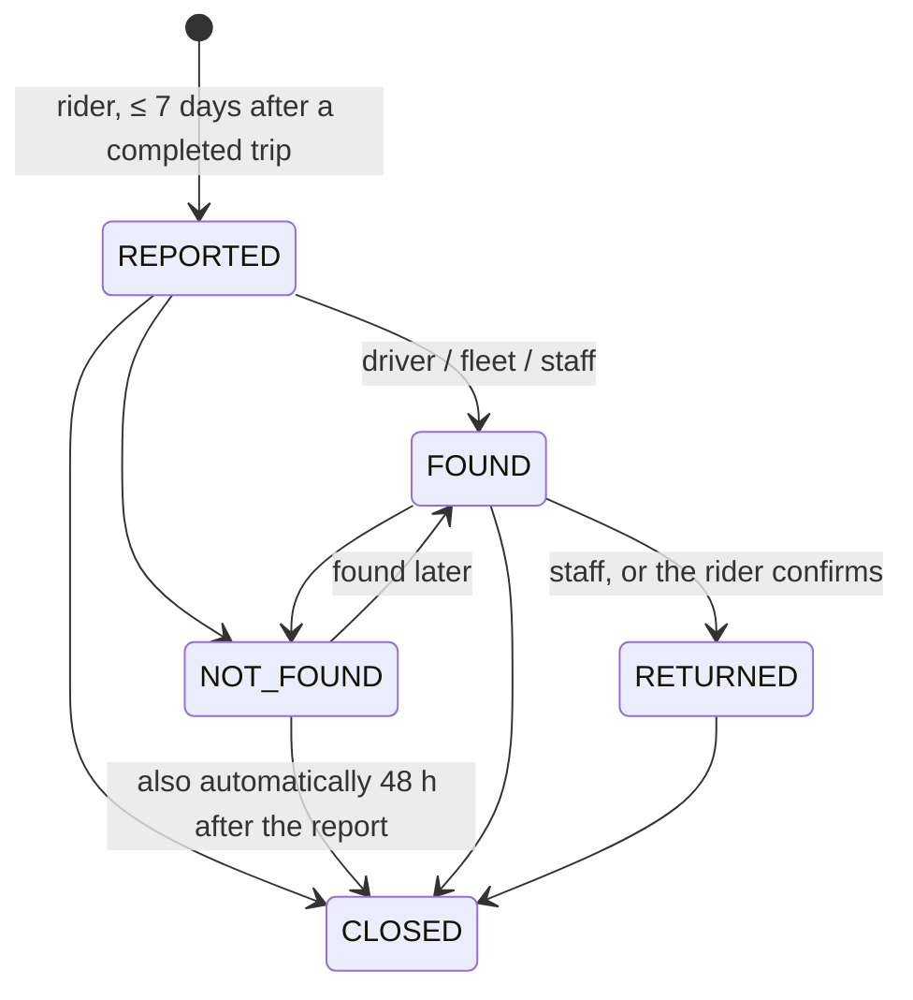

# Architecture

## Folders and modules

| Path | What it is |
|---|---|
| `src/server.ts` | Entry point: config, container, app, outbox relay, Kafka consumer, the hourly sweep (ticket and lost-item timers, idempotency purge), authz sync, listen, graceful shutdown |
| `src/app.ts` | `buildApp()`: Fastify (`trustProxy`, 32 KB body limit), error handler, helmet, rate limit 300/min, health routes, `registerRoutes()` |
| `src/container.ts` | Composition root: Prisma, Redis, trip lookup, realtime emitter, token verifier, the four domain services. Tests pass fakes through `ContainerOptions` (`trips`, `realtime`, `verifyAccessToken`, `now`) |
| `src/config/index.ts` | Zod environment schema; production refuses a missing `REDIS_URL` or `KAFKA_BROKERS` |
| `src/http/routes.ts` | All routes: zod validation, principal from either audience, idempotency wrapper, `/internal/ops/outbox` |
| `src/support/policy.ts` | Pure rules: category → priority + SLA, overdue, state machines for tickets, lost items, SOS and incidents, reopen / report / SOS windows |
| `src/support/tickets.ts` | Ticket service, plus `insertTicket`, `changeTicket`, `resolveTicket` used by lost items and timers |
| `src/support/lost-items.ts`, `sos.ts`, `incidents.ts` | The other domains (`insertIncident` is shared by tickets) |
| `src/support/views.ts` | What each caller sees (staff vs requester / owner) |
| `src/support/common.ts` | Deps type, staff check, city filters, keyset paging |
| `src/lib/trips.ts` | trip-service client (`GET /internal/trips/:id`), `TripServiceUnavailable` (503) |
| `src/lib/realtime.ts` | Socket.io Redis emitter to `user:{id}` rooms |
| `src/lib/idempotency.ts` | `Idempotency-Key` store (same contract as trip-service) |
| `src/outbox/` | `writeOutbox`, `audit()`, the relay (`FOR UPDATE SKIP LOCKED`) |
| `src/events/consumer.ts` | `refund.succeeded` / `refund.failed` → linked ticket refunds |

Routes call the domain services; the services use Prisma directly (same layout as platform- and audit-service).

## Request flow

1. `principal(req)`: the bearer token is verified as `ride-app` first, then as `ride-admin` if that fails with `invalid_token`. The audience decides whether a caller is staff (`isStaff`).
2. Validation with zod (`400 validation_error`).
3. The service loads the record and checks visibility: **hidden → 404**. A caller who can see it but lacks the action's permission → 403.
4. Writes run in a transaction: a conditional update on `(id, version)` (`409 invalid_state` if someone else won), then the outbox rows (domain event + `audit.recorded` for staff actions).
5. Best-effort socket push to the phone app after commit.

## Tickets

**Categories, priority, SLA** (workflow 13 §2, `CATEGORY_POLICY`):

| Category | Priority | First response |
|---|---|---|
| SAFETY | P1 (always; also opens an incident) | 5 min |
| PAYMENT | P2 | 4 h |
| TRIP | P3 | 8 h |
| LOST_ITEM | P2 | 2 h |
| ACCOUNT | P3 | 24 h |
| FEEDBACK | P4 | 72 h |

- `firstResponseDueAt = createdAt + SLA`. Staff may pick another priority when they create a ticket or change it later. A category change while nobody has answered moves the deadline.
- **First response:** the first *public* staff message (internal notes don't count).
- **Overdue:** no first response, past the deadline, and the ticket still OPEN, IN_PROGRESS or WAITING_REQUESTER.
- **City:** the trip's city when there is a trip, so a ticket about a driver from another city goes to the trip's queue (workflow 13 §7). Otherwise the `cityId` sent.

**State machine** (`TICKET_MOVES`): a simplification of workflow 13 §5. Approvals live in payment-service, and escalation is an incident link rather than a status.

- **Resolving** needs a `resolution` (NO_ACTION, EXPLAINED, REFUND, ADJUSTMENT, DRIVER_WARNING, ESCALATE_SAFETY) and a note. A CHECK constraint enforces it. ESCALATE_SAFETY opens an incident if there is none.
- **Reopening** clears the resolution and increments `reopenCount`. Requesters and staff can both reopen. After 7 days → `409 reopen_window_closed`.
- **Requester side:**
  - A reply to a RESOLVED ticket → `409 ticket_resolved` (reopen first).
  - A reply to a CLOSED ticket → `409 ticket_closed`.
  - Requesters never see internal notes, staff ids, the assignee or the incident link.
- **Refunds:** `POST /tickets/:id/refunds` stores `(ticketId, refundId)`. `refund.succeeded` / `refund.failed` set the status and add one internal SYSTEM message.

## Lost items

- **Viewers:**
  - the rider who reported;
  - the trip's driver;
  - the fleet owner: `trip:read` @ ORG for the trip's beneficiary org, which trip-service reports on `/internal/trips/:id`;
  - staff with `lost_item:manage` in the city.
- Anyone else gets 404. App viewers never see user ids. Staff see `driverNotFoundCount`: "not found" answers by that driver in 90 days. It is the "repeat not-found" flag of workflow 13 §3 step 16.
- Each report opens a LOST_ITEM ticket (P2, 2 h). RETURNED resolves that ticket as EXPLAINED and publishes `lost_item.returned`; CLOSED resolves it as NO_ACTION.
- One live report per trip (partial unique index) → `409 already_reported`.

## SOS

- **Who and when:** `sos:trigger` @ SELF, as the trip's rider, booker or driver; anyone else gets 404. Allowed while the trip is `matched`, `en_route` or `in_progress`, or within 30 min of `completedAt`. Otherwise `409 sos_unavailable`.
- **Dedupe:**
  - A live alert (OPEN / ACKNOWLEDGED) for the same user and trip is returned (`200`, `duplicate: true`), and its location is updated.
  - An alert of any status triggered in the last 2 min is returned too.
  - Concurrent presses are serialized by the partial unique index `ux_sos_alert_live`.
  - `Idempotency-Key` is honoured as well.
- **Safety first:** if trip-service can't be reached and the app sent `cityId`, the alert is accepted with `tripVerified: false`. Without `cityId` → `503 dependency_unavailable`.
- **Flow:** OPEN → ACKNOWLEDGED → RESOLVED (FALSE_ALARM / ASSISTED / ESCALATED, with an optional emergency-services reference). Resolving straight from OPEN also stamps the acknowledgement.
- **Who:**
  - acknowledge and notes: `sos:respond` (dispatchers and safety officers);
  - resolve: `sos:respond` **and** `incident:manage` (safety officers; dispatchers are "alert-only", Role.md / workflow 14 §8).
- **Overdue:** `ackOverdue` is true when an alert is still OPEN after 60 s. Nothing pages anyone yet.
- **No push to staff:** staff consoles poll `GET /api/support/sos` (the web every 5 s), because realtime-gateway admits only `ride-app` tokens. The person who pressed SOS gets a `support:sos` socket push on acknowledge and resolve.

## Incidents

- `incident:manage` in the incident's city is both the read and the write permission.
- Sources:
  - **SOS:** city and trip are copied; subjects are the rider, the driver and the presser.
  - **Ticket:** subjects are the requester.
  - **MANUAL:** `cityId` is required.
- A source can be linked once (`409 already_linked`).
- Status: OPEN ⇄ INVESTIGATING → RESOLVED (outcome CLEARED, WARNING, SUSPENDED_TEMPORARY or REMOVED_PERMANENTLY, plus a note). A resolved incident can't be patched (`409 incident_resolved`), but actions can still be recorded.
- **Actions** (`WARNING`, `SUSPENDED`, `BANNED`, `REINSTATED`, `PAIR_BLOCK`, with `until` and `reference`) record a decision carried out elsewhere: the web suspends through auth-service, then records it here.

## Timers (`server.ts`, hourly and at start)

| Timer | Effect |
|---|---|
| `tickets.sweep()` | WAITING_REQUESTER > 72 h → RESOLVED (NO_ACTION, `byUserId: null`); RESOLVED > 7 days → CLOSED (`ticket.closed`, `automatic: true`) |
| `lostItems.sweep()` | REPORTED / NOT_FOUND > 48 h after the report → CLOSED, ticket resolved NO_ACTION |
| `purgeIdempotencyKeys` | keys older than 24 h |

Each row is changed with the version check, so several replicas can sweep at once; at most 500 rows per pass.

## Concurrency and idempotency

| Race | Protection |
|---|---|
| Two agents change one ticket / item / alert / incident | `updateMany WHERE id AND version` → `409 invalid_state` |
| Two SOS presses | `ux_sos_alert_live` + returning the winner |
| Two lost-item reports for one trip | `ux_lost_item_live` → `409 already_reported` |
| Retried POST `/tickets`, `/lost-items`, `/sos` | `Idempotency-Key` (8–100 chars `[A-Za-z0-9_-]`); stored answer on retry, `409 request_in_progress`, `422 idempotency_mismatch`; kept 24 h |
| Replayed refund events | only `REQUESTED` links change |
| Two relay replicas | `FOR UPDATE SKIP LOCKED` |

## Security model

- **Tokens:** ES256 JWT from auth-service, both audiences. A token is refused when Redis `deny:{userId}` exists (`401 token_revoked`) or `pv` is outdated (`401 token_outdated`). A failed Redis lookup → `503 auth_unavailable` with `retry-after: 5` (error handler, `TokenCheckUnavailable`).
- **Permissions** (live matrix, `libs/shared-authz`):

| Action | Check |
|---|---|
| Create ticket (app) | `ticket:create` @ SELF, or @ ORG with `orgId` (fleet / company admins); a trip must be yours (rider, booker, driver) or your org's (billing org or fleet) |
| Create ticket (staff) | `ticket:create` @ the city (call center, support) |
| Read ticket (staff) | `ticket:read` @ city; lists filtered to `citiesWith(ticket:read)` |
| Change ticket | `ticket:update` @ city |
| Lost items (staff) | `lost_item:manage` @ city |
| SOS | `sos:trigger` @ SELF; queue / acknowledge / notes `sos:respond` @ city; resolve also `incident:manage` |
| Incidents | `incident:manage` @ city |

- `/internal/*` needs `INTERNAL_SERVICE_TOKEN` (constant-time compare). Kong never routes it.
- **No phone numbers or names** are stored. Masked calls are out of scope.
