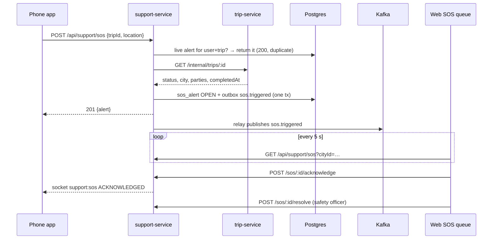

# Integrations

| Neighbour | Direction | How | Failure handling |
|---|---|---|---|
| trip-service | out | `GET {TRIP_INTERNAL_URL}/internal/trips/:id` with `INTERNAL_SERVICE_TOKEN`, 3 s timeout (`src/lib/trips.ts`). Reads status, city, rider, booker (`bookedByUserId`), driver, billing org, `beneficiary` (fleet org for ORGANIZATION vehicles), `times.completedAt` | 404 → the trip doesn't exist (callers get 404); anything else → `503 dependency_unavailable`, except SOS with a `cityId`, which is accepted unverified |
| auth-service | out | JWKS (`AUTH_JWKS_URL`), permission matrix (`/internal/authz/snapshot` + Redis `authz:changed`, `createAuthzSync`) | JWKS unreachable → `503 auth_unavailable`; the matrix falls back to the bundled one |
| auth-service (suspensions) | none | The web suspends through auth-service (`/api/identity`, `user:suspend`) and then records the decision with `POST /incidents/:id/actions` | — |
| payment-service | in (Kafka) | `refund.succeeded` / `refund.failed` update ticket refund links. Refunds are requested by the agent in payment-service (`POST /api/payments/payments/:id/refunds`); the returned refund id is linked here | consumer retries on DB errors |
| audit-service | out (Kafka) | `audit.recorded` from the outbox | events wait in the outbox |
| notification-service | none | No templates for tickets, lost items or SOS exist, including emergency-contact SMS (workflow 14 step 5). Not built | — |
| realtime-gateway | out (Redis) | Socket.io emitter to `user:{id}` rooms: `support:*` events to the phone app | best effort; without `REDIS_URL` nothing is pushed |
| realtime-gateway (staff) | — | The gateway admits only `ride-app` tokens, so staff consoles **poll**: the web SOS queue every 5 s | — |
| Kong | in | service `support-service` → `http://support-service:3009`, route `support-routes` `/api/support` (all methods, `strip_path: false`), rate-limiting 120/min (`infra/kong/kong.yml`). `/internal/*` is not routed | |
| Web app | in | `apps/web/src/lib/support.ts` and the pages `pages/support/Tickets.tsx`, `pages/support/LostItems.tsx`, `pages/safety/SosQueue.tsx`, `pages/safety/Incidents.tsx` (staff surface). Dev proxy: `/api/support` → `SUPPORT_URL` (default `http://localhost:3009`) in `apps/web/vite.config.ts` | |
| platform-service | in | System page: `/health/ready`, `/internal/ops/outbox`, consumer-group lag of `support-service` (`SERVICE_URLS`, `OUTBOX_OWNERS`, `CONSUMER_GROUPS`) | |

## SOS end to end

