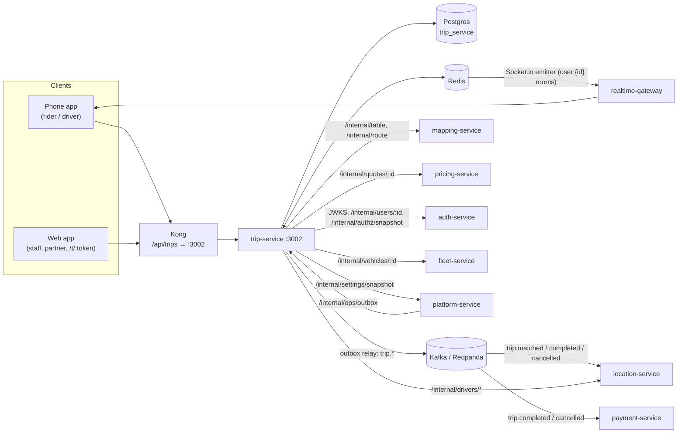

# trip-service documentation

Reference documentation for `services/trip-service`, written from the code. Where the code and a design document disagree, these pages describe the code. The design intent lives in [architecture §6](../../../docs/architecture/overview.md#6-trip-lifecycle) and workflows [05](../../../docs/design/workflows/05-ride-booking-matching.md) · [06](../../../docs/design/workflows/06-trip-execution.md) · [07](../../../docs/design/workflows/07-cancellations.md) · [08](../../../docs/design/workflows/08-payment-receipt-rating.md).

## What the service owns

| Owns | Where |
|---|---|
| The trip record and its status. **Only this service changes a trip's status.** | `trip` table, `src/trips/service.ts` |
| Matching: finding a driver, one offer at a time | `src/matching/matcher.ts`, `trip_offer`, Redis `match:*` |
| The one-active-trip rules (per rider, per driver) | `ux_trip_rider_active` index, `driver_active_trip` table |
| Cancellation and no-show fees, paid waiting, the final fare | `src/trips/policy.ts` |
| Ratings (both directions) and the average a person received | `trip_rating`, `src/trips/service.ts` |
| Saved places (Home, Work, others) | `saved_place`, `src/trips/places.ts` |
| Share-my-trip links and the public shared view | `trip_share`, `src/trips/share.ts` |
| Scheduled rides (booked ahead) and the scheduler that turns them into trips | `scheduled_trip`, `src/trips/scheduled.ts` |
| Company ride policies, checked on company bookings | `corporate_policy`, `src/trips/corporate.ts` |
| The GPS trace of trips (from `driver.location`) | `trip_trace`, `src/trips/trace.ts` |
| The regulatory report (monthly aggregates per city) | `regulatory_incident`, `src/trips/regulatory.ts` |
| The `trip.*` Kafka events (through a transactional outbox) | `outbox`, `src/outbox/` |
| Trip history (state changes) | `trip_event`, partitioned by month |

## What it does not own

| Not owned | Owner | How trip-service gets it |
|---|---|---|
| Fare quotes | pricing-service | `GET /internal/quotes/:id` when the trip is requested (`src/quotes.ts`) |
| Live driver positions and driver state (available / on trip) | location-service (Redis) | `GET /internal/drivers/nearby`, `GET /internal/drivers/:id` |
| Routes, driving-time matrices | mapping-service (OSRM) | `POST /internal/table` (ranking), `POST /internal/route` (builtin quotes only) |
| Identity, names, photos, tokens, the permission matrix | auth-service | JWKS, `GET /internal/users/:id`, `GET /internal/authz/snapshot` |
| Vehicles (plate, make, colour) | fleet-service | `GET /internal/vehicles/:id` |
| Live settings (matching, trip rules, fees, flags) | platform-service | `GET /internal/settings/snapshot` + Redis `settings:changed` |
| Socket connections | realtime-gateway | Socket.io Redis emitter (no HTTP hop) |
| Charging money, ledgers, receipts | payment-service | consumes `trip.completed` / `trip.cancelled` |

trip-service consumes `driver.location` (GPS traces) and `incident.opened` (regulatory incident counts); see [events.md](events.md#consumed-topics).

## One-screen overview

- **Stack:** Fastify 5, Prisma 7 (`@prisma/adapter-pg`) on PostgreSQL + PostGIS, ioredis, kafkajs, zod. Port `3002`.
- **Lifecycle:** `requested → matched → en_route → in_progress → completed`, with `cancelled` reachable from `requested`, `matched` and `en_route`. "Arrived" is a timestamp (`arrived_at`) inside `en_route`, not a status.
- **Every transition** is one database transaction: a conditional `UPDATE … WHERE status IN (…) AND version = v`, a `trip_event` row, and an `outbox` row. Zero rows updated → `409 invalid_state`.
- **Matching** runs in-process on a 250 ms tick, with all its state in Redis so any replica can continue a trip. Radii 2 → 4 → 6 km, offers of 15 s, 120 s overall (all live settings).
- **Auth:** every public route except the share view needs a bearer token (`ride-app` or `ride-admin` audience), checked with `libs/shared-authz`. Trips you may not read answer `404`. `/internal/*` needs the shared service token.
- **Pushes** go to `user:{id}` rooms through the Socket.io Redis emitter: `trip:offer`, `trip:offer_expired`, `trip:offer_cancelled`, `trip:status`.

## Index

| Page | Contents |
|---|---|
| [architecture.md](architecture.md) | Folders and layers, request flow, the state machine, matching, fees, ratings, places, share links, parties, quotes, background jobs, caching, concurrency, security model |
| [api.md](api.md) | Every HTTP route (public, the no-token share view, internal) and the socket events pushed |
| [events.md](events.md) | Kafka topics produced through the outbox, their payloads and consumers; Redis pub/sub used for signalling |
| [data-model.md](data-model.md) | Tables, columns, constraints and indexes; migrations in order; Redis keys |
| [integrations.md](integrations.md) | Every other system trip-service talks to, with timeouts and failure behaviour; sequence diagrams |
| [configuration.md](configuration.md) | Environment variables and the live settings read from platform-service |
| [operations.md](operations.md) | Running locally, tests, build and deploy, health, logging, failure modes and troubleshooting |

The two Kafka consumers are described in [events.md](events.md#consumed-topics).
