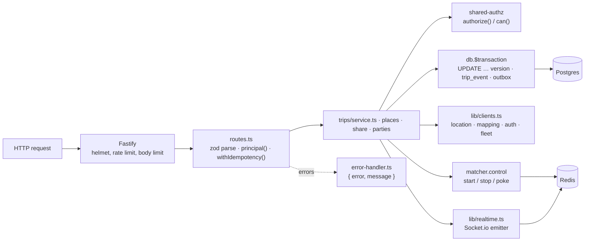
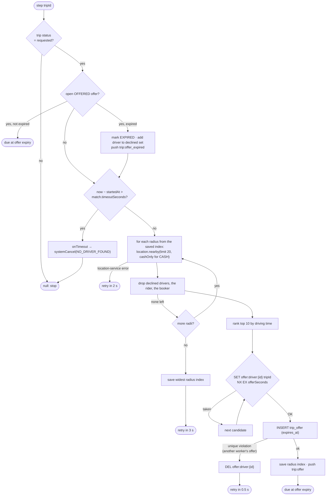
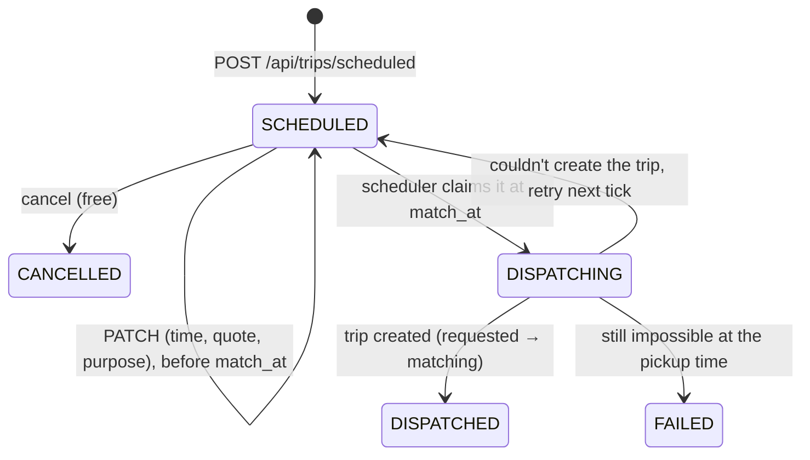

# Architecture

How trip-service is put together and why. Read [README.md](README.md) first for the one-screen overview.

## Contents

- [Folders and modules](#folders-and-modules)
- [Layers and request flow](#layers-and-request-flow)
- [Key design decisions](#key-design-decisions)
- [Trip state machine](#trip-state-machine)
- [Matching](#matching)
- [Money: final fare, waiting, cancellation fees](#money-final-fare-waiting-cancellation-fees)
- [Ratings](#ratings)
- [Saved places](#saved-places)
- [Share links](#share-links)
- [Parties view](#parties-view)
- [Quotes: pricing-service or builtin](#quotes-pricing-service-or-builtin)
- [Background jobs and timers](#background-jobs-and-timers)
- [Caching](#caching)
- [Concurrency and idempotency](#concurrency-and-idempotency)
- [Security model](#security-model)
- [Scheduled rides](#scheduled-rides)
- [Reassignment](#reassignment)
- [GPS trace](#gps-trace)
- [Company ride policies](#company-ride-policies)
- [Regulatory report](#regulatory-report)

## Folders and modules

The service does not follow the `routes/ → controllers/ → services/ → repositories/` template described in [architecture §3](../../../docs/architecture/overview.md#internal-structure-auth-service-is-the-reference-template). Routes call domain modules directly, and domain modules use Prisma and Redis directly.

| Path | What it is |
|---|---|
| `src/server.ts` | Entry point: loads config, builds the container and app, starts background loops (partitions, idempotency purge, outbox relay, settings client, matcher, authz sync), listens, and handles `SIGTERM`/`SIGINT` |
| `src/app.ts` | `buildApp()`: Fastify with `trustProxy`, a 32 KB body limit, the error handler, `@fastify/helmet`, `@fastify/rate-limit` (300/min), the health routes, then `registerRoutes()`. Does not listen (tests use `app.inject()`) |
| `src/container.ts` | Composition root: builds Prisma, Redis, HTTP clients, the realtime emitter, settings, quotes provider, matcher, trip service and token verifier. Tests pass fakes through `ContainerOptions` |
| `src/config/index.ts` | Zod schema for the environment, with production refusals ([configuration.md](configuration.md)) |
| `src/db.ts` | `createDb()`: Prisma client over `@prisma/adapter-pg` |
| `src/http/routes.ts` | Every HTTP route: parsing (zod), the token → `Principal` step, idempotency wrapping, and the `/internal` plugin with the service-token hook |
| `src/trips/service.ts` | The lifecycle: request, accept, decline, assign, en-route, arrive, start, complete, cancel, system cancel, ratings, reads. Also `tripView()` (the API shape) and `ACTIVE` |
| `src/trips/policy.ts` | Money rules: `policyFor()` (live per-city settings), `waitingFee()`, `cancellationFee()`. `DEFAULT_POLICY` is only used by unit tests |
| `src/trips/parties.ts` | `GET /api/trips/:id/parties` and the share view's driver/car: names and photos from auth-service, the car from fleet-service, cached 60 s |
| `src/trips/places.ts` | Saved places |
| `src/trips/share.ts` | Share links: create, revoke, public view |
| `src/matching/matcher.ts` | The matcher: Redis-backed per-trip state, the tick loop, ranking, offers |
| `src/quotes.ts` | `QuoteProvider`: `pricingQuotes()` (pricing-service) or `builtinQuotes()` (development stand-in) |
| `src/outbox/outbox.ts` | `writeOutbox()`: adds an outbox row inside the caller's transaction |
| `src/outbox/relay.ts` | `createOutboxRelay()`: publishes unpublished outbox rows to Kafka |
| `src/lib/clients.ts` | HTTP clients for location-service, mapping-service, auth-service (names) and fleet-service (vehicles), 2.5 s timeout each |
| `src/lib/realtime.ts` | `socketEmitter()`: Socket.io Redis emitter, addressed by user (`user:{id}` rooms) |
| `src/lib/idempotency.ts` | `withIdempotency()` and `purgeIdempotencyKeys()` |
| `src/lib/errors.ts` | `AppError` helpers (`badRequest`, `forbidden`, `notFound`, `conflict`, `unauthorized`) |
| `src/middlewares/error-handler.ts` | Maps errors to `{ error, message }` JSON; 404 handler |
| `src/utils/logger.ts` | pino logger named `trip-service` (from `@ride-app/shared-utils`) |
| `src/generated/prisma/` | Generated Prisma client (`prisma generate`, also run on `postinstall`). Do not edit |
| `prisma/schema.prisma`, `prisma/migrations/` | Schema and SQL migrations ([data-model.md](data-model.md)) |
| `tests/unit/`, `tests/integration/` | Tests ([operations.md](operations.md#tests)) |

Shared libraries used: `@ride-app/shared-authz` (token verification, `authorize`/`can`, matrix sync), `@ride-app/shared-settings` (live settings client, setting registry), `@ride-app/shared-location` (`haversineMeters`, `cityAt`, Redis key names such as `offer:driver:{id}`), `@ride-app/shared-types` (event payload types, `RATING_TAGS`), `@ride-app/shared-utils` (`AppError`, logger).

## Layers and request flow

A typical state-changing request (`POST /api/trips/:id/complete`):

1. `routes.ts` calls `principal(req)`: reads `Authorization: Bearer …`, verifies it as a `ride-app` token, and on `invalid_token` retries as `ride-admin`. The verifier also checks the Redis denylist (`deny:{userId}`) and the permission version (`pv:{userId}`).
2. The route parses params/body with zod (a `ZodError` becomes `400 validation_error`).
3. If the route is idempotent, `withIdempotency()` claims `(userId, Idempotency-Key)` in `idempotency_key`, or returns the stored answer.
4. The domain function loads the trip, checks who may act (`assertDriver()` → `404` for anyone but the assigned driver, then `authorize(p, "trip:update_status", …)`), reads live settings, and calls `transition()`.
5. `transition()` runs one Prisma transaction: conditional `updateMany` on `id`, allowed `status` values and `version`; reload; insert `trip_event`; run the `extra` step (e.g. delete `driver_active_trip`); insert the `outbox` row.
6. After commit: `notify()` pushes `trip:status` to the rider, booker and driver; matcher state is stopped where relevant.
7. The response is `tripView(trip, principal)`; the idempotency row is marked `DONE` with that body.

## Key design decisions

| Decision | Where | Why (from code comments) |
|---|---|---|
| Conditional update with a `version` column, not row locks | `transition()` in `src/trips/service.ts` | The first writer wins; a loser gets `409 invalid_state` with the current status (Database.md §9, race 2) |
| Database-enforced invariants | migrations | One active trip per rider (partial unique index), one per driver (`driver_active_trip` PK), one open offer per trip (partial unique index), corporate billing consistency, valid statuses/money/PINs (checks) |
| Transactional outbox | `src/outbox/` | "an event exists exactly when its state change committed" |
| Matcher state in Redis, DB as source of truth | `src/matching/matcher.ts` | Any replica can continue a trip's matching; the DB (`trip.status`, `trip_offer`, `driver_active_trip`) decides who gets the trip |
| Snapshot at match | `matchDriver()` | Vehicle, owner type and beneficiary are copied onto the trip when matched (Role.md §6, Payment.md D1): earnings follow the owner at that moment |
| The quote is binding | `request()`, `complete()` | Final fare = quoted fare + paid waiting. Actual distance = the planned route (`est_distance_m`) until GPS-trace matching exists |
| Pushes via Socket.io's Redis emitter | `src/lib/realtime.ts` | No network hop to realtime-gateway; address people (`user:{id}`), not connections |
| 404, never 403, for unreadable trips | `readable()`, `assertDriver()`, `sharable()` | Don't confirm that someone else's trip exists |
| Live settings with env defaults | `src/container.ts` | Admins change matching and fee rules without a deploy; env values are only defaults |

## Trip state machine

Statuses (`ck_trip_status`): `requested`, `matched`, `en_route`, `in_progress`, `completed`, `cancelled`. `ACTIVE` = the first four (`src/trips/service.ts`).

```mermaid
stateDiagram-v2
  [*] --> requested: POST /api/trips<br/>rider trip:create @ SELF<br/>call center trip:create_on_behalf @ CITY<br/>coordinator trip:create_on_behalf @ ORG

  requested --> matched: POST /:id/accept (offered driver, trip:accept @ SELF)<br/>POST /:id/assign (dispatcher, trip:assign @ CITY)<br/>guards: driver available, not stale, same city + vehicle type,<br/>balance not BLOCKED, cash allowed for CASH trips,<br/>driver_active_trip free
  requested --> cancelled: POST /:id/cancel (always free)<br/>or matcher timeout → SYSTEM, NO_DRIVER_FOUND

  matched --> en_route: POST /:id/en-route<br/>assigned driver, trip:update_status @ SELF
  matched --> cancelled: POST /:id/cancel<br/>rider fee after the free window

  en_route --> en_route: POST /:id/arrive (sets arrived_at)<br/>guard: last position ≤ 60 s old and<br/>≤ trip.arrivalRadiusMeters (150 m) from pickup
  en_route --> in_progress: POST /:id/start<br/>guards: arrived_at set; PIN when trip.pinRequired
  en_route --> cancelled: POST /:id/cancel<br/>rider fee (+ waiting after arrival)<br/>driver NO_SHOW: 5 min after arrival, at pickup

  in_progress --> completed: POST /:id/complete<br/>final fare = quote + paid waiting<br/>FAR_FROM_DROPOFF flag if > 300 m
  completed --> [*]
  cancelled --> [*]
```

| Transition | Function | Who | Guards | `trip_event` row | Outbox topic | Push |
|---|---|---|---|---|---|---|
| → `requested` | `request()` | see [API](api.md#post-apitrips) | quote exists, `requestedBy` = caller, not expired, not used by another trip that isn't `cancelled` (`400 quote_used`); corporate ⇔ `billingOrgId`; permission per channel; `maintenance.newTrips` off; channel flags; payment method allowed in city; no other active trip for the rider (unique index → `409 active_trip_exists`) | `to_status=requested`, `data={quoteId, approximate}` | `trip.requested` | `trip:status` |
| `requested → matched` | `accept()` / `assign()` → `matchDriver()` | offered driver / dispatcher | see diagram; `driver_active_trip` insert (PK violation → `409 driver_busy`) | `data={assignedBy}` for assign | `trip.matched` | `trip:status` |
| `matched → en_route` | `enRoute()` | assigned driver | status `matched` | yes | `trip.driver_en_route` | `trip:status` |
| `en_route → en_route` | `arrive()` | assigned driver | not `matched` (→ `409 invalid_state`); already arrived → returns the trip unchanged; position known (`409 position_unknown`); within radius (`409 too_far_from_pickup`) | `data={arrived:true, metersFromPickup}` | `trip.driver_arrived` | `trip:status` |
| `en_route → in_progress` | `start()` | assigned driver | `arrived_at` set (`409 not_arrived`); PIN equal when `trip.pinRequired` (`400 wrong_pin`). No geofence check at start | yes | `trip.started` | `trip:status` |
| `in_progress → completed` | `complete()` | assigned driver | status `in_progress` | `data={metersFromDropoff}` when the position was known | `trip.completed` | `trip:status` |
| `requested/matched/en_route → cancelled` | `cancel()` / `systemCancel()` | see [cancellation](#cancellation) | status in those three (`in_progress` cannot be cancelled) | yes | `trip.cancelled` | `trip:status` to parties, `trip:offer_cancelled` to a driver holding an open offer |

Every row in this table goes through `transition()`, which also increments `version`. The `requested` row is written directly in `request()`, in its own transaction.

### Cancellation

`cancel()` in `src/trips/service.ts`:

1. `readable()` (else `404`), then `authorize(p, "trip:cancel", { ownerUserIds: [rider, driver], cityId, orgId: billingOrgId })`. So riders and drivers cancel at `SELF`, coordinators at `ORG`, call center / dispatch / support / safety at `CITY`. The booker is not in `ownerUserIds`; a booker needs an `ORG` or `CITY` grant.
2. Status must be `requested`, `matched` or `en_route`.
3. `cancelledBy` is derived: `ride-admin` audience → `STAFF`; the assigned driver → `DRIVER`; anyone else → `RIDER` (this includes a corporate coordinator).
4. `NO_SHOW`: only a `DRIVER` may use it (`400` otherwise), only `trip.noShowAfterSeconds` after `arrived_at` (`409 too_early_for_no_show`), and only while the driver's live position is within `trip.arrivalRadiusMeters` of the pickup (`409 too_far_from_pickup`).
5. Fee from `cancellationFee()` ([below](#money-final-fare-waiting-cancellation-fees)); `systemCancel()` is always free and only acts on the three cancellable statuses.
6. `finishCancel()`: transition, delete `driver_active_trip`, expire open offers, stop the matcher, delete `offer:driver:{id}` and push `trip:offer_cancelled` to any driver with an open offer, push `trip:status`.

The reasons accepted by the route are `CHANGED_PLANS`, `DRIVER_TOO_FAR`, `DRIVER_ASKED_TO_CANCEL`, `WRONG_PICKUP`, `NO_SHOW`, `SAFETY`, `OTHER`, `STAFF_DECISION`. Only `NO_SHOW` is restricted by caller; `STAFF_DECISION` is accepted from anyone. The system uses `NO_DRIVER_FOUND`, which the route does not accept.

## Matching

`src/matching/matcher.ts`. One driver at a time, nearest by driving time, widening the radius, until the timeout.

### Lifecycle

- `request()` calls `matching.start(tripId)` after the trip commits: resets `match:{trip}` (`startedAt`, `radius=0`, TTL 15 min), clears `match:{trip}:declined`, and adds the trip to the `match:due` sorted set with score "now".
- `server.ts` calls `matcher.start()`: a `setInterval` every **250 ms** runs `tick()`.
- `tick()` (skipped if the previous tick is still running) takes up to **20** trips whose due time has passed. For each, it takes the lease `match:lease:{trip}` (`SET NX PX 5000`, owner = a random id per process), runs `step()`, then re-schedules the trip (`ZADD XX`) at the returned time, or `stop()`s it when `step()` returns `null`. A failed step is retried after 2 s. The lease is deleted at the end.
- `accept`/`assign`/cancel call `matching.stop()` (removes the trip from `match:due` and deletes its state); `decline` calls `matching.poke()` (`ZADD XX now`, so it never resurrects a finished trip).

### One step

Details:

| Topic | Behaviour |
|---|---|
| Radii | `match.radiiMeters` (default `[2000, 4000, 6000]`, env `MATCH_RADII_METERS`). The index of the radius that produced the last offer is kept in `match:{trip}.radius`, so the next step starts there. When nobody is found at the widest radius, the search stays there and retries every 3 s until the timeout |
| Candidate search | `GET /internal/drivers/nearby?cityId&vehicleType&lat&lng&radiusMeters&limit=20&cashOnly` on location-service. location-service (`nearbyAvailable()` in `libs/shared-location`) already drops stale, offline, on-trip and currently-offered drivers, drivers that can't take cash when `cashOnly`, and blocked balances |
| Cash filter | `cashOnly = paymentMethod === "CASH"` is passed to location-service. `matchDriver()` re-checks `cashAllowed` and `balanceState !== "BLOCKED"` at accept/assign time (`409 driver_unavailable`) |
| Skipped | Drivers in `match:{trip}:declined` (declined or let an offer expire), the trip's rider and the booker |
| Ranking | Top 10 candidates (location-service order) → `POST /internal/table` on mapping-service (sources = drivers, destination = pickup). Sorted by duration; candidates with a `null` duration are dropped. If mapping-service fails: ETA = haversine × 1.35 at 22 km/h, kept in location-service's distance order (no re-sort) |
| Reservation | `SET offer:driver:{driverId} {tripId} EX match.offerSeconds NX`. The key is shared with location-service, which treats a reserved driver as not available |
| Offer | `trip_offer` row (`OFFERED`, `eta_seconds`, `distance_meters`, `expires_at = now + offerSeconds`), then the `trip:offer` push ([api.md](api.md#socket-events)) |
| Offer window | `match.offerSeconds` (default 15 s, env `OFFER_SECONDS`) |
| Timeout | `match.timeoutSeconds` (default 120 s, env `MATCH_TIMEOUT_SECONDS`), measured from `match:{trip}.startedAt`. The check runs only when a step runs, after expiring the open offer, so the actual cancellation can be up to one offer window later |
| Late accept | `accept()` allows an `EXPIRED` offer if the trip is still `requested` and no other offer is `OFFERED` (workflow 05 §7) |
| Decline | `trip_offer → DECLINED`, driver added to the declined set, `offer:driver:{id}` deleted, matcher poked. Declining a non-open offer answers `{ declined: false }` |
| Settings changes | `config()` is read on every step, so new values apply to trips already searching |
| Recovery | If a process dies mid-step, its lease expires after 5 s and any replica's tick picks the trip up from `match:due` |

Matching does not use acceptance rates or rider ↔ driver blocks (not found in code).

## Money: final fare, waiting, cancellation fees

All amounts are in santim (minor units, `BIGINT` columns). The rules are in `src/trips/policy.ts`; values come from live per-city settings through `policyFor(settings, cityId)`:

| Policy field | Setting key | Default |
|---|---|---|
| `arrivalRadiusMeters` | `trip.arrivalRadiusMeters` | 150 m |
| `freeWaitingSeconds` | `trip.freeWaitingSeconds` | 180 s |
| `noShowAfterSeconds` | `trip.noShowAfterSeconds` | 300 s |
| `freeCancelSeconds` | `cancel.freeSeconds` | 120 s |
| `cancellationFeeMinor` | `cancel.feeMinor` | 3000 (30 ETB) |
| `driverCompensationShare` | `cancel.driverShare` | 0.8 |
| `completeFarFromDropoffMeters` | `trip.completeFarFromDropoffMeters` | 300 m |

**Paid waiting** (`waitingFee()`): zero if the driver never arrived; otherwise `ceil((until − arrived_at − freeWaitingSeconds) / 60)` started minutes × `waiting_per_min_minor` (from the quote). `until` is `started_at` at completion, or "now" in a rider cancellation.

**Final fare** (`complete()`): `fare_final_minor = fare_estimate_minor + waiting_fee_minor`. `distance_m = est_distance_m`; `duration_s = completed_at − started_at`. If the driver's live position is known and farther than `completeFarFromDropoffMeters` from the drop-off, `FAR_FROM_DROPOFF` is added to `flags` (staff-only in the API). An unknown position does not block completion.

**Promo discount** (workflow 15): `request()` copies the booked quote's `discountMinor` (clamped to 0 … fare, `quoteDiscount()` in `src/quotes.ts`) to `promo_discount_minor` and its code to `promo_code`; the `requested` history row records them. The fare stays the full fare (driver earnings, commission and corporate policy checks use it). At completion `trip.completed` carries `promoDiscountMinor = min(promo_discount_minor, fare_final_minor)` (`payableDiscount()`) and `quoteId`; the rider pays `fare − discount` (payment-service). `trip.cancelled` carries `quoteId` so pricing-service releases the reservation. Scheduled rides carry no promo.

**Cancellation fee** (`cancellationFee()`):

| Cancelled by | Situation | Fee | Compensation |
|---|---|---|---|
| `SYSTEM`, `STAFF` | any | 0 | 0 |
| `DRIVER` | reason `NO_SHOW` | `cancel.feeMinor` | fee × `cancel.driverShare` |
| `DRIVER` | other reasons | 0 | 0 |
| `RIDER` | status `requested` or no `matched_at` | 0 | 0 |
| `RIDER` | reason `DRIVER_ASKED_TO_CANCEL` | 0 (`waived: driver_asked`) | 0 |
| `RIDER` | driver has arrived | `cancel.feeMinor` + paid waiting so far | (fee incl. waiting) × share |
| `RIDER` | within `cancel.freeSeconds` of `matched_at` | 0 (`waived: free_window`) | 0 |
| `RIDER` | otherwise | `cancel.feeMinor` | fee × share |

Compensation is computed as `fee × round(share × 100) / 100` in integer arithmetic. The `waived` field is returned by the function but not stored or published. The fee is published in `trip.cancelled`; payment-service charges it.

## Ratings

`rate()`, `ratingOf()`, `ratingOfUser()` in `src/trips/service.ts`.

- Only the trip's rider (`byRole=RIDER`) or driver (`byRole=DRIVER`) may rate; anyone else gets `404`. The booker cannot rate. There is no permission check beyond that.
- The trip must be `completed`; ratings close **7 days** after `completed_at` (`409 rating_closed`).
- `stars` 1–5, `comment` ≤ 500 chars (trimmed, empty → null), `tags` ≤ 5 items, deduplicated, each from `RATING_TAGS[byRole]` in `libs/shared-types/src/trip.ts` (`400 invalid_tags`).
- One rating per trip and role: primary key `(trip_id, by_role)` → `409 already_rated`.
- `ratee_user_id` is the driver when a rider rates, the rider when a driver rates.
- `ratingOfUser(userId)` = average (one decimal) and count over `ratee_user_id`, cached in Redis `rating:user:{userId}` for 300 s; `rate()` deletes the ratee's cache key.
- `GET /api/trips/:id/parties` shows a driver's average only when they have **3 or more** ratings.
- No event is published for ratings (no `trip.rated` in code).

## Saved places

`src/trips/places.ts`. Per user (any token; no permission check), never shared.

- Labels `HOME`, `WORK`, `OTHER`. One `HOME` and one `WORK` per user (partial unique index); `PUT /api/trips/places/home|work` replaces it.
- At most **20** places per user in total (`MAX_PLACES`). The limit is checked only in `add()` (OTHER); `setFixed()` does not count.
- Listing order: HOME, WORK, then others by creation time.
- Deleting another user's place answers `404`.

## Share links

`src/trips/share.ts`.

- Only the trip's rider or booker may create or revoke a link; others get `404`.
- `create()`: refused with `409 trip_ended` if the trip is not active and ended more than 30 min ago (`AFTER_END_MS`). Returns the caller's existing live link for the trip if there is one, else creates a token of 16 random bytes, base64url (22 chars). `expires_at` = end + 30 min for an ended trip, else now + 12 h (`WHILE_ACTIVE_MS`, an upper bound; reads re-check the trip).
- `revoke()`: sets `revoked_at` on every unrevoked link this person made for the trip.
- `view(token)` (public, no auth): `404` if the token is unknown, revoked, past `expires_at`, or the trip ended more than 30 min ago. Returns status, pickup/drop-off (address as `name` + coordinates), the driver's first name and photo and the car (from the parties cache), the route polyline, times, estimated duration, the effective expiry, and a live position only when the trip is active, location-service says the driver is on **this** trip, not stale, and the fix is under 60 s old. It never includes user ids, the PIN or the fare.
- The web page `apps/web/src/pages/public/SharedTrip.tsx` (route `/t/:token`) reads this view. Links are built as `{SHARE_BASE_URL}/t/{token}`.

## Parties view

`src/trips/parties.ts`. Who is on the other side of a trip.

- Loads the rider's and driver's `{ name, image }` from auth-service (`GET /internal/users/:id`) and the vehicle from fleet-service (`GET /internal/vehicles/:id`), in parallel.
- A name that looks like a phone number (`/^\+?[\d\s-]{7,}$/`, the sign-up placeholder) is replaced with `null`. Phone numbers are never returned.
- Each upstream failure is logged and becomes `null` (no error to the caller). The result is cached 60 s under `trip:parties:{tripId}:{driverId|-}:{vehicleId|-}`, so the key changes when a driver is matched.
- `forTrip()`: the rider or booker sees the driver (name, photo, rating if ≥ 3 ratings, rating count) and the vehicle; the driver sees the rider (name, photo); staff (`ride-admin`) see both. A partner holding `trip:read` @ ORG of the trip's `billingOrgId` (the billed company) sees all three; one holding it @ ORG of the `beneficiaryId` of an `ORGANIZATION` vehicle (the fleet) sees the driver and the car, not the rider.
- `forShare()`: the driver's first name (first word of the name) and photo, and the vehicle.

## Quotes: pricing-service or builtin

`src/quotes.ts`, chosen in `src/container.ts` from `PRICING`.

| Mode | Source | Notes |
|---|---|---|
| `service` (default) | `GET {PRICING_INTERNAL_URL}/internal/quotes/:id` with the service token, 2.5 s timeout | `404` → unknown quote. Any other error → `503 dependency_unavailable` from `POST /api/trips`. Riders get quotes from pricing-service's `POST /api/pricing/estimates` |
| `builtin` | In-process: `POST /api/trips/estimates` creates quotes from a mapping-service route × the live `fares.{vehicleType}.*` settings, stored in Redis `devquote:{id}` for `quote.ttlSeconds` | Refused in production by config. Used by the integration tests. Fare = max(`minFareMinor`, round-to-whole-birr(base + km × perKm + min × perMin)) |

The `Quote` shape trip-service expects is the interface in `src/quotes.ts` (`id`, `requestedBy`, `cityId`, `vehicleType`, `pickup`, `dropoff`, addresses, `fareMinor`, `waitingPerMinMinor`, `currency`, `distanceMeters`, `durationSeconds`, `approximate`, `routePolyline6?`, `expiresAt`). `request()` snapshots it into the trip. A quote is not marked as used; the same quote id can be used again until it expires (the one-active-trip rule prevents two at once).

## Background jobs and timers

All run inside the API process (`src/server.ts`); there is no separate worker.

| Job | Interval | What it does | On failure |
|---|---|---|---|
| Partition maintenance | at start, then every 24 h | `SELECT ensure_trip_event_partitions(2)`: creates `trip_event_YYYY_MM` for this month and the next two | logged (`partition maintenance failed`); rows fall into `trip_event_default` |
| Idempotency purge | every 24 h (first run 24 h after start) | deletes `idempotency_key` rows older than 24 h | logged |
| Outbox relay | every 500 ms, only when `KAFKA_BROKERS` is set | publishes up to 100 unpublished rows per pass, loops while a pass is full | logged as a warning; retried next interval ([events.md](events.md#outbox-relay)) |
| Matcher tick | every 250 ms | [Matching](#matching) | per-trip errors logged, retried after 2 s |
| Settings client | at start, on Redis `settings:changed`, every 30 s | reloads the platform-service snapshot | keeps the current values (env defaults if never loaded) |
| Authz sync | at start, on Redis `authz:changed`, every 30 s | reloads the permission matrix from auth-service | keeps the current matrix (built-in matrix if never loaded) |
| Scheduler tick | every `SCHEDULE_TICK_SECONDS` (15 s) | claims due bookings and creates their trips ([Scheduled rides](#scheduled-rides)) | logged (`scheduler tick failed`); a claim left by a crash is taken over after 2 min |
| Event consumer | continuous, only when `KAFKA_BROKERS` is set | `driver.location` → `trip_trace`, `incident.opened` → `regulatory_incident` ([events.md](events.md#consumed-topics)) | kafkajs retries the message; a failed start is logged and the API keeps running |

Shutdown order on `SIGTERM`/`SIGINT`: authz sync, settings client, daily timer, matcher, scheduler, event consumer, Fastify (in-flight requests finish), outbox relay (disconnects the producer), container (Prisma, Redis).

## Caching

| What | Key | TTL | Invalidation |
|---|---|---|---|
| Rating average received | `rating:user:{userId}` | 300 s | deleted when the user receives a new rating |
| Parties (names, photos, car) | `trip:parties:{tripId}:{driverId\|-}:{vehicleId\|-}` | 60 s | none (TTL only) |
| Builtin quotes | `devquote:{quoteId}` | `quote.ttlSeconds` | none |
| Settings snapshot | in memory | — | `settings:changed` + 30 s poll |
| Permission matrix | in memory | — | `authz:changed` + 30 s poll |

No trip data is cached; every read goes to Postgres.

## Concurrency and idempotency

| Race | Protection |
|---|---|
| Two writers change the same trip (e.g. rider cancels while driver accepts) | `transition()`: `WHERE status IN (…) AND version = v`; the loser gets `409 invalid_state` |
| A rider requests twice | `ux_trip_rider_active` → `409 active_trip_exists`; plus `Idempotency-Key` |
| A driver gets two trips (two accepts, or accept + dispatcher assign) | `driver_active_trip` primary key → `409 driver_busy` |
| Two matcher workers on one trip | `match:lease:{trip}` (`SET NX PX 5000`) and `ux_trip_offer_open` (one `OFFERED` row per trip) |
| A driver offered two trips at once | `offer:driver:{id}` `SET NX EX` (shared with location-service) |
| Retried POSTs | `Idempotency-Key` ([below](#idempotency-key)) |
| Two relay replicas | `FOR UPDATE SKIP LOCKED` on the outbox |

### Idempotency key

`src/lib/idempotency.ts`, used by `POST /api/trips`, `/accept`, `/assign`, `/complete`, `/cancel`. Other POSTs ignore the header.

- Header `Idempotency-Key`, 8–100 characters of `[A-Za-z0-9_-]` (else `400 bad_request`). No header → no idempotency.
- Scope: `(user id, key)`. The request hash is SHA-256 of `JSON.stringify({ url, body })`.
- First request inserts `IN_PROGRESS`, runs, then stores `DONE` with the status code and body. A failing request deletes its row so it can be retried.
- Retry with the same key and body after completion → the stored status and body. While still running → `409 request_in_progress`. Same key, different URL or body → `422 idempotency_mismatch`.
- Rows are purged after 24 h.

## Security model

### Authentication

- Public routes: `Authorization: Bearer <access token>` issued by auth-service. Verified by `createTokenVerifier()` (`libs/shared-authz/src/verify.ts`): ES256 signature against `AUTH_JWKS_URL`, issuer `AUTH_ISSUER`, audience, expiry (30 s clock tolerance), required `sub`/`exp`/`iat`.
- Both audiences are accepted: `ride-app` first, then `ride-admin` if the first fails with `invalid_token`. The audience matters later: `ride-admin` callers are treated as staff in `tripView()` (see flags), in `request()` (channel `PHONE`), in `cancel()` (`STAFF`) and in the parties view.
- Revocation: a token is refused if Redis `deny:{userId}` exists (`401 token_revoked`) or its `pv` claim is lower than Redis `pv:{userId}` (`401 token_outdated`). Both keys are written by auth-service. If the Redis lookup itself fails, the token is refused with `503 auth_unavailable` (`retry-after: 5`).
- `GET /api/trips/shared/:token` needs no token; the share token is the secret.
- `/internal/*`: `Authorization: Bearer {INTERNAL_SERVICE_TOKEN}`, compared in constant time (`timingSafeEqual`), else `401 unauthorized`. Kong never routes `/internal/*`.

### Authorization

Permission checks use `authorize()` / `can()` from `libs/shared-authz` against the live matrix (scope letters S = own, O = organisation, C = city, G = global). The checks per action:

| Action | Check |
|---|---|
| Request for yourself | `trip:create` with `ownerUserIds=[you]` (+ `orgId` when billing a company) |
| Staff (call center) books | `ride-admin` audience, `riderUserId` required, `trip:create_on_behalf` with `cityId` of the quote |
| Someone else books for a rider (`ride-app`) | `billingOrgId` required, `trip:create_on_behalf` with `orgId` |
| Bill a company | additionally `trip:bill_corporate` with `orgId` |
| Read a trip | `trip:read` with `ownerUserIds=[rider, booker, driver]`, `cityId`, `orgId=billingOrgId`; or, for `ORGANIZATION` vehicles, `trip:read` with `orgId=beneficiaryId` (the fleet) |
| Read a trip's history (`GET /api/trips/:id/events`) | `ride-admin` token and `trip:read` with `cityId` of the trip; anyone else `404` |
| Accept / decline | the offer belongs to you (`404` otherwise), then `trip:accept` @ SELF |
| Assign | `trip:assign` with the trip's `cityId` |
| Progress (en-route, arrive, start, complete) | you are the assigned driver (`404` otherwise), then `trip:update_status` @ SELF |
| Cancel | readable, then `trip:cancel` with `ownerUserIds=[rider, driver]`, `cityId`, `orgId` |
| Board | `trip:read` with `cityId` |
| Stats | `report:read` with `cityId` if given (without `cityId` only GLOBAL-scoped grants pass) |
| Rate, my rating, saved places, my trips, my active trip, share create/revoke | identity checks only (rider/driver/booker/owner), no permission check |

### What callers see

`tripView(trip, viewer)`:

- `pin` only when the viewer is the rider or the booker.
- `flags` only when the viewer's audience is `ride-admin`.
- Socket `trip:status` pushes and `GET /internal/trips/:id` use `tripView(trip)` with no viewer: no PIN, no flags. The internal route adds `bookedByUserId` and `beneficiary` for support-service.

### 404, not 403

Unreadable trips, offers that aren't yours, trips you don't drive, places that aren't yours and share links that don't work all answer `404 not_found`. A caller who **can** read a trip but lacks the permission for an action (for example a `trip:read`-only analyst trying to cancel) gets `403 forbidden`.

### Other protections

- `@fastify/helmet` default headers; `@fastify/rate-limit` 300 requests/min per client IP (in-process memory; `trustProxy: true`, so the client IP comes from `X-Forwarded-For`). `GET /api/trips/shared/:token` 30/min. `GET /internal/trips/:id` is exempt.
- 32 KB request body limit.
- The share view sets `cache-control: no-store` and `referrer-policy: no-referrer`.
- 5xx responses never include internal details; they are logged with the request id.

## Scheduled rides

Workflow 12, `src/trips/scheduled.ts`. **Design choice:** a booking is a row in `scheduled_trip`, not a trip with a `scheduled` status as the workflow page proposes. `TripStatus` (shared-types and the Dart mirror), the state machine, `ux_trip_rider_active`, the board and every trip query stay unchanged; the booking becomes a normal `requested` trip when matching should start.

- **Booking** reuses the on-demand rules (`authorizeBooking` in `service.ts`: channel, on-behalf permissions, `trip:bill_corporate`, maintenance, channel flags, city payment methods), plus `features.scheduledRides`, the window (30 min – 7 days), at most 5 upcoming bookings per rider, none within 60 min of another, and the company policy at the **pickup** time. The quote must be fresh and unused; its fare, route and addresses are kept on the booking.
- **Lead time:** `match_at = scheduled_for − SCHEDULE_LEAD_MINUTES` (15), or `SCHEDULE_NIGHT_LEAD_MINUTES` (30) when the pickup is 22:00–06:00 Addis time. Airport and low-supply lead times aren't distinguished yet.
- **Dispatch** (every replica, every 15 s): `UPDATE … SET status = 'DISPATCHING' WHERE id IN (SELECT … WHERE (SCHEDULED AND match_at ≤ now) OR (DISPATCHING AND claimed_at < now − 2 min) … FOR UPDATE SKIP LOCKED LIMIT 20)`. For each claim: re-price (`QuoteProvider.reprice`, see [integrations.md](integrations.md#pricing-service)); the fare is the **lower** of the fresh and the booked quote, the route and waiting rate come from the fresh one (the booked quote if re-pricing isn't available). Then one transaction creates the trip (channel, booker, billing, purpose copied; `trip_event.actor_id` null with `scheduledTripId`), moves the booking to `DISPATCHED` (`version` checked) and writes `trip.requested`; matching starts as for any trip. If the rider still has an active trip (`ux_trip_rider_active`) or anything else fails, the booking goes back to `SCHEDULED` and is retried next tick until the pickup time, then `FAILED` + `trip.schedule_failed`.
- **Escalation** (workflow 12 step 8): the matcher's timeout calls `matchTimedOut()`. For a trip created from a booking, before `scheduled_for + 10 min`, the first timeout adds the flag `DISPATCH_ESCALATED` (a `requested → requested` transition with `trip.dispatch_escalated`, `scheduled_trip.escalated_at`) and the matcher **restarts** the round instead of cancelling; dispatchers see the flag on the board and can `/assign`. After the grace period the trip is cancelled `NO_DRIVER_FOUND` like any other.
- **Cancellation** before dispatch is always free (there is no trip to charge). From `DISPATCHING` on, the rider cancels the trip itself (normal fee policy). Workflow 12's "free until 60 min before" and driver reservations ahead of time are not implemented.
- **Pushes:** `scheduled:status` to the rider and booker on every change.

## Reassignment

`reassign()` in `service.ts`, `trip:reassign` @ CITY. From `matched` or `en_route`:

- to a named driver: the same availability checks as `/assign` (`assertAssignable`), then one transition `→ matched` that swaps the driver / vehicle / beneficiary snapshot, clears `arrived_at`, deletes the old and inserts the new `driver_active_trip` row (`P2002` → `409 driver_busy`), and writes `trip.matched` (new driver), `trip.reassigned` and `audit.recorded`;
- back to matching: `→ requested` with the driver fields cleared, matching restarted and the old driver added to `match:{trip}:declined`.

Both add the `REASSIGNED` flag. Afterwards trip-service releases the old driver in the live state shared with location-service (`releaseDriver`: `on_trip` → `available` if still on this trip, back into the available geo set, out of `trip:{id}:members`, `trip:{id}:last` deleted), pushes `trip:reassigned` to the old driver and `trip:status` to everyone on the trip. The new driver becomes `on_trip` when location-service consumes the `trip.matched`.

## GPS trace

`src/trips/trace.ts`. The recorder consumes `driver.location` ([events.md](events.md#consumed-topics)); per trip it keeps the last kept point in memory (falling back to the newest `trip_trace` row) and the trip's status and driver cached 10 s. A ping is kept when ≥ 5 s and ≥ 20 m passed since the last kept point, or ≥ 60 s. Points belong to the trip only while it is matched / en route / in progress and only from its current driver (so a reassigned driver's late pings are dropped).

The reader (`GET /api/trips/:id/trace`) needs `trip:read_gps_trace` @ CITY and writes an `audit.recorded` per read. Each point's phase (`to_pickup`, `ride`, `after`) comes from the trip's `started_at` / `completed_at`, not from the recorded status. Distances are straight lines between points; legs implying more than 200 km/h are skipped as GPS jumps.

**Actual distance.** `complete()` sets `trip.distance_m` (and `trip.completed.distanceMeters`) to the driven distance between `started_at` and the completion when the trace has ≥ 2 points in that window, else the planned distance as before. The fare is still the quote (+ waiting). Points still in Kafka when the driver taps Complete are not counted. OSRM `/match` is not used yet.

## Company ride policies

`src/trips/corporate.ts`. One `corporate_policy` row per company, saved by the corporate admin (`corporate:manage_policies` @ ORG). `check()` runs on every booking with a `billingOrgId` — `request()`, scheduled `book()` and `update()` — and throws `PolicyViolation` (422, with the `rule`), which the error handler sends as `{ error: "policy_violation", rule, message }`. Rules, in order: vehicle type; day of week and hours in Addis time (overnight windows allowed); the quote's fare ≤ `max_fare_minor`; `purpose` present when required; monthly budget (the company's non-cancelled trips created in the Addis month: final fare, else estimate; plus undispatched bookings for that month; plus this ride). No cache: one indexed read per booking (the workflow allows 60 s). Policies apply at request time; a dispatched scheduled ride isn't re-checked. Zones and per-employee budgets (workflow 11 step 4) are not implemented; the company's credit limit is payment-service's.

## Regulatory report

`src/trips/regulatory.ts`, `report:read_regulatory`. Three aggregate queries per request over `trip` (by request month: requested, cancelled, no driver; by drop-off month: completed, distinct drivers and vehicles, kilometres) and `regulatory_incident` (by opening month, serious = HIGH / CRITICAL), grouped by Addis month and city. Incident counts come from support-service's `incident.opened` events, copied by the consumer, because support-service has no internal count API; incidents opened before trip-service started consuming are missing.
