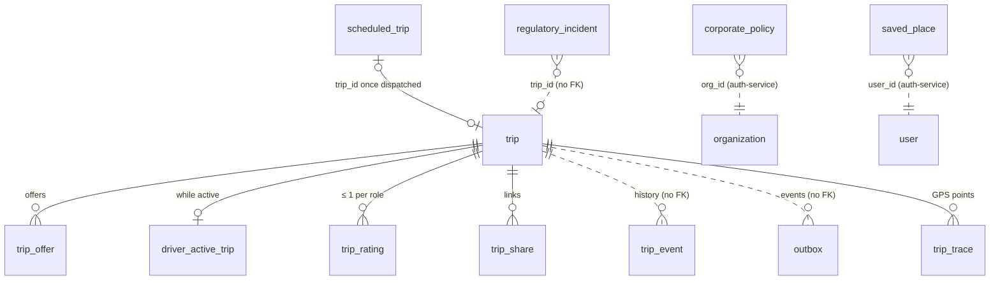

# Data model

The `trip_service` Postgres database (PostGIS enabled) and the Redis keys trip-service uses. Sources: `prisma/schema.prisma` (tables and columns are snake_case via `@map`) and `prisma/migrations/*/migration.sql`, which add what Prisma can't express (check constraints, partial unique indexes, generated geography columns, the partitioned `trip_event`). Design background: [Database.md](../../../docs/design/Database.md) §7.3, §8, §9.

Primary keys use `uuidv7()` as the database default (time-ordered UUIDs; PostgreSQL 18 provides the function).

## `trip`

One row per trip. Created with `fillfactor = 85` (room for HOT updates).

| Column | Type | Null | Default | Notes |
|---|---|---|---|---|
| `id` | uuid | no | `uuidv7()` | PK |
| `city_id` | text | no | | from the quote |
| `rider_user_id` | uuid | no | | |
| `booked_by_user_id` | uuid | no | | the caller who requested |
| `channel` | text | no | | check: `APP`, `PHONE`, `CORPORATE_PORTAL` |
| `billing_type` | text | no | | check: `PERSONAL`, `CORPORATE` |
| `billing_org_id` | uuid | yes | | check: set ⇔ `billing_type = CORPORATE` |
| `payment_method` | text | no | | check: `CASH`, `MOBILE_MONEY`, `CARD`, `CORPORATE`; `CORPORATE` ⇔ `billing_type = CORPORATE` |
| `status` | text | no | `requested` | check: the six statuses |
| `vehicle_type` | text | no | | |
| `quote_id` | text | yes | | |
| `pickup_lat`, `pickup_lng`, `dropoff_lat`, `dropoff_lng` | double precision | no | | check: \|lat\| ≤ 90, \|lng\| ≤ 180 |
| `pickup`, `dropoff` | `geography(Point,4326)` | — | generated, stored | `ST_SetSRID(ST_MakePoint(lng, lat), 4326)::geography`. `Unsupported` in Prisma (never written by the app) |
| `pickup_address`, `dropoff_address` | text | yes | | from the quote |
| `driver_user_id` | uuid | yes | | check: required unless status is `requested` or `cancelled` |
| `vehicle_id` | text | yes | | snapshot at match |
| `vehicle_owner_type` | text | yes | | check: null, `INDIVIDUAL`, `ORGANIZATION` |
| `beneficiary_id` | uuid | yes | | fleet org for `ORGANIZATION`, else the driver |
| `matched_at` | timestamptz | yes | | |
| `fare_estimate_minor` | bigint | no | | the quoted fare |
| `waiting_per_min_minor` | bigint | no | 0 | from the quote |
| `fare_final_minor` | bigint | yes | | set at completion |
| `waiting_fee_minor` | bigint | yes | | set at completion |
| `promo_discount_minor` | bigint | no | 0 | promo discount from the booked quote (`discountMinor` as pricing-service served it at booking, clamped to 0 … fare). CHECK `ck_trip_promo_discount`: 0 ≤ discount ≤ `fare_estimate_minor`. The rider pays fare − discount; the driver earns on the full fare |
| `promo_code` | text | yes | | the promo code applied (from the quote), null without a discount |
| `currency` | char(3) | no | `ETB` | |
| `est_distance_m`, `est_duration_s` | int | no | | from the quote |
| `distance_m`, `duration_s` | int | yes | | set at completion (`distance_m` = `est_distance_m` for now) |
| `route_polyline` | text | yes | | encoded polyline precision 6, from the quote |
| `pin` | char(4) | no | | random 0000–9999; check `^[0-9]{4}$` |
| `arrived_at`, `started_at`, `completed_at` | timestamptz | yes | | |
| `cancelled_at` | timestamptz | yes | | check: set ⇔ status `cancelled` |
| `cancelled_by` | text | yes | | check: null, `RIDER`, `DRIVER`, `SYSTEM`, `STAFF` |
| `cancelled_by_user_id` | uuid | yes | | null for `SYSTEM` |
| `cancel_reason` | text | yes | | |
| `cancel_fee_minor` | bigint | yes | | |
| `driver_compensation_minor` | bigint | yes | | |
| `flags` | text[] | yes | `{}` | review flags, e.g. `FAR_FROM_DROPOFF` |
| `version` | int | no | 0 | incremented by every transition (optimistic concurrency) |
| `created_at` | timestamptz | no | now | |
| `updated_at` | timestamptz | no | now | Prisma `@updatedAt` |

Check `ck_trip_money`: `fare_estimate_minor ≥ 0`, `fare_final_minor ≥ 0`, `cancel_fee_minor ≥ 0`, `driver_compensation_minor ≤ cancel_fee_minor` (nulls as 0).

Indexes:

| Index | Columns | Purpose |
|---|---|---|
| `trip_pkey` | `id` | |
| `ix_trip_rider_recent` | `(rider_user_id, created_at DESC)` | my trips as rider |
| `ix_trip_booked_by_recent` | `(booked_by_user_id, created_at DESC)` | trips I booked |
| `ux_trip_rider_active` | unique `(rider_user_id)` WHERE status is active | **one active trip per rider** |
| `ix_trip_driver_recent` | `(driver_user_id, created_at DESC)` WHERE driver set | my trips as driver |
| `ix_trip_city_active` | `(city_id, status, created_at)` WHERE status is active | dispatcher board |
| `ix_trip_billing_org` | `(billing_org_id, created_at)` WHERE org set | company trips (`GET /api/trips/org/:orgId?role=billing`) |
| `ix_trip_pickup_gix` | GiST `(pickup)` | zone and heatmap queries (no query in this service uses it yet) |
| `ix_trip_city_recent` | `(city_id, created_at DESC)` | staff search by city, daily report (migration 5) |
| `ix_trip_fleet_recent` | `(beneficiary_id, created_at DESC)` WHERE `vehicle_owner_type = 'ORGANIZATION'` | a fleet's trips (`GET /api/trips/org/:orgId?role=fleet`, migration 5) |
| `ix_trip_vehicle_recent` | `(vehicle_id, created_at DESC)` WHERE `vehicle_id IS NOT NULL` | search by vehicle (migration 5) |

## `driver_active_trip`

One active trip per driver, enforced by the primary key (Database.md §9, race 1). Inserted in the `requested → matched` transaction; deleted when the trip completes or is cancelled.

| Column | Type | Notes |
|---|---|---|
| `driver_user_id` | uuid | PK |
| `trip_id` | uuid | unique, FK → `trip.id` (`ON DELETE RESTRICT`) |
| `since` | timestamptz | default now |

## `trip_offer`

Every offer made during matching.

| Column | Type | Notes |
|---|---|---|
| `id` | uuid | PK, `uuidv7()` |
| `trip_id` | uuid | FK → `trip.id` (`RESTRICT`) |
| `driver_user_id` | uuid | |
| `status` | text | default `OFFERED`; check: `OFFERED`, `ACCEPTED`, `DECLINED`, `EXPIRED` |
| `eta_seconds` | int | driving time to the pickup at offer time |
| `distance_meters` | int | straight-line distance from location-service |
| `offered_at` | timestamptz | |
| `expires_at` | timestamptz | `offered_at + match.offerSeconds` |
| `answered_at` | timestamptz | when it left `OFFERED` |

Indexes: `(trip_id, offered_at)`, `ix_trip_offer_driver_recent (driver_user_id, offered_at DESC)`, and **`ux_trip_offer_open`**: unique `(trip_id)` WHERE `status = 'OFFERED'` (at most one open offer per trip).

## `trip_event`

Append-only state history. **Partitioned by range on `at`, one partition per month**; no foreign key to `trip`.

| Column | Type | Notes |
|---|---|---|
| `id` | uuid | `uuidv7()` |
| `trip_id` | uuid | |
| `at` | timestamptz | default now (the app passes its clock) |
| `from_status` | text | null for the first row |
| `to_status` | text | |
| `actor_id` | uuid | the caller; null for system actions |
| `data` | jsonb | e.g. `{quoteId, approximate}`, `{assignedBy}`, `{arrived, metersFromPickup}`, `{metersFromDropoff}` |

PK `(at, id)` (the partition key must be part of it). Index `ix_trip_event_trip (trip_id, at)`.

Partitions: `trip_event_default` (catches anything without a monthly partition) and `trip_event_YYYY_MM`, created by the SQL function `ensure_trip_event_partitions(months_ahead int DEFAULT 2)`, which creates the current month and the next `months_ahead` months if missing. The migration calls it once; `src/server.ts` calls it at start and daily. Arrival writes a row with `from_status = to_status = en_route`.

## `trip_rating`

| Column | Type | Notes |
|---|---|---|
| `trip_id` | uuid | FK → `trip.id` (`RESTRICT`) |
| `by_role` | text | check: `RIDER`, `DRIVER` |
| `by_user_id` | uuid | |
| `ratee_user_id` | uuid | nullable; the person rated (added in migration 3) |
| `stars` | int | check 1–5 |
| `tags` | text[] | not null, default `{}` (added in migration 3) |
| `comment` | text | |
| `created_at` | timestamptz | |

PK `(trip_id, by_role)`: one rating per side per trip. Index `trip_rating_ratee_user_id_idx (ratee_user_id)` for averages.

## `saved_place`

| Column | Type | Notes |
|---|---|---|
| `id` | uuid | PK, `uuidv7()` |
| `user_id` | uuid | |
| `label` | text | check: `HOME`, `WORK`, `OTHER` |
| `name` | text | |
| `address` | text | nullable |
| `lat`, `lng` | double precision | |
| `created_at` | timestamptz | |
| `updated_at` | timestamptz | not null, set by Prisma (`@updatedAt`) |

Indexes: `saved_place_user_id_created_at_idx (user_id, created_at)`, `saved_place_user_home_work_uniq`: unique `(user_id, label)` WHERE label in (`HOME`, `WORK`).

## `trip_share`

| Column | Type | Notes |
|---|---|---|
| `token` | text | PK: 16 random bytes, base64url |
| `trip_id` | uuid | FK → `trip.id`, **`ON DELETE CASCADE`** |
| `created_by_user_id` | uuid | rider or booker |
| `created_at` | timestamptz | |
| `expires_at` | timestamptz | |
| `revoked_at` | timestamptz | nullable |

Index `trip_share_trip_id_idx (trip_id)`.

## `idempotency_key`

| Column | Type | Notes |
|---|---|---|
| `user_id` | uuid | PK part |
| `key` | text | PK part |
| `request_hash` | bytea | SHA-256 of `{url, body}` |
| `status` | text | default `IN_PROGRESS`; check: `IN_PROGRESS`, `DONE` |
| `status_code` | int | |
| `response` | jsonb | |
| `created_at` | timestamptz | rows older than 24 h are purged daily |

## `outbox`

| Column | Type | Notes |
|---|---|---|
| `id` | uuid | PK, `uuidv7()` |
| `topic` | text | |
| `key` | text | the trip id |
| `payload` | jsonb | envelope + fields ([events.md](events.md)) |
| `created_at` | timestamptz | |
| `published_at` | timestamptz | null until the relay publishes it |

Index `ix_outbox_unpublished (created_at)` WHERE `published_at IS NULL`. Unlike auth-service's outbox there is no `attempts` column.

## Migrations

Applied in order by `prisma migrate deploy` (`make db-migrate`). The `migration_lock.toml` provider is PostgreSQL.

| # | Folder | What it does |
|---|---|---|
| 1 | `20261026120000_init` | `CREATE EXTENSION postgis`; tables `trip` (with generated `pickup`/`dropoff` geography, fillfactor 85), `driver_active_trip`, `trip_offer`, `trip_event` (partitioned by `at`), `trip_rating`, `idempotency_key`, `outbox`; foreign keys; all `trip` check constraints; `ux_trip_rider_active`, `ix_trip_driver_recent`, `ix_trip_city_active`, `ix_trip_billing_org`, `ix_trip_pickup_gix`; `ck_trip_offer_status` and `ux_trip_offer_open`; rating stars/role checks; idempotency status check; `ix_outbox_unpublished`; `trip_event_default`, the function `ensure_trip_event_partitions()` and a first call to it |
| 2 | `20261027090000_saved_places` | `saved_place` with its label check, the `(user_id, created_at)` index and the partial unique index for HOME/WORK |
| 3 | `20261027093000_rating_ratee_tags` | adds `trip_rating.ratee_user_id` and `tags`, backfills `ratee_user_id` from the trip (rider's rating → driver, driver's → rider), indexes `ratee_user_id` |
| 4 | `20261030090000_trip_share` | `trip_share` with its index and the cascading FK to `trip` |
| 5 | `20261031090000_trip_search_indexes` | `ix_trip_city_recent` (also an `@@index` in `schema.prisma`), the partial `ix_trip_fleet_recent` and `ix_trip_vehicle_recent` (SQL only) |
| 6 | `20261101090000_scheduled_policies_trace` | `trip.purpose`; `scheduled_trip` (status and `match_at ≤ scheduled_for` checks, unique `trip_id` with `ON DELETE SET NULL`, the partial due-queue index and per rider / booker / org / city indexes); `corporate_policy` (minute, day and money checks); `ix_trip_billing_org_recent`; `trip_trace` (FK cascade); `regulatory_incident` with its `(city_id, opened_at)` index |

Writing a new migration: the Makefile notes that `prisma migrate dev` sees the generated PostGIS columns as drift; use `pnpm exec prisma migrate dev --create-only` and edit the SQL.

## Redis keys

trip-service uses one Redis (`REDIS_URL`), which must be the same Redis as location-service and realtime-gateway.

| Key | Type | TTL | Written by | Purpose |
|---|---|---|---|---|
| `match:due` | ZSET (tripId → next step, ms) | none | matcher, `request()` | trips being matched and when to look at them next |
| `match:{tripId}` | HASH `startedAt`, `radius` | 15 min | matcher | matching start time and current radius index |
| `match:{tripId}:declined` | SET of driver ids | none (deleted when matching stops) | matcher, `decline()` | drivers not to offer again |
| `match:lease:{tripId}` | STRING (process id) | 5 s (`PX 5000`) | matcher tick | one worker per trip step |
| `offer:driver:{driverId}` | STRING (tripId) | `match.offerSeconds` | matcher (`SET NX EX`) | soft reservation, read by location-service; deleted on decline, accept, cancel, and by location-service on `trip.matched` |
| `rating:user:{userId}` | STRING (JSON `{average, count}`) | 300 s | `ratingOfUser()` | cached average received |
| `trip:parties:{tripId}:{driverId\|-}:{vehicleId\|-}` | STRING (JSON) | 60 s | parties | names, photos, car |
| `devquote:{quoteId}` | STRING (JSON `Quote`) | `quote.ttlSeconds` | builtin quotes only | development quotes |
| `driver:{driverId}`, `geo:{city}:{type}:busy\|available`, `trip:{tripId}:members`, `trip:{tripId}:last` | (location-service's) | | `reassign()` only | the old driver of a reassigned trip is put back to available, removed from the trip's watchers, and the trip's last position cleared (`releaseDriver` in `src/trips/service.ts`) |
| `deny:{userId}` | STRING | (auth-service) | auth-service | read: suspended user → `401 token_revoked` |
| `pv:{userId}` | STRING (int) | (auth-service) | auth-service | read: permission version → `401 token_outdated` |

Pub/sub channels are listed in [events.md](events.md#redis-pubsub-and-signalling-keys). Driver state (`driver:{id}`, geo sets) is location-service's; trip-service reads it over HTTP and writes it only when a dispatcher reassigns a trip (location-service has no event for that yet).

## `trip.purpose` (added in migration 6)

`purpose text` nullable: the trip purpose / cost centre for company rides (≤ 200 chars at the API). Copied from the scheduled booking at dispatch. Shown in the trip object except to the driver.

## `scheduled_trip`

A ride booked ahead (workflow 12). Not a trip: the scheduler creates the `trip` at `match_at`.

| Column | Type | Notes |
|---|---|---|
| `id` | uuid | PK, `uuidv7()` |
| `city_id`, `rider_user_id`, `booked_by_user_id`, `channel`, `billing_type`, `billing_org_id`, `payment_method`, `vehicle_type`, `purpose` | | as on `trip`; copied onto it at dispatch |
| `quote_id` | text | the quote booked with (one booking or trip per quote) |
| `pickup_lat/lng`, `dropoff_lat/lng`, `pickup_address`, `dropoff_address` | | from the quote |
| `fare_estimate_minor`, `waiting_per_min_minor`, `currency`, `est_distance_m`, `est_duration_s`, `route_polyline` | | the booked quote; the fare is the ceiling at dispatch |
| `scheduled_for` | timestamptz | pickup time |
| `match_at` | timestamptz | `scheduled_for − lead`; check `match_at <= scheduled_for` |
| `status` | text | default `SCHEDULED`; check: `SCHEDULED`, `DISPATCHING`, `DISPATCHED`, `CANCELLED`, `FAILED` |
| `trip_id` | uuid | unique, FK → `trip.id` `ON DELETE SET NULL`; set at dispatch |
| `claimed_at` | timestamptz | when a scheduler instance claimed it (stale after 2 min) |
| `dispatched_at`, `cancelled_at`, `cancelled_by_user_id`, `fail_reason`, `escalated_at` | | |
| `version` | int | optimistic concurrency (claim, edit, dispatch) |
| `created_at`, `updated_at` | timestamptz | |

Indexes: `ix_scheduled_trip_due (match_at) WHERE status IN ('SCHEDULED','DISPATCHING')` (the scheduler's queue), `ix_scheduled_trip_rider (rider_user_id, scheduled_for)`, `ix_scheduled_trip_booker (booked_by_user_id, scheduled_for)`, `ix_scheduled_trip_org (billing_org_id, scheduled_for) WHERE billing_org_id IS NOT NULL`, `ix_scheduled_trip_city (city_id, scheduled_for)`.

## `corporate_policy`

| Column | Type | Notes |
|---|---|---|
| `org_id` | uuid | PK: the company (auth-service organisation) |
| `allowed_vehicle_types` | text[] | empty = any |
| `allowed_days` | int[] | 0 = Sunday … 6 = Saturday, Addis time; empty = any; check `<@ {0..6}` |
| `start_minute`, `end_minute` | int | minutes after Addis midnight; both null or both set (start 0–1439, end 1–1440, different); start > end wraps past midnight |
| `max_fare_minor`, `monthly_budget_minor` | bigint | null = no limit; check > 0 |
| `require_purpose` | boolean | default false |
| `updated_by_user_id` | uuid | |
| `version` | int | incremented on every save |
| `created_at`, `updated_at` | timestamptz | |

Index added on `trip` for the budget: `ix_trip_billing_org_recent (billing_org_id, created_at DESC) WHERE billing_org_id IS NOT NULL`.

## `trip_trace`

Thinned GPS points of a trip from `driver.location` ([architecture.md](architecture.md#gps-trace)).

| Column | Type | Notes |
|---|---|---|
| `trip_id` | uuid | PK part, FK → `trip.id` `ON DELETE CASCADE` |
| `at` | timestamptz | PK part: device time of the ping |
| `lat`, `lng` | double | |
| `speed`, `accuracy` | real | nullable, as the app reported them |
| `status` | text | the trip status when recorded (cached up to 10 s, informational) |

No retention job yet (Role.md Q5: retention with legal counsel; workflow 14: incident traces kept beyond 90 days).

## `regulatory_incident`

A copy of support-service `incident.opened` (counts only, no PII), for the regulatory report.

| Column | Type | Notes |
|---|---|---|
| `incident_id` | uuid | PK (a replayed event is ignored) |
| `city_id`, `category`, `severity` | text | |
| `trip_id` | uuid | nullable, no FK |
| `opened_at` | timestamptz | the event's `at` |

Index `ix_regulatory_incident_city_opened (city_id, opened_at)`.

