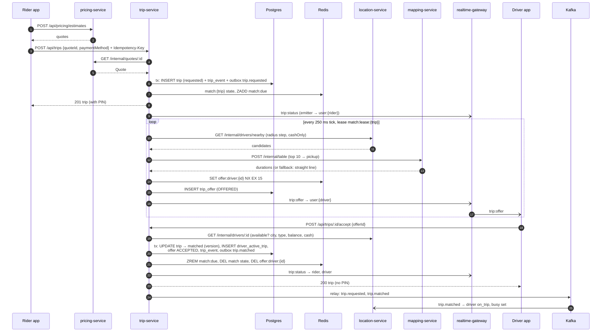
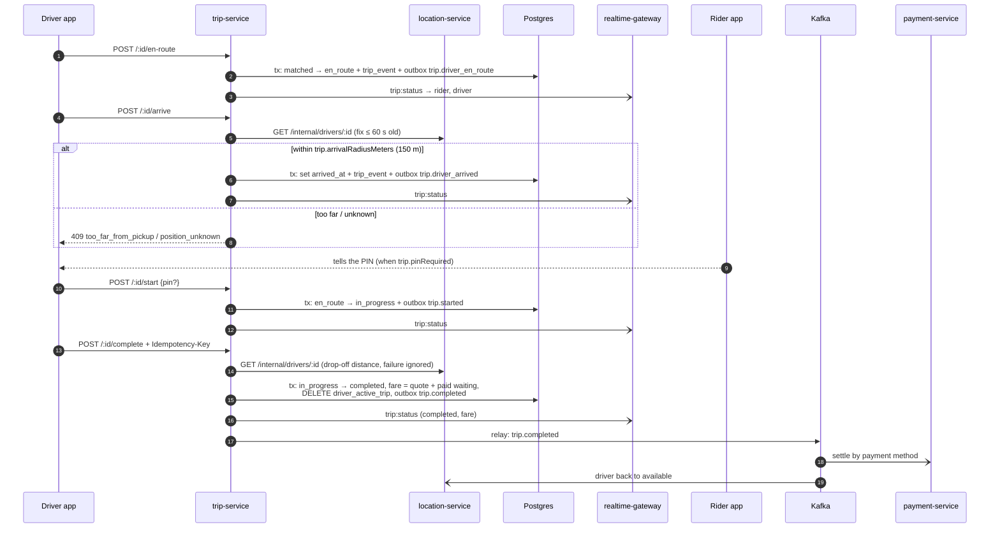
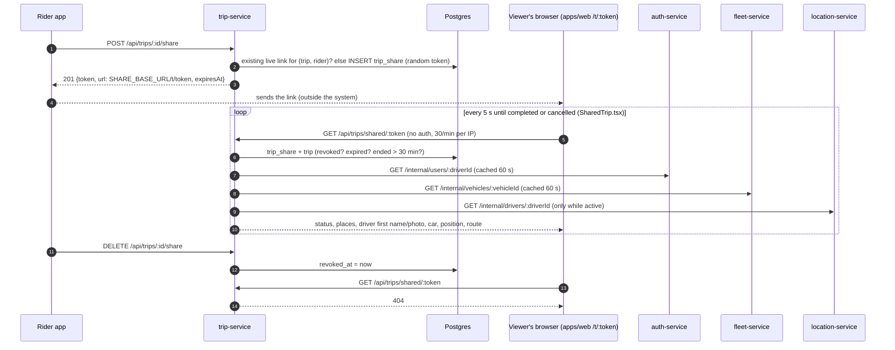

# Integrations

How trip-service talks to every other system. All service-to-service HTTP calls send `Authorization: Bearer {INTERNAL_SERVICE_TOKEN}` (the same value in every service).

## Contents

- [Summary](#summary)
- [location-service](#location-service)
- [mapping-service](#mapping-service)
- [pricing-service](#pricing-service)
- [auth-service](#auth-service)
- [fleet-service](#fleet-service)
- [platform-service](#platform-service)
- [realtime-gateway](#realtime-gateway)
- [payment-service and location-service via Kafka](#payment-service-and-location-service-via-kafka)
- [Web share page](#web-share-page)
- [Kong](#kong)
- [Sequence: request → matching → accept](#sequence-request--matching--accept)
- [Sequence: trip execution to completion](#sequence-trip-execution-to-completion)
- [Sequence: share link](#sequence-share-link)

## Summary

| System | Direction | Path / mechanism | Timeout | On failure | Code |
|---|---|---|---|---|---|
| location-service | out | `GET /internal/drivers/nearby`, `GET /internal/drivers/:id` | 2.5 s | matching retries in 2 s; accept/assign/arrive/no-show → `503 dependency_unavailable`; complete and share view continue without a position | `src/lib/clients.ts` |
| mapping-service | out | `POST /internal/table`; `POST /internal/route` (builtin quotes) | 2.5 s | ranking falls back to straight-line; builtin estimate → `500` | `src/lib/clients.ts` |
| pricing-service | out | `GET /internal/quotes/:id` | 2.5 s | `POST /api/trips` → `503 dependency_unavailable` | `src/quotes.ts` |
| auth-service | out | JWKS (`AUTH_JWKS_URL`), `GET /internal/users/:id`, `GET /internal/authz/snapshot` | JWKS: jose default; users 2.5 s; snapshot 3 s | tokens can't be verified → `401`; names → `null`; matrix → keeps current | `src/container.ts`, `src/lib/clients.ts`, `src/server.ts` |
| fleet-service | out | `GET /internal/vehicles/:id` | 2.5 s | vehicle → `null` | `src/lib/clients.ts` |
| platform-service | out | `GET /internal/settings/snapshot` + Redis `settings:changed` | 3 s | keeps current values (env defaults if never loaded) | `src/container.ts` |
| platform-service | in | `GET /internal/ops/outbox` | — | — | `src/http/routes.ts` |
| realtime-gateway | out | Socket.io Redis emitter, room `user:{id}` | — | lost silently if nobody is connected | `src/lib/realtime.ts` |
| Kafka | out | outbox relay, `trip.*` | — | rows stay in the outbox, retried every 500 ms | `src/outbox/relay.ts` |
| Web app | in | `GET /api/trips/shared/:token` and the staff/partner/admin pages | — | — | `apps/web/src/` |
| Kong | in | `/api/trips` → `trip-service:3002` | — | — | `infra/kong/kong.yml` |

HTTP clients (`call()` in `src/lib/clients.ts`): JSON, `AbortSignal.timeout(2500)`, an upstream `404` becomes `NotFoundUpstream` (mapped to `null` where a missing record is normal), any other non-2xx throws. There are no retries or circuit breakers in the clients; callers decide what a failure means.

## location-service

`LOCATION_INTERNAL_URL` (default `http://localhost:3003`).

| Call | Query / path | Response used | Used by |
|---|---|---|---|
| `GET /internal/drivers/nearby` | `cityId, vehicleType, lat, lng, radiusMeters, limit=20, cashOnly` | `{ drivers: [{ driverId, lat, lng, distanceMeters, cashAllowed, vehicleId, at }] }`, nearest first | matcher |
| `GET /internal/drivers/:driverId` | | `DriverLive`: `status` (`available`/`on_trip`/`offline`), `cityId`, `vehicleType`, `vehicleId`, `fleetOrgId?`, `tripId?`, `cashAllowed`, `balanceState?`, `lat?`, `lng?`, `heading?`, `at?`, `stale`. `404` → `null` | `matchDriver()` (availability + snapshot), `arrive()` and no-show (position), `complete()` (drop-off flag), share view (live position) |

- location-service's nearby search already excludes stale, offline, on-trip, currently-offered (`offer:driver:{id}` exists), cash-ineligible (when `cashOnly`) and blocked drivers (`nearbyAvailable()` in `libs/shared-location/src/drivers.ts`).
- A position counts only if `at` is within 60 s (`livePosition()` in `src/trips/service.ts`); the share view also requires `tripId` to equal the trip and `stale` false.
- The two services also share Redis keys: trip-service writes `offer:driver:{id}`; location-service deletes it on `trip.matched`.

## mapping-service

`MAPPING_INTERNAL_URL` (default `http://localhost:3007`).

| Call | Body | Response | Used by |
|---|---|---|---|
| `POST /internal/table` | `{ sources: LatLng[], destinations: [pickup] }` | `{ durations: (number\|null)[][], approximate }` | matcher ranking (top 10 candidates) |
| `POST /internal/route` | `{ points: [pickup, dropoff], geometry: true }` | `{ distanceMeters, durationSeconds, approximate, geometry? }` | builtin quotes only |

Failure of `table` is logged (`mapping-service unavailable, ranking by distance`) and the matcher estimates ETA as haversine × 1.35 at 22 km/h.

## pricing-service

`PRICING_INTERNAL_URL` (default `http://localhost:3004`), only when `PRICING=service`.

- `GET /internal/quotes/{quoteId}` (URL-encoded). `200` → `Quote` (interface in `src/quotes.ts`, implemented by `services/pricing-service/src/quotes.ts`), `404` → unknown quote (`400 invalid_quote` to the rider), other status / timeout → `503 dependency_unavailable`.
- Riders get quotes from pricing-service directly (`POST /api/pricing/estimates`); trip-service only reads one when the trip is requested and copies it onto the trip.

## auth-service

| Use | URL | Notes |
|---|---|---|
| Token verification | `AUTH_JWKS_URL` (default `http://localhost:3001/api/auth/jwks`), issuer `AUTH_ISSUER` | `createRemoteJWKSet` from jose (fetched and cached by jose). Plus Redis `deny:{userId}` and `pv:{userId}` |
| Permission matrix | `GET {AUTH_INTERNAL_URL}/internal/authz/snapshot` | at start, on Redis `authz:changed`, every 30 s (`createAuthzSync`) |
| Names and photos | `GET {AUTH_INTERNAL_URL}/internal/users/:id` → `{ name, image? }` | parties view and share view |

## fleet-service

`FLEET_INTERNAL_URL` (default `http://localhost:3008`). `GET /internal/vehicles/:id` → `{ id, plateNumber, vehicleType, make, model, color }`; parties and share views. Errors and `404` become `null`.

## platform-service

- **Settings:** `createSettingsClient()` from `@ride-app/shared-settings` loads `GET {PLATFORM_INTERNAL_URL}/internal/settings/snapshot` at start (`await settingsClient.start()`), reloads on the Redis channel `settings:changed`, and polls every 30 s. `get()` resolves city override → global value → trip-service's env default → registry default. If platform-service is down at start the service runs on defaults. Keys read: [configuration.md](configuration.md#live-settings-platform-service).
- **System page:** platform-service calls trip-service's `GET /internal/ops/outbox` to show the unpublished-event backlog (`services/platform-service/src/system/health.ts`; trip-service's URL comes from platform-service's config).

## realtime-gateway

No HTTP. `src/lib/realtime.ts` uses `@socket.io/redis-emitter` on the same `REDIS_URL`; the emitter publishes on `socket.io#/#user:{userId}#`, which the gateway's Socket.io Redis adapter delivers to every socket in room `user:{userId}`. Events and payloads: [api.md](api.md#socket-events). If `REDIS_URL` points at a different Redis than the gateway's, pushes are silently lost.

## payment-service and location-service via Kafka

trip-service does not call payment-service. payment-service consumes `trip.completed` (settle the fare) and `trip.cancelled` (settle a fee > 0), deduping on `eventId`. location-service consumes `trip.matched`, `trip.completed` and `trip.cancelled` to move the driver between `available` and `on_trip`. Payment state affects matching only through location-service's driver state (`balanceState`, `cashAllowed`). Details: [events.md](events.md#consumers-in-other-services).

## Web share page

- Route `/t/:token` in `apps/web/src/App.tsx` → `apps/web/src/pages/public/SharedTrip.tsx`, which fetches `GET /api/trips/shared/{token}` (no token).
- trip-service builds the link as `{SHARE_BASE_URL}/t/{token}` (`src/trips/share.ts`). In production `SHARE_BASE_URL` may not be `http://localhost…` or `http://127.…`.
- Other web callers: the dispatcher board (`GET /api/trips/board`, `POST /:id/assign`, `POST /:id/cancel` with `STAFF_DECISION`), phone booking and the partner portal (`POST /api/trips` with `Idempotency-Key`), trip detail (`GET /api/trips/:id`, polled every 8 s), admin overview (`GET /api/trips/stats`). In development Vite proxies `/api/trips` to `TRIP_URL`, else `GATEWAY_URL`, else port 3002 (`apps/web/vite.config.ts`). The share page polls every 5 s until the trip is completed or cancelled.
- The phone app uses base `/api/trips` (`packages/core/lib/src/api/service_apis.dart`) and port 3002 when not going through Kong (`api_client.dart`).

## Kong

`infra/kong/kong.yml`:

```yaml
- name: trip-service
  url: http://trip-service:3002
  routes:
    - name: trip-routes
      paths: ["/api/trips"]
      strip_path: false
  plugins:
    - name: rate-limiting
      config: { minute: 60, policy: local }
```

- `strip_path: false`: the service sees the full `/api/trips/...` path.
- Kong does **not** verify JWTs (comment at the top of the file); trip-service verifies every token itself.
- `/internal/*` is never routed by Kong.
- There is no request-size-limiting plugin on this service in Kong; the service's own 32 KB body limit applies.
- `GET /api/trips/shared/:token` goes through the same route and Kong's 60/min limit, on top of the service's 30/min.

## Sequence: request → matching → accept



If nobody accepts within `match.timeoutSeconds`, a step calls `systemCancel(NO_DRIVER_FOUND)`: free cancellation, `trip.cancelled`, `trip:status` to the rider.

## Sequence: trip execution to completion



## Sequence: share link


